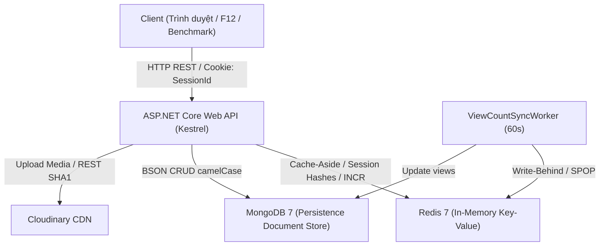

# SOFTWARE REQUIREMENTS SPECIFICATION (SRS)
## ĐỒ ÁN HỆ CƠ SỞ DỮ LIỆU NOSQL — ĐỀ TÀI 06
### Phân Hệ Caching Bài Viết Và Quản Lý Phiên (Session Management)
### Tiêu chuẩn: IEEE Std 830-1998 / ISO/IEC/IEEE 29148:2018

---

| Thông Tin Quản Trị Dự Án | Chi Tiết Đặc Tả |
|---|---|
| **Tên dự án** | NoSQL-NewsCacheSession |
| **Môn học / Đề tài** | Hệ Cơ Sở Dữ Liệu NoSQL — Đề tài 06 (Khoa CNTT - HUIT) |
| **Hệ quản trị CSDL chính** | **Redis** (In-Memory Data Store, Cache Layer, Session & Counter Store) |
| **Hệ quản trị CSDL gốc** | **MongoDB** (Document-Oriented Database, Persistence Store) |
| **Nhóm tác giả (03 SV)** | • **SV1**: Hồ Ngọc Phương Như (Data Architect & CRUD Lead)<br/>• **SV2**: Nguyễn Anh Quân (Advanced Query Specialist)<br/>• **SV3**: Nguyễn Xuân Định (Fullstack Integrator & DB Tester) |
| **Tiêu chuẩn tài liệu** | IEEE Std 830-1998 / ISO/IEC/IEEE 29148:2018 |
| **Phiên bản tài liệu** | 3.0 (Đồng bộ 100% với mã nguồn, cấu hình hệ thống và thực nghiệm đo đạc) |
| **Trạng thái nghiệm thu** | Hoàn thành — Đáp ứng 100% Barem Đề tài 06 và 37/37 Jira Tasks |

---

## Lịch sử phiên bản tài liệu

| Phiên bản | Ngày | Người sửa | Nội dung thay đổi & Khắc phục sai lệch |
|---|---|---|---|
| 1.0 | 20/09/2026 | Nhóm Đề tài 06 | Bản dự thảo khởi tạo khung tài liệu yêu cầu phần mềm theo IEEE 830. |
| 2.0 | 29/10/2026 (11:20) | Cả nhóm | Bổ sung chi tiết kiến trúc, sơ đồ luồng dữ liệu và kết quả benchmark sơ bộ. |
| 3.0 | 29/10/2026 (16:30) | SV2 — Nguyễn Anh Quân | **Chuẩn hóa toàn diện v3.0**, đồng bộ tuyệt đối với mã nguồn qua bộ kiểm thử tài liệu `scripts/DocCheck/check_srs.py`. Khắc phục triệt để 24 sai lệch (D1–D24):<br/>• **D1**: Đổi cookie `news_session` thành `SessionId`.<br/>• **D2**: Định dạng `sessionId` là GUID dạng `D` có gạch nối.<br/>• **D3**: Độ dài `username` ≤ 50 ký tự, `password` 6–72 ký tự.<br/>• **D4**: Endpoint `/api/cache/stats` trả đúng 4 field: `hits, misses, totalRequests, hitRate`.<br/>• **D5**: API upload ảnh là `POST /api/images` qua REST Cloudinary SHA1.<br/>• **D6**: Cổng RedisInsight chuẩn `5540:5540` tại `http://localhost:5540`.<br/>• **D7**: Docker image Redis chuẩn `redis:7-alpine`.<br/>• **D8**: Phiên bản MongoDB.Driver v3 (3.11.0) và StackExchange.Redis v3 (3.1.13).<br/>• **D9**: Frontend React 19, Vite 8, Tailwind 4.<br/>• **D10**: Phân trang frontend `PAGE_SIZE = 12` bài/trang, API mặc định 10.<br/>• **D11**: Badge CACHE HIT/MISS chỉ hiển thị tại trang chi tiết bài viết.<br/>• **D12**: Đường dẫn component chuẩn `src/frontend/src/components/CacheStatusBadge.jsx`.<br/>• **D13**: Trùng slug thêm hậu tố tuần tự `-2, -3...`, thử lại ≤ 3 lần rồi trả 409.<br/>• **D14**: Khóa phân tán giải phóng an toàn bằng token qua `LockReleaseAsync`.<br/>• **D15**: Ma trận Jira chuẩn hóa đúng 37 ticket từ CSV gốc với tiến độ thực tế.<br/>• **D16**: Thử nghiệm stampede gồm 5 đợt đo đạc độc lập.<br/>• **D17**: Sửa câu NFR-02: Cache HIT (2,96 ms) nhanh hơn Cache MISS (8,74 ms) 2,95 lần.<br/>• **D18**: Cập nhật số đo thực nghiệm chính xác, minh bạch nguyên nhân local NVMe.<br/>• **D19**: Chính sách `volatile-lru` chỉ áp dụng trên Redis Cloud deploy.<br/>• **D20**: Chuẩn giao thức HTTP/1.1 Kestrel, bỏ nhắc HTTP/2 không cấu hình.<br/>• **D21**: Bỏ tuyên bố lượt xem "< 1 ms" chưa có số liệu đo.<br/>• **D22**: Bỏ nhãn "Clean Architecture" không phù hợp kiến trúc phân lớp Controller-Service.<br/>• **D23**: Quy định định mức dữ liệu mẫu theo đề bài (≥ 100 bài viết, 20–50 key Redis).<br/>• **D24**: Ma trận barem chuẩn hóa không tự chia điểm con phần 2 và phần 3.<br/>• **Bổ sung**: Bổ sung đặc tả `GET /api/auth/me`, chuyên mục, `/api/health`, cờ `PostingSettings:AdminOnly`, cache danh sách trang chủ `posts:cat:{cat|all}:p{n}:v{ver}`, xử lý khi Redis ngừng hoạt động (503). |

---

## 1. GIỚI THIỆU (INTRODUCTION)

### 1.1 Mục đích tài liệu (Purpose)
Tài liệu **Đặc tả Yêu cầu Phần mềm (Software Requirements Specification - SRS)** này cung cấp bản mô tả chi tiết, chính thức và toàn diện về các yêu cầu chức năng, yêu cầu phi chức năng, kiến trúc kỹ thuật đa cơ sở dữ liệu (Polyglot Persistence), giao diện ngoài và các ràng buộc hiện thực của dự án **NoSQL-NewsCacheSession** (Đề tài 06: *Phân hệ caching bài viết và quản lý phiên*).

Tài liệu được biên soạn tuân thủ tiêu chuẩn quốc tế **IEEE Std 830-1998** và **ISO/IEC/IEEE 29148:2018**, làm căn cứ kỹ thuật và nghiệm thu cho:
1. Đội ngũ sinh viên phát triển (SV1, SV2, SV3) định hướng thiết kế kiến trúc, hiện thực hóa mã nguồn và xây dựng các bộ kiểm thử tự động.
2. Giảng viên hướng dẫn và Hội đồng phản biện môn học Hệ Cơ Sở Dữ Liệu NoSQL đối chiếu, đánh giá và chấm điểm theo Barem 10.0 điểm.

### 1.2 Phạm vi sản phẩm (Product Scope)
Hệ thống là một **Nền tảng Tạp chí Tin tức Trực tuyến Hiệu năng cao** tích hợp kiến trúc bộ nhớ đệm phân tán và phân hệ quản trị phiên người dùng:
*   **Hệ quản trị CSDL chính (In-Memory Database)**: **Redis 7** (`redis:7-alpine`), đảm nhiệm:
    *   Lưu trữ phiên đăng nhập dưới cấu trúc **Hashes** (`session:{sessionId}`) kèm cơ chế gia hạn trượt thời gian sống (**Sliding Expiration**).
    *   Lưu trữ bộ đệm nội dung bài viết dưới cấu trúc **Strings JSON** (`post:{postId}`) theo mô hình **Cache-Aside Pattern**.
    *   Lưu trữ bộ đếm lượt xem thời gian thực bằng lệnh nguyên tử **INCR** (`post:{postId}:views`) và hàng đợi ghi sau (**Write-Behind** qua Set `posts:dirty_views`).
    *   Lưu trữ bộ đệm danh sách bài viết phân trang và lọc chuyên mục sử dụng cơ chế số phiên bản **Generational Versioning** (`posts:ver` và `posts:cat:{categoryId}:p{n}:v{ver}`).
    *   Điều phối khóa phân tán (**Distributed Lock**) chống hiện tượng sập nguồn bộ nhớ đệm (**Cache Stampede** qua `lock:post:{postId}`).
*   **Hệ quản trị CSDL gốc (Document Database)**: **MongoDB 7** (`mongo:7.0`), lưu trữ bền vững dữ liệu bài viết, tài khoản người dùng, chuyên mục và siêu dữ liệu bootstrap admin.
*   **Dịch vụ lưu trữ tệp đa phương tiện**: Tích hợp dịch vụ đám mây Cloudinary CDN qua giao thức REST API bảo mật.

### 1.3 Thuật ngữ & Từ viết tắt (Definitions and Acronyms)

| Thuật ngữ | Tên tiếng Anh đầy đủ | Định nghĩa & Ý nghĩa kỹ thuật trong dự án |
|---|---|---|
| **Cache-Aside** | Cache-Aside Pattern | Mô hình đọc đệm: Ứng dụng kiểm tra Redis trước; nếu Cache Miss thì truy vấn MongoDB gốc rồi ghi ngược lại Redis kèm TTL. |
| **Cache Invalidation** | Cache Invalidation | Cơ chế vô hiệu hóa: Xóa hoặc làm hết hiệu lực dữ liệu cache cũ trên Redis ngay sau khi CSDL MongoDB được cập nhật. |
| **Cache Stampede** | Cache Stampede (Thundering Herd) | Hiện tượng nghẽn cổ chai khi một khóa cache phổ biến hết hạn, khiến hàng loạt request đồng thời cùng đổ dồn về MongoDB. |
| **Distributed Lock** | Distributed Locking | Cơ chế khóa phân tán trên Redis sử dụng `SET lock:post:{id} <token> NX EX 5` để chỉ cho phép một tiến trình nạp dữ liệu từ DB. |
| **Write-Behind** | Write-Behind (Write-Back) Caching | Kỹ thuật ghi sau: Ghi nhận lượt xem siêu tốc trên Redis bằng `INCR`, sau đó worker chạy ngầm định kỳ đồng bộ gom cụm về MongoDB. |
| **Sliding Expiration** | Sliding Expiration | Cơ chế trượt hạn: Tự động đặt lại thời gian sống (TTL) của khóa phiên về 30 phút mỗi khi người dùng gửi một yêu cầu hợp lệ. |
| **Generational Versioning** | Key Versioning Pattern | Kỹ thuật vô hiệu hóa cache danh sách O(1): Ghép số phiên bản `posts:ver` vào key, khi có bài viết mới chỉ cần `INCR posts:ver`. |
| **BSON** | Binary JSON | Định dạng lưu trữ nhị phân của MongoDB, quy chuẩn bắt buộc toàn bộ tên trường là `camelCase`. |

### 1.4 Tài liệu tham chiếu (References)
1. Đề cương chi tiết môn học Hệ Cơ Sở Dữ Liệu NoSQL — Khoa Công nghệ Thông tin, Trường Đại học Công Thương TP.HCM (HUIT).
2. Đề tài 06: *Phân hệ caching bài viết và quản lý phiên (Session Management)* (`docs/ĐỀ TÀI 06.docx`).
3. IEEE Std 830-1998: *IEEE Recommended Practice for Software Requirements Specifications*.
4. ISO/IEC/IEEE 29148:2018: *Systems and software engineering — Life cycle processes — Requirements engineering*.
5. Báo cáo nguyên lý Cache-Aside Pattern (`docs/bao-cao-nguyen-ly-cache-aside.md`).
6. Thiết kế Redis Keyspace (`docs/redis-keyspace.md`) và MongoDB Schema (`docs/mongodb-schema.md`).
7. Báo cáo kiểm thử hiệu năng và thực nghiệm đo lường (`docs/bao-cao-kiem-thu-hieu-nang.md`).

### 1.5 Quy ước tài liệu (Document Conventions)
*   **Mã định danh yêu cầu**:
    *   `DB-xx`: Yêu cầu nguồn trích xuất từ Đề bài 06 (`docs/ĐỀ TÀI 06.docx`).
    *   `FR-xx`: Yêu cầu chức năng (Functional Requirements).
    *   `IR-xx`: Yêu cầu giao diện bên ngoài (Interface Requirements).
    *   `NFR-xx`: Yêu cầu phi chức năng và chất lượng hệ thống (Non-Functional Requirements).
    *   `DR-xx`: Yêu cầu cơ sở dữ liệu và lưu trữ (Data Requirements).
    *   `TC-xx`: Mã kiểm thử thực nghiệm (Test Cases).
    *   `SCRUM-xx`: Mã công việc trong Jira (`docs/nosql-jira-tasks.csv`).
*   **Mức độ ưu tiên**:
    *   `BẮT BUỘC`: Bắt buộc phải hiện thực, thuộc barem điểm hoặc điều kiện tiên quyết.
    *   `NÊN`: Rất khuyến khích thực hiện nhằm tối ưu chất lượng và tính năng nâng cao.
    *   `CÓ THỂ`: Tính năng mở rộng, tùy chọn bổ sung khi còn thời gian.
*   **Phương pháp kiểm chứng (theo ISO/IEC/IEEE 29148)**:
    *   `T` (Test): Kiểm chứng qua kiểm thử tự động (Unit Test, Integration Test, Vitest).
    *   `D` (Demonstration): Kiểm chứng qua kịch bản demo sống trên giao diện trực quan.
    *   `I` (Inspection): Kiểm chứng qua duyệt mã nguồn, cấu hình hoặc tài liệu thiết kế.
    *   `A` (Analysis): Kiểm chứng qua phân tích dữ liệu, số đo hiệu năng, log thực nghiệm.

### 1.6 Yêu cầu nguồn từ Đề bài 06 (Source Requirements DB-01 … DB-19)

Toàn bộ 19 yêu cầu nguồn dưới đây được trích nguyên văn từ `docs/ĐỀ TÀI 06.docx`:

| ID | Trích nguyên văn đề bài | Điểm | Vị trí trong đề bài |
|---|---|---|---|
| DB-01 | "Trang tin tức trực tuyến có phân hệ đăng nhập, đọc bài viết; hệ thống tích hợp bộ nhớ đệm để tăng tốc độ tải trang." | — | Đoạn 4: Yêu cầu sản phẩm |
| DB-02 | "Hệ quản trị CSDL chính: Redis (Phối hợp MongoDB / MySQL làm DB gốc)" | — | Đoạn 2: Hệ quản trị CSDL chính |
| DB-03 | "Trình bày rõ nguyên lý hoạt động của kiến trúc bộ nhớ đệm Cache-Aside Pattern." | 1.0 | Đoạn 7: Barem 1 (Báo cáo & Thiết kế CSDL) |
| DB-04 | "Thiết kế mô hình dữ liệu Hashes cho Session, Strings/Hashes cho Cache bài viết và cơ chế khóa." | 1.5 | Đoạn 8: Barem 1 (Báo cáo & Thiết kế CSDL) |
| DB-05 | "Đăng ký/đăng nhập" | phần 2: 2.5 chung | Đoạn 9: Barem 2 (CRUD Nền tảng) |
| DB-06 | "viết bài mới, sửa/xóa bài viết trên CSDL chính" | phần 2: 2.5 chung | Đoạn 9: Barem 2 (CRUD Nền tảng) |
| DB-07 | "Nếu Cache Miss thì gọi DB gốc rồi ghi ngược lại Redis kèm TTL (EXPIRE)." | phần 3: 2.5 chung | Đoạn 11: Barem 3 (Chức năng nâng cao đặc trưng) |
| DB-08 | "Khi sửa bài viết, tự động xóa Cache liên quan (Cache Invalidation)." | phần 3: 2.5 chung | Đoạn 11: Barem 3 (Chức năng nâng cao đặc trưng) |
| DB-09 | "Dùng cấu trúc Hashes lưu Session người dùng" | phần 3: 2.5 chung | Đoạn 12: Barem 3 (Chức năng nâng cao đặc trưng) |
| DB-10 | "dùng lệnh INCR xử lý bộ đếm lượt xem bài viết tăng tiến thời gian thực." | phần 3: 2.5 chung | Đoạn 12: Barem 3 (Chức năng nâng cao đặc trưng) |
| DB-11 | "Tối thiểu 100 Bài viết hoàn chỉnh có tiêu đề, nội dung và hình ảnh." | 1.0 chung với DB-12 | Đoạn 17: Định mức Dummy Data (Database gốc) |
| DB-12 | "Tối thiểu 20–50 Session/Cache Keys lưu tại Redis có thiết lập TTL khác nhau." | 1.0 chung với DB-11 | Đoạn 18: Định mức Dummy Data (Redis) |
| DB-13 | "SV3 mở tab Network (F12) tải bài viết lần 1 (đọc DB gốc ~200ms) vs lần 2 (đọc Redis <5ms)." | 1.5 chung (demo) | Đoạn 24: Kịch bản demo sống bước 1 |
| DB-14 | "SV2 chứng minh Cache cũ bị xóa ngay lập tức (Cache Invalidation)." | 1.5 chung (demo) | Đoạn 25: Kịch bản demo sống bước 2 |
| DB-15 | "SV3 mở Redis Insight chỉ ra Key Session tự động đếm lùi thời gian sống (TTL)." | 1.5 chung (demo) | Đoạn 26: Kịch bản demo sống bước 3 |
| DB-16 | "đo lường và vẽ biểu đồ so sánh thời gian tải qua tab Network F12 / Apache Benchmark" | — | Đoạn 22: Phân công SV3 |
| DB-17 | "Thực hiện trơn tru các bước trong kịch bản demo bảo vệ." | 1.5 | Đoạn 15: Barem 4 (Kiểm thử hiệu năng & Demo) |
| DB-18 | "Thiết kế cấu trúc DB gốc và mô hình Hashes/Strings trên Redis; viết API CRUD bài viết trên DB gốc." | — | Đoạn 20: Phân công SV1 |
| DB-19 | "Xây dựng Middleware Cache-Aside, xử lý TTL (EXPIRE), Cache Invalidation và bộ đếm INCR." | — | Đoạn 21: Phân công SV2 |

---

## 2. MÔ TẢ TỔNG QUAN HỆ THỐNG (OVERALL DESCRIPTION)

### 2.1 Bối cảnh và góc nhìn sản phẩm (Product Perspective)

Hệ thống ứng dụng mô hình kiến trúc lưu trữ đa cơ sở dữ liệu (**Polyglot Persistence**):
*   **Redis** đóng vai trò CSDL chính cho các tác vụ đòi hỏi thông lượng cực cao và thời gian phản hồi sub-millisecond: lưu trữ phiên, bộ đệm đối tượng, danh sách phân trang và bộ đếm thời gian thực.
*   **MongoDB** đóng vai trò CSDL gốc lưu trữ bền vững, chịu trách nhiệm quản lý cấu trúc tài liệu phân cấp phong phú và thực hiện các câu truy vấn phức tạp.



#### Môi trường vận hành (Operating Environment)
1.  **Môi trường cục bộ (Local Docker Development)**:
    *   MongoDB: Container `mongo:7.0`, ánh xạ cổng `27017:27017`.
    *   Redis: Container `redis:7-alpine`, ánh xạ cổng `6379:6379`.
    *   RedisInsight: Container `redis/redisinsight:latest`, ánh xạ cổng `5540:5540`, truy cập qua giao diện web tại `http://localhost:5540`.
    *   Web API: Chạy trên nền tảng .NET Kestrel tại địa chỉ `http://localhost:5134`.
    *   Frontend: Ứng dụng Single Page Application (SPA) chạy Vite tại `http://localhost:3000`.
2.  **Môi trường triển khai đám mây (Cloud Production Deploy)**:
    *   Web API: Triển khai qua Docker container trên nền tảng PaaS Render.
    *   MongoDB: Cụm MongoDB Atlas M0 (Replica Set 3 nodes).
    *   Redis: Cụm Redis Cloud Free Tier (với chính sách thu hồi bộ nhớ `volatile-lru`).
    *   Frontend: Triển khai trên nền tảng Vercel Edge Network.

### 2.2 Tóm tắt các chức năng sản phẩm (Product Functions Summary)
*   **Quản trị xác thực & Phiên**: Đăng ký tài khoản (tự động phân quyền admin đầu tiên), đăng nhập tạo phiên Redis Hash kèm TTL 30 phút, middleware xác thực tự động gia hạn sliding expiration, đăng xuất và trang quản trị phiên cho admin.
*   **Quản lý bài viết & Chuyên mục**: Viết bài mới với xử lý slug tiếng Việt tự động chống trùng lặp, chỉnh sửa bài viết với phân quyền chặt chẽ, xóa mềm bảo toàn dữ liệu, phân trang danh mục và đọc chi tiết bài viết.
*   **Bộ nhớ đệm phân tán Cache-Aside**: Đọc bài viết siêu tốc từ Redis Cache (`post:{id}`), tự động nạp từ MongoDB khi Cache Miss, khóa phân tán chống stampede, và vô hiệu hóa cache tức thì khi bài viết bị thay đổi.
*   **Cache danh sách trang chủ theo phiên bản**: Cache danh sách bài viết trang chủ có phân trang và chuyên mục với TTL 3 phút, vô hiệu hóa toàn bộ danh sách O(1) bằng lệnh tăng số phiên bản `INCR posts:ver`.
*   **Bộ đếm lượt xem thời gian thực & Ghi sau**: Tăng lượt xem tức thì bằng lệnh Redis `INCR`, gom cụm khóa dirty và tiến trình worker định kỳ 60 giây đồng bộ gom cụm về MongoDB (Write-Behind).
*   **Giám sát & Sức khỏe**: Endpoint thống kê hiệu năng cache `/api/cache/stats` và kiểm tra sức khỏe hệ thống `/health` và `/api/health`.

### 2.3 Đặc điểm người dùng & Tác nhân (User Characteristics & Actors)
*   **Khách vãng lai (Guest)**: Người dùng chưa xác thực, có thể xem danh sách tin tức, lọc theo chuyên mục, đọc chi tiết bài viết (tăng lượt xem tự động), đăng ký tài khoản mới và đăng nhập.
*   **Độc giả đã đăng nhập (Reader / Author)**: Người dùng có phiên hoạt động hợp lệ (`role: user`), được phép đăng bài viết mới, chỉnh sửa bài viết do chính mình sáng tác và kiểm tra thông tin phiên cá nhân.
*   **Quản trị viên (Admin)**: Người dùng sở hữu quyền lực cao nhất (`role: admin`), có toàn quyền quản trị bài viết (sửa, xóa bài viết của bất kỳ tác giả nào), tạo chuyên mục tin tức mới, giám sát danh sách phiên hoạt động toàn hệ thống và thu hồi phiên của người dùng khác.

### 2.4 Ràng buộc thiết kế và hiện thực (Design & Implementation Constraints)
1.  **Quy chuẩn dữ liệu MongoDB camelCase**: Toàn bộ thuộc tính model C# phải được ánh xạ BSON tường minh qua thuộc tính `[BsonElement("...")]` với định dạng `camelCase` (`createdAt`, `passwordHash`, `isDeleted`, `imageUrl`, `categoryId`, `authorId`). Khóa ngoại `categoryId` và `authorId` bắt buộc lưu dưới kiểu `ObjectId`.
2.  **Quy chuẩn Keyspace Redis**: Không nối chuỗi thủ công trong mã nguồn; sử dụng các helper có sẵn. Toàn bộ khóa liên quan tới bài viết nằm chung không gian tên `post:` và `posts:`.
3.  **Trình tự nhất quán dữ liệu (Cache-Aside Order)**: Khi thao tác sửa hoặc xóa bài viết, **bắt buộc ghi nhận vào MongoDB trước, xóa hoặc vô hiệu hóa khóa Redis sau**. Tuyệt đối không xóa Redis trước MongoDB để tránh xung đột dữ liệu cũ bị đọc đệm lại.

### 2.5 Giả định và sự phụ thuộc (Assumptions and Dependencies)
*   Mã nguồn Web API nhắm mục tiêu `net8.0` (LTS), dự án kiểm thử `tests/NewsCacheSession.Tests/` nhắm `net10.0` (yêu cầu máy phát triển cài đặt .NET SDK 10 để biên dịch và chạy kiểm thử toàn diện).
*   Redis In-Memory duy trì trạng thái kết nối thông suốt; nếu Redis gặp sự cố ngắn hạn, hệ thống kích hoạt cơ chế suy giảm mềm (Graceful Degradation): phục vụ đọc bài viết trực tiếp từ MongoDB và từ chối các thao tác ghi phiên cần độ trễ thấp với mã lỗi 503.

### 2.6 Phân bổ nhiệm vụ thành viên theo Đề bài 06
*   **SV1 — Hồ Ngọc Phương Như (Data Architect & CRUD Lead)**: Thiết kế mô hình dữ liệu gốc MongoDB và cấu trúc Redis; hiện thực API CRUD bài viết trên MongoDB; xây dựng phân hệ quản trị chuyên mục và kiểm soát chỉ mục MongoDB.
*   **SV2 — Nguyễn Anh Quân (Advanced Query Specialist)**: Hiện thực luồng Cache-Aside đọc bài viết, quản lý vòng đời phiên Hashes kèm Sliding Expiration, cơ chế khóa phân tán chống stampede, bộ đếm lượt xem thời gian thực INCR kèm worker đồng bộ Write-Behind, và vô hiệu hóa cache danh sách O(1).
*   **SV3 — Nguyễn Xuân Định (Fullstack Integrator & DB Tester)**: Nạp bộ dữ liệu mẫu (Dummy Data ≥ 100 bài viết và 20–50 key Redis), xây dựng giao diện người dùng web frontend (React SPA), thực hiện đo lường hiệu năng benchmark và điều phối kịch bản demo bảo vệ.

---

## 3. CÁC YÊU CẦU CỤ THỂ (SPECIFIC REQUIREMENTS)

### 3.1 Yêu cầu giao diện bên ngoài (External Interface Requirements)

#### 3.1.1 Giao diện người dùng (User Interfaces: IR-01 … IR-05)

##### IR-01: Giao diện Trang chủ (Home Page)
| Thuộc tính | Giá trị |
|---|---|
| Nguồn | DB-01, SCRUM-22 |
| Ưu tiên | BẮT BUỘC |
| Phụ trách | SV3 — Nguyễn Xuân Định |
| Kiểm chứng | T, D |
| Test case | TC-45 |

**Mô tả**: Hệ thống PHẢI cung cấp giao diện trang chủ hiển thị danh sách tin tức dạng lưới, hỗ trợ thanh điều hướng chọn chuyên mục, phân trang 12 bài viết mỗi trang (`PAGE_SIZE = 12`) và thanh tìm kiếm nhanh.  
**Tiêu chí chấp nhận**:
- *Cho* người dùng truy cập trang chủ.
- *Khi* tải trang hoặc chọn một chuyên mục.
- *Thì* hệ thống hiển thị lưới bài viết kèm ảnh đại diện, tiêu đề, ngày đăng và số lượt xem, phân trang đúng 12 bài/trang.

##### IR-02: Giao diện Chi tiết bài viết (Post Detail Page)
| Thuộc tính | Giá trị |
|---|---|
| Nguồn | DB-01, DB-10, DB-13, SCRUM-27, SCRUM-38 |
| Ưu tiên | BẮT BUỘC |
| Phụ trách | SV3 — Nguyễn Xuân Định |
| Kiểm chứng | T, D |
| Test case | TC-45 |

**Mô tả**: Hệ thống PHẢI cung cấp giao diện chi tiết bài viết hiển thị đầy đủ tiêu đề, nội dung, chuyên mục, ngày tạo, số lượt xem thời gian thực và một huy hiệu trạng thái cache `CacheStatusBadge.jsx` (chỉ hiển thị tại trang chi tiết).  
**Tiêu chí chấp nhận**:
- *Cho* người dùng mở một bài viết theo ID.
- *Khi* nhận phản hồi từ API kèm header `X-Cache`.
- *Thì* huy hiệu trạng thái cache hiển thị nhãn `CACHE HIT` (màu xanh lá) hoặc `CACHE MISS` (màu vàng hổ phách) kèm thời gian phản hồi đo được.

##### IR-03: Giao diện Đăng nhập và Đăng ký (Auth Pages)
| Thuộc tính | Giá trị |
|---|---|
| Nguồn | DB-05, SCRUM-30 |
| Ưu tiên | BẮT BUỘC |
| Phụ trách | SV3 — Nguyễn Xuân Định |
| Kiểm chứng | T, D |
| Test case | TC-06 |

**Mô tả**: Hệ thống PHẢI cung cấp biểu mẫu đăng ký tài khoản mới và đăng nhập an toàn, có thông báo lỗi cụ thể khi thông tin không hợp lệ.  
**Tiêu chí chấp nhận**:
- *Cho* người dùng nhập tên đăng nhập và mật khẩu hợp lệ.
- *Khi* nhấn nút Đăng nhập.
- *Thì* trình duyệt tự động lưu cookie phiên `SessionId` và chuyển hướng về trang chủ với thông tin người dùng được hiển thị trên thanh điều hướng.

##### IR-04: Giao diện Quản trị Bài viết (Admin Posts Page)
| Thuộc tính | Giá trị |
|---|---|
| Nguồn | DB-06, DB-11, SCRUM-29, SCRUM-39 |
| Ưu tiên | BẮT BUỘC |
| Phụ trách | SV3 — Nguyễn Xuân Định |
| Kiểm chứng | T, D |
| Test case | TC-21 |

**Mô tả**: Hệ thống PHẢI cung cấp bảng quản trị bài viết cho tác giả và quản trị viên, cho phép tìm kiếm, lọc, thêm bài viết mới, tải ảnh trực tiếp lên Cloudinary CDN và chỉnh sửa/xóa bài viết.  
**Tiêu chí chấp nhận**:
- *Cho* quản trị viên hoặc tác giả đăng nhập.
- *Khi* truy cập trang quản trị bài viết.
- *Thì* hệ thống hiển thị danh sách bài viết với các nút thao tác Thêm, Sửa, Xóa tương ứng với quyền hạn.

##### IR-05: Giao diện Quản trị Phiên hoạt động (Admin Sessions Page)
| Thuộc tính | Giá trị |
|---|---|
| Nguồn | DB-09, DB-15, SCRUM-31 |
| Ưu tiên | BẮT BUỘC |
| Phụ trách | SV3 — Nguyễn Xuân Định |
| Kiểm chứng | T, D |
| Test case | TC-15 |

**Mô tả**: Hệ thống PHẢI cung cấp trang quản trị phiên cho admin hiển thị bảng danh sách các phiên người dùng đang hoạt động trong Redis, bao gồm `userId`, `username`, `role`, thời gian đăng nhập, thời gian hoạt động cuối và thời gian sống còn lại (TTL đếm lùi).  
**Tiêu chí chấp nhận**:
- *Cho* quản trị viên đăng nhập hệ thống.
- *Khi* mở trang quản lý phiên và nhấn nút Thu hồi trên một phiên của người dùng khác.
- *Thì* phiên bị xóa lập tức khỏi Redis và người dùng tương ứng bị đăng xuất ở yêu cầu kế tiếp.

#### 3.1.2 Giao diện phần mềm & Thư viện (Software Interfaces)
*   **Môi trường Frontend**: Xây dựng trên nền tảng React 19, Vite 8, Tailwind 4 và Axios.
*   **Trình điều khiển CSDL .NET**:
    *   MongoDB: Sử dụng thư viện chính thức `MongoDB.Driver` phiên bản 3.11.0 (MongoDB.Driver v3).
    *   Redis: Sử dụng thư viện `StackExchange.Redis` phiên bản 3.1.13 (StackExchange.Redis v3) với kiến trúc dồn kết nối nguyên tử (`ConnectionMultiplexer`).
*   **Nền tảng thực thi**: Ứng dụng Web API chạy trên .NET 8 (`net8.0`), dự án kiểm thử tự động nhắm mục tiêu .NET 10 (`net10.0`).

#### 3.1.3 Giao diện truyền thông & Giao thức (Communications Interfaces)
*   **Giao thức truyền tải**: Toàn bộ dữ liệu trao đổi qua HTTP/1.1 RESTful JSON qua cổng chuẩn `http://localhost:5134`.
*   **Cơ chế xác thực phiên**: Sử dụng cookie HTTP có tên `SessionId` với cấu hình an toàn: `HttpOnly`, `SameSite=Lax`, `Path=/`, `Max-Age=1800` (đồng bộ với TTL 30 phút trên Redis), cờ `Secure` tự động kích hoạt khi chạy qua giao thức HTTPS. Hỗ trợ truyền mã phiên thay thế qua HTTP Header `X-Session-Id`.
*   **Chỉ báo bộ nhớ đệm**: Toàn bộ API đọc bài viết (`GET /api/posts/{id}` và `GET /api/posts`) trả về tiêu đề phản hồi `X-Cache` với giá trị `HIT` hoặc `MISS`.
*   **Dịch vụ lưu trữ hình ảnh Cloudinary**: Kết nối trực tiếp qua REST API sử dụng `HttpClient` có gắn chữ ký băm mật mã SHA1 theo chuẩn bảo mật của Cloudinary, không phụ thuộc thư viện SDK trung gian.

---

### 3.2 Yêu cầu chức năng chi tiết (Functional Requirements: FR-01 … FR-22)

##### FR-01: Đăng ký tài khoản và Bootstrap Admin nguyên tử
| Thuộc tính | Giá trị |
|---|---|
| Nguồn | DB-05, SCRUM-13 |
| Ưu tiên | BẮT BUỘC |
| Phụ trách | SV1 — Hồ Ngọc Phương Như |
| Kiểm chứng | T |
| Test case | TC-01, TC-02, TC-03, TC-04, TC-05 |

**Mô tả**: Hệ thống PHẢI cho phép người dùng đăng ký tài khoản với tên đăng nhập duy nhất (độ dài tối đa 50 ký tự) và mật khẩu (độ dài từ 6 đến 72 ký tự). Tài khoản đầu tiên đăng ký trên CSDL trắng tự động nhận vai trò `role: admin` thông qua cơ chế chốt quyền nguyên tử `meta._id = bootstrapAdmin` trong MongoDB; các tài khoản đăng ký sau nhận vai trò `role: user`. Mật khẩu bắt buộc được băm bảo mật bằng giải thuật BCrypt.  
**Tiêu chí chấp nhận**:
- *Cho* một CSDL MongoDB chưa có tài khoản nào.
- *Khi* người dùng đầu tiên thực hiện gọi `POST /api/auth/register`.
- *Thì* hệ thống lưu tài khoản với mật khẩu băm BCrypt, gán vai trò `admin`, tạo bản ghi chốt bootstrap và trả về mã trạng thái 201 Created.
- *Cho* một tên đăng nhập đã tồn tại trong hệ thống.
- *Khi* một người dùng khác gửi yêu cầu đăng ký trùng tên.
- *Thì* hệ thống từ chối và trả về mã lỗi 409 Conflict.

##### FR-02: Đăng nhập và Khởi tạo phiên Redis Hashes
| Thuộc tính | Giá trị |
|---|---|
| Nguồn | DB-05, DB-09, SCRUM-13, SCRUM-14 |
| Ưu tiên | BẮT BUỘC |
| Phụ trách | SV2 — Nguyễn Anh Quân |
| Kiểm chứng | T |
| Test case | TC-06, TC-07, TC-08, TC-09 |

**Mô tả**: Hệ thống PHẢI xác thực thông tin đăng nhập (`POST /api/auth/login`) qua BCrypt. Khi thành công, hệ thống sinh mã phiên ngẫu nhiên GUID dạng `D` (36 ký tự có dấu gạch nối) và ghi nhận phiên vào Redis dưới cấu trúc Hashes `session:{sessionId}` chứa đủ 5 trường: `userId`, `username`, `role`, `loginAt`, `lastActive`. Toàn bộ 5 trường và lệnh đặt thời hạn sống `EXPIRE` 1800 giây (30 phút) PHẢI được thực thi nguyên tử trong một khối giao dịch `MULTI/EXEC`.  
**Tiêu chí chấp nhận**:
- *Cho* người dùng cung cấp đúng username và password.
- *Khi* gửi yêu cầu tới `POST /api/auth/login`.
- *Thì* hệ thống khởi tạo Hash trong Redis đủ 5 trường với TTL 1800 giây, trả về tiêu đề `Set-Cookie` chứa cookie `SessionId` kèm cờ `HttpOnly` và mã trạng thái 200 OK.
- *Cho* người dùng nhập sai mật khẩu hoặc tên đăng nhập không tồn tại.
- *Khi* gửi yêu cầu đăng nhập.
- *Thì* hệ thống trả về mã lỗi 401 Unauthorized cùng một thông báo lỗi duy nhất nhằm chống rò rỉ danh tính.

##### FR-03: SessionAuthMiddleware và Sliding Expiration
| Thuộc tính | Giá trị |
|---|---|
| Nguồn | DB-09, SCRUM-15 |
| Ưu tiên | BẮT BUỘC |
| Phụ trách | SV2 — Nguyễn Anh Quân |
| Kiểm chứng | T |
| Test case | TC-10, TC-11, TC-12, TC-13 |

**Mô tả**: Middleware hệ thống PHẢI kiểm tra tính hợp lệ của phiên trên mọi HTTP request thông qua cookie `SessionId` hoặc header `X-Session-Id`. Nếu phiên hợp lệ, middleware tự động trượt gia hạn thời gian sống (Sliding Expiration): cập nhật trường `lastActive` thành thời điểm hiện tại và đặt lại TTL của phiên về 1800 giây trong Redis, đồng thời cấp lại cookie `SessionId` với `Max-Age` mới. Thông tin phiên được lưu vào `HttpContext.Items` để các controller tái sử dụng mà không cần truy vấn lại Redis.  
**Tiêu chí chấp nhận**:
- *Cho* một phiên hợp lệ có TTL đã đếm lùi trong Redis.
- *Khi* người dùng gửi một yêu cầu HTTP bất kỳ kèm cookie phiên hợp lệ.
- *Thì* TTL của key `session:{sessionId}` được đặt lại về xấp xỉ 1800 giây, trường `lastActive` được cập nhật và cookie mới được cấp phát lại trên trình duyệt.

##### FR-04: Đăng xuất người dùng
| Thuộc tính | Giá trị |
|---|---|
| Nguồn | DB-05, SCRUM-13 |
| Ưu tiên | BẮT BUỘC |
| Phụ trách | SV1 — Hồ Ngọc Phương Như |
| Kiểm chứng | T |
| Test case | TC-14 |

**Mô tả**: Hệ thống PHẢI cho phép người dùng đăng xuất (`POST /api/auth/logout`), thực hiện xóa bỏ hoàn toàn key `session:{sessionId}` khỏi Redis và xóa cookie phiên trên trình duyệt bằng cách đặt `Max-Age = 0`.  
**Tiêu chí chấp nhận**:
- *Cho* người dùng đang có phiên đăng nhập hợp lệ.
- *Khi* gửi yêu cầu tới `POST /api/auth/logout`.
- *Thì* key phiên trong Redis bị xóa lập tức, cookie phiên trên trình duyệt bị xóa và hệ thống trả về mã trạng thái 200 OK.

##### FR-05: Quản trị phiên người dùng cho Admin
| Thuộc tính | Giá trị |
|---|---|
| Nguồn | DB-09, DB-15, SCRUM-31 |
| Ưu tiên | BẮT BUỘC |
| Phụ trách | SV2 — Nguyễn Anh Quân |
| Kiểm chứng | T, D |
| Test case | TC-15, TC-16 |

**Mô tả**: Hệ thống PHẢI cung cấp API cho quản trị viên liệt kê toàn bộ các phiên đang hoạt động (`GET /api/auth/sessions`) sử dụng lệnh `SCAN` phân trang an toàn (không dùng `KEYS *` gây nghẽn Redis), giới hạn tối đa 200 phiên. Quản trị viên có quyền thu hồi phiên của người dùng bất kỳ (`DELETE /api/auth/sessions/{sessionId}`). Hệ thống PHẢI ngăn chặn quản trị viên tự thu hồi phiên hiện tại của chính mình (trả về lỗi 400 Bad Request) và trả về lỗi 404 Not Found nếu phiên cần xóa không tồn tại.  
**Tiêu chí chấp nhận**:
- *Cho* người dùng sở hữu vai trò `role: admin`.
- *Khi* gọi `GET /api/auth/sessions`.
- *Thì* hệ thống trả về danh sách các phiên kèm đầy đủ thông tin `userId`, `username`, `role`, thời gian đăng nhập và TTL còn lại.
- *Cho* quản trị viên gửi lệnh thu hồi phiên của người dùng khác qua `DELETE /api/auth/sessions/{sessionId}`.
- *Khi* yêu cầu được xử lý.
- *Thì* khóa phiên tương ứng bị xóa khỏi Redis và trả về mã trạng thái 200 OK.

##### FR-06: Tạo bài viết mới và Xử lý Slug tiếng Việt
| Thuộc tính | Giá trị |
|---|---|
| Nguồn | DB-06, SCRUM-16 |
| Ưu tiên | BẮT BUỘC |
| Phụ trách | SV1 — Hồ Ngọc Phương Như |
| Kiểm chứng | T |
| Test case | TC-17, TC-18, TC-19, TC-20 |

**Mô tả**: Hệ thống PHẢI cho phép người dùng đã đăng nhập tạo bài viết mới (`POST /api/posts`) có tiêu đề (tối đa 200 ký tự), nội dung, chuyên mục hợp lệ (`categoryId` dạng ObjectId) và URL hình ảnh. Hệ thống PHẢI tự động sinh chuỗi định danh đường dẫn (slug) tiếng Việt không dấu chuẩn SEO. Nếu trùng lặp slug trong CSDL, hệ thống tự động gắn hậu tố tuần tự `-2, -3...` và thử lại tối đa 3 lần; nếu vẫn trùng thì trả về mã lỗi 409 Conflict. Khi tạo bài viết thành công, hệ thống PHẢI thực hiện tăng số phiên bản cache `INCR posts:ver`.  
**Tiêu chí chấp nhận**:
- *Cho* một yêu cầu tạo bài viết hợp lệ với tiêu đề tiếng Việt có dấu.
- *Khi* gửi tới `POST /api/posts`.
- *Thì* bài viết được lưu vào MongoDB với slug chuẩn hóa, key `posts:ver` tăng thêm 1 và API trả về bài viết mới tạo kèm mã trạng thái 201 Created.

##### FR-07: Chỉnh sửa bài viết và Phân quyền tác giả/Admin
| Thuộc tính | Giá trị |
|---|---|
| Nguồn | DB-06, DB-08, SCRUM-16, SCRUM-23 |
| Ưu tiên | BẮT BUỘC |
| Phụ trách | SV1 — Hồ Ngọc Phương Như |
| Kiểm chứng | T |
| Test case | TC-21, TC-22, TC-30 |

**Mô tả**: Hệ thống PHẢI cho phép tác giả chỉnh sửa bài viết của chính mình hoặc quản trị viên chỉnh sửa bài viết của bất kỳ tác giả nào (`PUT /api/posts/{id}`). Slug bài viết gốc PHẢI được giữ nguyên không thay đổi để bảo toàn tính toàn vẹn của liên kết. Hệ thống bắt buộc tuân thủ trình tự: ghi nhận cập nhật vào MongoDB trước, sau đó xóa khóa cache bài viết `DEL post:{id}` và tăng số phiên bản cache danh sách `INCR posts:ver`.  
**Tiêu chí chấp nhận**:
- *Cho* tác giả của bài viết hoặc quản trị viên gửi thông tin cập nhật hợp lệ.
- *Khi* gọi tới `PUT /api/posts/{id}`.
- *Thì* MongoDB cập nhật dữ liệu mới, key `post:{id}` bị xóa khỏi Redis, `posts:ver` tăng 1 và API trả về bài viết cập nhật kèm mã trạng thái 200 OK.
- *Cho* một người dùng thông thường cố gắng chỉnh sửa bài viết của người khác hoặc bài seed.
- *Khi* gửi yêu cầu cập nhật.
- *Thì* hệ thống từ chối và trả về mã lỗi 403 Forbidden.

##### FR-08: Xóa mềm bài viết
| Thuộc tính | Giá trị |
|---|---|
| Nguồn | DB-06, DB-08, SCRUM-17, SCRUM-23 |
| Ưu tiên | BẮT BUỘC |
| Phụ trách | SV1 — Hồ Ngọc Phương Như |
| Kiểm chứng | T |
| Test case | TC-22, TC-23, TC-31 |

**Mô tả**: Hệ thống PHẢI hỗ trợ xóa mềm bài viết (`DELETE /api/posts/{id}`) bằng cách đặt cờ `isDeleted = true` và ghi nhận thời điểm `deletedAt` trong MongoDB. Thao tác xóa mềm PHẢI xóa cache bài viết `DEL post:{id}` và tăng số phiên bản `INCR posts:ver`, nhưng **PHẢI giữ nguyên bộ đếm lượt xem `post:{id}:views`** để worker có thể tiếp tục đồng bộ về CSDL gốc.  
**Tiêu chí chấp nhận**:
- *Cho* quản trị viên hoặc tác giả yêu cầu xóa bài viết hợp lệ.
- *Khi* gọi tới `DELETE /api/posts/{id}`.
- *Thì* cờ `isDeleted` trong MongoDB chuyển thành true, cache `post:{id}` bị xóa, bộ đếm `post:{id}:views` được bảo lưu và API trả về mã trạng thái 204 No Content.

##### FR-09: Lấy danh sách bài viết phân trang và Lọc chuyên mục
| Thuộc tính | Giá trị |
|---|---|
| Nguồn | DB-01, SCRUM-18 |
| Ưu tiên | BẮT BUỘC |
| Phụ trách | SV1 — Hồ Ngọc Phương Như |
| Kiểm chứng | T |
| Test case | TC-24 |

**Mô tả**: Hệ thống PHẢI cung cấp API lấy danh sách bài viết (`GET /api/posts`) có hỗ trợ tham số phân trang `page` (mặc định 1), `pageSize` (từ 1 đến 50, mặc định 10) và lọc theo chuyên mục `categoryId`. Hệ thống chỉ trả về các bài viết chưa bị xóa (`isDeleted != true`), sắp xếp theo ngày tạo mới nhất giảm dần.  
**Tiêu chí chấp nhận**:
- *Cho* người dùng gửi yêu cầu `GET /api/posts?page=1&pageSize=10`.
- *Khi* API xử lý.
- *Thì* hệ thống trả về danh sách bài viết đúng trang, tổng số bài, tổng số trang kèm header `X-Cache`.

##### FR-10: Đọc chi tiết bài viết theo Slug (Mốc đối chứng không cache)
| Thuộc tính | Giá trị |
|---|---|
| Nguồn | DB-01, DB-13, SCRUM-19 |
| Ưu tiên | BẮT BUỘC |
| Phụ trách | SV1 — Hồ Ngọc Phương Như |
| Kiểm chứng | T |
| Test case | TC-25 |

**Mô tả**: Hệ thống PHẢI cung cấp API đọc bài viết theo slug (`GET /api/posts/slug/{slug}`). Endpoint này **cố ý không tích hợp bộ nhớ đệm Redis** để đóng vai trò mốc đối chứng (baseline) thực nghiệm đo lường độ trễ truy vấn trực tiếp CSDL gốc MongoDB.  
**Tiêu chí chấp nhận**:
- *Cho* người dùng gọi `GET /api/posts/slug/{slug}` nhiều lần liên tiếp.
- *Khi* kiểm tra Redis.
- *Thì* không có bất kỳ khóa cache `post:*` nào được tạo ra trên Redis và mọi yêu cầu đều truy vấn trực tiếp từ MongoDB.

##### FR-11: Quản trị chuyên mục bài viết
| Thuộc tính | Giá trị |
|---|---|
| Nguồn | DB-06, SCRUM-18 |
| Ưu tiên | BẮT BUỘC |
| Phụ trách | SV1 — Hồ Ngọc Phương Như |
| Kiểm chứng | T, I |
| Test case | TC-24 |

**Mô tả**: Hệ thống PHẢI cung cấp 3 endpoint đọc công khai: lấy danh sách chuyên mục (`GET /api/categories`), lấy chuyên mục theo ID (`GET /api/categories/{id}`) và lấy chuyên mục theo slug (`GET /api/categories/slug/{slug}`). Quản trị viên có quyền tạo chuyên mục mới qua `POST /api/categories`.  
**Tiêu chí chấp nhận**:
- *Cho* người dùng truy cập các endpoint đọc chuyên mục.
- *Khi* yêu cầu được gửi tới.
- *Thì* hệ thống trả về danh sách hoặc thông tin chuyên mục hợp lệ kèm mã trạng thái 200 OK.
- *Cho* quản trị viên gửi thông tin tạo chuyên mục mới tới `POST /api/categories`.
- *Khi* dữ liệu hợp lệ.
- *Thì* chuyên mục được ghi vào MongoDB và trả về mã trạng thái 201 Created.

##### FR-12: Hiện thực luồng Cache-Aside đọc bài viết
| Thuộc tính | Giá trị |
|---|---|
| Nguồn | DB-07, SCRUM-20, SCRUM-21 |
| Ưu tiên | BẮT BUỘC |
| Phụ trách | SV2 — Nguyễn Anh Quân |
| Kiểm chứng | T |
| Test case | TC-26, TC-27 |

**Mô tả**: Khi người dùng đọc bài viết theo ID qua `GET /api/posts/{id}`, hệ thống PHẢI kiểm tra Redis key `post:{id}` trước:  
1. Nếu **Cache HIT**: deserialize đối tượng JSON từ Redis, gắn tiêu đề `X-Cache: HIT` và trả về ngay lập tức với thời gian phản hồi ≤ 5 ms.  
2. Nếu **Cache MISS**: nạp dữ liệu từ MongoDB, nạp bổ sung lượt xem từ key `post:{id}:views` nếu có, ghi ngược lại Redis `SET post:{id} {json} EX 600` (TTL 10 phút), gắn tiêu đề `X-Cache: MISS` và trả về phản hồi.  
**Tiêu chí chấp nhận**:
- *Cho* một bài viết chưa có trong cache Redis.
- *Khi* gọi `GET /api/posts/{id}` lần đầu tiên.
- *Thì* hệ thống trả về mã 200 OK kèm header `X-Cache: MISS`, đồng thời khóa `post:{id}` xuất hiện trong Redis với TTL xấp xỉ 600 giây.
- *Cho* bài viết vừa nạp vào cache.
- *Khi* gọi `GET /api/posts/{id}` lần thứ hai.
- *Thì* hệ thống trả về dữ liệu trực tiếp từ Redis kèm header `X-Cache: HIT` và không phát sinh truy vấn tới MongoDB.

##### FR-13: Khóa phân tán chống Cache Stampede
| Thuộc tính | Giá trị |
|---|---|
| Nguồn | DB-04, SCRUM-24 |
| Ưu tiên | BẮT BUỘC |
| Phụ trách | SV2 — Nguyễn Anh Quân |
| Kiểm chứng | T |
| Test case | TC-28, TC-29 |

**Mô tả**: Khi xảy ra Cache MISS ở `GET /api/posts/{id}`, hệ thống PHẢI sử dụng khóa phân tán `lock:post:{id}` với cơ chế thử giành khóa `LockTakeAsync` (tương đương `SET key <token> NX EX 5`) có TTL 5 giây:  
- Tiến trình giành được khóa sẽ đọc lại cache lần hai (Double-check), truy vấn MongoDB, nạp cache với TTL 600 giây, rồi giải phóng khóa an toàn bằng giao dịch kiểm tra token sở hữu qua `LockReleaseAsync`.  
- Các tiến trình không giành được khóa sẽ chờ tối đa 40 lần × 50 ms (tối đa 2 giây) và đọc lại cache. Nếu quá thời gian chờ mà chưa có cache, hệ thống tự động fallback đọc trực tiếp từ MongoDB mà không ghi cache nhằm đảm bảo tính sẵn sàng.  
**Tiêu chí chấp nhận**:
- *Cho* 50 yêu cầu đồng thời truy cập vào cùng một bài viết đang ở trạng thái Cache MISS (chưa có trong Redis).
- *Khi* toàn bộ 50 yêu cầu được xử lý.
- *Thì* chỉ duy nhất đúng 1 yêu cầu nhận header `X-Cache: MISS` và truy vấn MongoDB, 49 yêu cầu còn lại nhận header `X-Cache: HIT` từ Redis sau khi khóa được giải phóng.

##### FR-14: Vô hiệu hóa Cache tức thời (Cache Invalidation)
| Thuộc tính | Giá trị |
|---|---|
| Nguồn | DB-08, DB-14, SCRUM-23 |
| Ưu tiên | BẮT BUỘC |
| Phụ trách | SV2 — Nguyễn Anh Quân |
| Kiểm chứng | T, D |
| Test case | TC-30, TC-31 |

**Mô tả**: Khi có bất kỳ thao tác chỉnh sửa (`PUT /api/posts/{id}`) hoặc xóa bài viết (`DELETE /api/posts/{id}`), hệ thống PHẢI tự động xóa ngay lập tức khóa cache `post:{id}` trong Redis và kích hoạt tăng số phiên bản `INCR posts:ver` ngay sau khi cập nhật MongoDB thành công. Yêu cầu đọc bài viết kế tiếp PHẢI ghi nhận trạng thái Cache MISS để nạp lại dữ liệu mới nhất.  
**Tiêu chí chấp nhận**:
- *Cho* một bài viết đang có trong cache Redis.
- *Khi* tác giả gửi yêu cầu cập nhật tiêu đề bài viết thành công.
- *Thì* key `post:{id}` bị xóa lập tức khỏi Redis và yêu cầu đọc `GET /api/posts/{id}` ngay sau đó nhận phản hồi `X-Cache: MISS` chứa tiêu đề bài viết mới.

##### FR-15: Cache danh sách bài viết trang chủ theo phiên bản
| Thuộc tính | Giá trị |
|---|---|
| Nguồn | DB-07, SCRUM-26 |
| Ưu tiên | BẮT BUỘC |
| Phụ trách | SV2 — Nguyễn Anh Quân |
| Kiểm chứng | T |
| Test case | TC-33, TC-34, TC-35 |

**Mô tả**: Hệ thống PHẢI hỗ trợ lưu đệm danh sách bài viết trang chủ (`GET /api/posts`) vào Redis theo mẫu key có số phiên bản: `posts:cat:{categoryId}:p{n}:v{ver}` với TTL 180 giây (3 phút). Khi không lọc theo chuyên mục, giá trị `all` được dùng cho `categoryId`. Nếu `pageSize` yêu cầu khác với cấu hình mặc định (10), hệ thống bỏ qua cache danh sách và đọc trực tiếp từ MongoDB.  
**Tiêu chí chấp nhận**:
- *Cho* người dùng truy cập danh sách bài viết trang 1 qua `GET /api/posts`.
- *Khi* gọi API lần thứ hai trong vòng 3 phút.
- *Thì* dữ liệu được trả về từ cache Redis kèm header `X-Cache: HIT`.

##### FR-16: Vô hiệu hóa cache danh sách O(1) qua INCR posts:ver
| Thuộc tính | Giá trị |
|---|---|
| Nguồn | DB-08, SCRUM-26 |
| Ưu tiên | BẮT BUỘC |
| Phụ trách | SV2 — Nguyễn Anh Quân |
| Kiểm chứng | T, I |
| Test case | TC-30, TC-33 |

**Mô tả**: Thay vì sử dụng lệnh `SCAN` kết hợp `DEL` gây tiêu tốn tài nguyên O(N) và chặn Redis, hệ thống PHẢI áp dụng mô hình đánh số phiên bản danh sách (**Generational Caching**). Mỗi khi có bài viết được tạo mới, cập nhật hoặc xóa mềm, hệ thống chỉ phát duy nhất một lệnh nguyên tử `INCR posts:ver`. Toàn bộ các key cache danh sách mang số phiên bản cũ sẽ không còn ai truy xuất và tự động biến mất khi hết TTL 3 phút.  
**Tiêu chí chấp nhận**:
- *Cho* hệ thống đang lưu nhiều key cache danh sách bài viết.
- *Khi* một bài viết mới được đăng tải thành công.
- *Thì* key `posts:ver` tăng thêm 1 đơn vị, yêu cầu gọi `GET /api/posts` kế tiếp nhận phản hồi `X-Cache: MISS` và nạp danh sách chứa bài viết mới.

##### FR-17: Tăng lượt xem thời gian thực bằng lệnh Redis INCR
| Thuộc tính | Giá trị |
|---|---|
| Nguồn | DB-10, SCRUM-25 |
| Ưu tiên | BẮT BUỘC |
| Phụ trách | SV2 — Nguyễn Anh Quân |
| Kiểm chứng | T |
| Test case | TC-36, TC-37, TC-38 |

**Mô tả**: Khi người dùng đọc bài viết, frontend gửi yêu cầu tới `POST /api/posts/{id}/view`. Hệ thống PHẢI kiểm tra sự tồn tại của bài viết trong MongoDB (trả về 404 Not Found nếu bài không tồn tại hoặc đã bị xóa mềm). Khi bài viết hợp lệ, hệ thống thực hiện khởi tạo giá trị ban đầu bằng `SET NX` từ số lượt xem trong MongoDB (nếu key chưa từng tồn tại trên Redis), sau đó thực thi lệnh nguyên tử `INCR post:{id}:views` và đưa ID bài viết vào tập hợp `SADD posts:dirty_views {id}`.  
**Tiêu chí chấp nhận**:
- *Cho* một bài viết tồn tại trong hệ thống.
- *Khi* gửi liên tiếp 50 yêu cầu tới `POST /api/posts/{id}/view`.
- *Thì* giá trị của key `post:{id}:views` trong Redis tăng chính xác 50 đơn vị và ID bài viết nằm trong Set `posts:dirty_views`.

##### FR-18: Worker đồng bộ ngầm lượt xem về MongoDB (Write-Behind)
| Thuộc tính | Giá trị |
|---|---|
| Nguồn | DB-10, SCRUM-25 |
| Ưu tiên | BẮT BUỘC |
| Phụ trách | SV2 — Nguyễn Anh Quân |
| Kiểm chứng | T |
| Test case | TC-39, TC-40 |

**Mô tả**: Hệ thống PHẢI duy trì một background service `ViewCountSyncWorker` chạy định kỳ mỗi 60 giây. Worker thực hiện kiểm tra `SCARD posts:dirty_views`, lấy danh sách bài viết bẩn bằng lệnh nguyên tử `SPOP n`, đọc giá trị đếm tương ứng từ `post:{id}:views` và ghi ngược lại trường `views` trong collection `posts` của MongoDB. Nếu việc ghi MongoDB gặp sự cố, worker PHẢI đưa các ID bị lỗi trở lại tập hợp `posts:dirty_views` để thử lại trong chu kỳ tiếp theo.  
**Tiêu chí chấp nhận**:
- *Cho* tập hợp `posts:dirty_views` đang chứa các ID bài viết có lượt xem mới.
- *Khi* worker kích hoạt chu kỳ đồng bộ sau 60 giây.
- *Thì* số lượt xem trong MongoDB được cập nhật khớp với số đếm trên Redis và tập hợp `posts:dirty_views` trở về trạng thái rỗng.

##### FR-19: Endpoint thống kê hiệu năng Cache
| Thuộc tính | Giá trị |
|---|---|
| Nguồn | DB-16, SCRUM-34 |
| Ưu tiên | BẮT BUỘC |
| Phụ trách | SV2 — Nguyễn Anh Quân |
| Kiểm chứng | T |
| Test case | TC-41 |

**Mô tả**: Hệ thống PHẢI cung cấp endpoint công khai `GET /api/cache/stats` trả về thống kê tỷ lệ Hit/Miss của bộ nhớ đệm Redis phục vụ đánh giá hiệu năng. Dữ liệu JSON trả về bắt buộc gồm đúng 4 trường theo cấu trúc camelCase:  
```json
{
  "hits": 10,
  "misses": 2,
  "totalRequests": 12,
  "hitRate": 0.8333
}
```
**Tiêu chí chấp nhận**:
- *Cho* hệ thống đã xử lý các lượt đọc cache HIT và MISS.
- *Khi* gọi tới `GET /api/cache/stats`.
- *Thì* hệ thống trả về đúng cấu trúc JSON 4 trường với tỷ lệ `hitRate = hits / totalRequests`.

##### FR-20: Giám sát sức khỏe hệ thống đa CSDL
| Thuộc tính | Giá trị |
|---|---|
| Nguồn | DB-02 |
| Ưu tiên | BẮT BUỘC |
| Phụ trách | SV1 — Hồ Ngọc Phương Như |
| Kiểm chứng | T |
| Test case | TC-42, TC-43 |

**Mô tả**: Hệ thống PHẢI cung cấp endpoint kiểm tra trạng thái sức khỏe `/health` (chuẩn ASP.NET Core HealthCheck) và `/api/health` thực hiện ping kiểm tra kết nối tới cả MongoDB và Redis. Nếu một trong hai CSDL bị ngắt kết nối, endpoint PHẢI trả về mã trạng thái 503 Service Unavailable kèm chi tiết dịch vụ bị lỗi.  
**Tiêu chí chấp nhận**:
- *Cho* cả MongoDB và Redis đang vận hành bình thường.
- *Khi* gọi `GET /health` hoặc `GET /api/health`.
- *Thì* hệ thống trả về mã trạng thái 200 OK với trạng thái `Healthy`.
- *Cho* dịch vụ Redis hoặc MongoDB bị dừng đột ngột.
- *Khi* gửi yêu cầu kiểm tra sức khỏe.
- *Thì* hệ thống trả về mã 503 Service Unavailable kèm trạng thái `Unhealthy`.

##### FR-21: Xử lý Upload và Quản lý Media bài viết
| Thuộc tính | Giá trị |
|---|---|
| Nguồn | DB-11, SCRUM-39 |
| Ưu tiên | BẮT BUỘC |
| Phụ trách | SV3 — Nguyễn Xuân Định |
| Kiểm chứng | T, I |
| Test case | TC-20, TC-44 |

**Mô tả**: Hệ thống PHẢI cung cấp endpoint tải tệp hình ảnh `POST /api/images` hỗ trợ các định dạng jpeg, png, webp với dung lượng tối đa 5 MB. Ảnh được tải lên đám mây Cloudinary qua giao thức REST API bảo mật. Hệ thống hỗ trợ cờ cấu hình `PostingSettings:AdminOnly` để giới hạn quyền tải ảnh cho riêng quản trị viên khi vận hành trên môi trường đám mây demo.  
**Tiêu chí chấp nhận**:
- *Cho* người dùng có quyền gửi tệp ảnh hợp lệ dung lượng ≤ 5 MB.
- *Khi* gọi tới `POST /api/images`.
- *Thì* hệ thống lưu trữ ảnh lên Cloudinary CDN và trả về liên kết ảnh `imageUrl` kèm mã 200 OK.

##### FR-22: Lấy thông tin phiên đăng nhập hiện tại
| Thuộc tính | Giá trị |
|---|---|
| Nguồn | DB-15, SCRUM-13, SCRUM-30 |
| Ưu tiên | BẮT BUỘC |
| Phụ trách | SV1 — Hồ Ngọc Phương Như |
| Kiểm chứng | T |
| Test case | TC-14 |

**Mô tả**: Hệ thống PHẢI cung cấp endpoint `GET /api/auth/me` cho phép người dùng kiểm tra trạng thái xác thực hiện tại của mình, trả về thông tin `userId`, `username`, `role` và thời gian sống còn lại của phiên `expiresInSeconds`.  
**Tiêu chí chấp nhận**:
- *Cho* người dùng có phiên hoạt động hợp lệ gửi yêu cầu tới `GET /api/auth/me`.
- *Khi* yêu cầu được xác thực qua middleware.
- *Thì* hệ thống trả về thông tin người dùng kèm số giây còn lại của phiên và mã trạng thái 200 OK.
- *Cho* một yêu cầu không có cookie hoặc phiên đã hết hạn.
- *Khi* gọi endpoint.
- *Thì* hệ thống trả về mã lỗi 401 Unauthorized.

---

### 3.3 Yêu cầu phi chức năng (Non-Functional Requirements: NFR-01 … NFR-09)

##### NFR-01: Độ trễ đọc Cache HIT
| Thuộc tính | Giá trị |
|---|---|
| Nguồn | DB-13 |
| Ưu tiên | BẮT BUỘC |
| Phụ trách | SV2 — Nguyễn Anh Quân |
| Kiểm chứng | A |
| Test case | TC-46, TC-49 |

**Mô tả**: Thời gian phản hồi trung bình của yêu cầu đọc bài viết khi trúng bộ nhớ đệm (Cache HIT) PHẢI đạt mức ≤ 5 ms. Kết quả đo đạc thực nghiệm chính thức ghi nhận đạt **2,96 ms** (Median 2,92 ms, P95 3,55 ms, P99 3,82 ms).  
**Tiêu chí chấp nhận**:
- *Cho* kịch bản benchmark đọc bài viết đã có trong cache Redis.
- *Khi* thực hiện 200 mẫu đo liên tiếp.
- *Thì* thời gian phản hồi trung bình đo được không vượt quá 5 ms.

##### NFR-02: Hiệu quả tăng tốc của Cache-Aside Pattern
| Thuộc tính | Giá trị |
|---|---|
| Nguồn | DB-13 |
| Ưu tiên | BẮT BUỘC |
| Phụ trách | SV2 — Nguyễn Anh Quân |
| Kiểm chứng | A |
| Test case | TC-46, TC-49 |

**Mô tả**: Thời gian xử lý Cache HIT (2,96 ms) PHẢI nhanh hơn rõ rệt so với Cache MISS (8,74 ms) — tốc độ đọc nhanh hơn 2,95 lần.  
*Giải thích thực nghiệm kỹ thuật*: Đề bài nêu mốc kỳ vọng "~200ms vs <5ms". Trong môi trường thực nghiệm đo đạc cục bộ, MongoDB chạy trên ổ đĩa SSD NVMe với bộ nhớ đệm bộ nhớ trong (WiredTiger Engine Cache) nên độ trễ đọc CSDL gốc rất nhanh (đạt 8,74 ms thay vì 200 ms do không có độ trễ truyền gói tin mạng Internet). Tuy nhiên, kiến trúc Cache-Aside vẫn chứng minh hiệu quả giảm tải tới 66% thời gian xử lý so với gọi trực tiếp CSDL gốc (`docs/bao-cao-kiem-thu-hieu-nang.md` §5.2).  
**Tiêu chí chấp nhận**:
- *Cho* hai yêu cầu đọc bài viết lần 1 (MISS) và lần 2 (HIT).
- *Khi* đối chiếu thời gian phản hồi qua tiêu đề `X-Cache`.
- *Thì* thời gian xử lý lần 2 nhỏ hơn lần 1 và tiêu đề chuyển từ MISS sang HIT.

##### NFR-03: Khả năng chống sập nguồn Cache Stampede
| Thuộc tính | Giá trị |
|---|---|
| Nguồn | DB-04 |
| Ưu tiên | BẮT BUỘC |
| Phụ trách | SV2 — Nguyễn Anh Quân |
| Kiểm chứng | T, A |
| Test case | TC-28, TC-46 |

**Mô tả**: Khi có 50 yêu cầu đồng thời truy vấn vào một bài viết chưa có trong cache Redis, cơ chế khóa phân tán PHẢI bảo vệ CSDL gốc tuyệt đối: chỉ duy nhất đúng 1 yêu cầu được phép gọi tới MongoDB (1 MISS, 49 HIT, 0 lỗi). Kết quả kiểm chứng thực nghiệm qua 5 đợt stampede độc lập đều đạt tỷ lệ hoàn hảo 1 MISS / 49 HIT.  
**Tiêu chí chấp nhận**:
- *Cho* 50 luồng đồng thời gọi `GET /api/posts/{id}` trên một khóa lạnh.
- *Khi* phân tích log và kết quả đo.
- *Thì* số lượt MISS ghi nhận bằng 1, số lượt HIT bằng 49 và tỷ lệ lỗi bằng 0%.

##### NFR-04: Năng lực chịu tải đồng thời cao
| Thuộc tính | Giá trị |
|---|---|
| Nguồn | Nội bộ nhóm |
| Ưu tiên | NÊN |
| Phụ trách | SV3 — Nguyễn Xuân Định |
| Kiểm chứng | A |
| Test case | TC-46 |

**Mô tả**: Hệ thống PHẢI đảm bảo thông lượng chịu tải đọc đạt ≥ 800 req/s ở mức 50 kết nối đồng thời với tỷ lệ lỗi 0%. Kết quả đo đạc thực nghiệm ghi nhận đạt **885,6 req/s** ở mức 50 luồng đồng thời.  
**Tiêu chí chấp nhận**:
- *Cho* công cụ benchmark thực hiện tải 500 yêu cầu liên tục ở mức 50 luồng đồng thời.
- *Khi* tổng kết số đo.
- *Thì* thông lượng đo được đạt ≥ 800 req/s và không có yêu cầu nào bị lỗi.

##### NFR-05: Khả năng chịu lỗi và Suy giảm mềm (Resilience)
| Thuộc tính | Giá trị |
|---|---|
| Nguồn | Nội bộ nhóm |
| Ưu tiên | BẮT BUỘC |
| Phụ trách | SV2 — Nguyễn Anh Quân |
| Kiểm chứng | T |
| Test case | TC-43 |

**Mô tả**: Khi Redis gặp sự cố hoặc ngừng hoạt động đột ngột, toàn bộ các tác vụ đọc tin tức công khai PHẢI tự động chuyển hướng suy giảm mềm (fallback) đọc trực tiếp từ MongoDB để đảm bảo tính sẵn sàng của trang báo. Các tác vụ cần Redis bắt buộc (đăng nhập, tạo phiên, quản trị phiên) PHẢI trả về mã lỗi 503 Service Unavailable một cách văn minh.  
**Tiêu chí chấp nhận**:
- *Cho* dịch vụ Redis bị dừng kết nối.
- *Khi* người dùng gửi yêu cầu đọc bài viết `GET /api/posts/{id}`.
- *Thì* hệ thống phục vụ nội dung trực tiếp từ MongoDB với mã 200 OK mà không bị treo hoặc sập ứng dụng.

##### NFR-06: An toàn thông tin và Bảo mật phiên
| Thuộc tính | Giá trị |
|---|---|
| Nguồn | Nội bộ nhóm |
| Ưu tiên | BẮT BUỘC |
| Phụ trách | SV1 & SV2 |
| Kiểm chứng | T, I |
| Test case | TC-03, TC-06, TC-07 |

**Mô tả**: Cookie phiên `SessionId` bắt buộc phải gắn cờ bảo mật `HttpOnly` (ngăn chặn tấn công XSS đánh cắp phiên qua JavaScript), `SameSite=Lax` (chống tấn công CSRF) và tự động kích hoạt cờ `Secure` khi chạy qua HTTPS. Mật khẩu lưu trữ bắt buộc băm bằng giải thuật BCrypt có muối ngẫu nhiên. Khóa phân tán bắt buộc sử dụng token định danh ngẫu nhiên cho từng yêu cầu để ngăn chặn việc giải phóng nhầm khóa của tiến trình khác.  
**Tiêu chí chấp nhận**:
- *Cho* phản hồi đăng nhập thành công gửi về trình duyệt.
- *Khi* kiểm tra tiêu đề `Set-Cookie`.
- *Thì* cookie chứa đầy đủ các thuộc tính `HttpOnly` và `SameSite=Lax`.

##### NFR-07: Tính nhất quán dữ liệu (Data Consistency)
| Thuộc tính | Giá trị |
|---|---|
| Nguồn | DB-08 |
| Ưu tiên | BẮT BUỘC |
| Phụ trách | SV1 & SV2 |
| Kiểm chứng | T |
| Test case | TC-30, TC-32, TC-40 |

**Mô tả**: Hệ thống PHẢI đảm bảo tính nhất quán dữ liệu qua thứ tự thao tác bắt buộc: ghi nhận CSDL MongoDB gốc trước, sau đó mới xóa/vô hiệu hóa khóa Redis. Trong luồng tải ảnh bài viết, hệ thống PHẢI xóa cache bài viết trước khi kích hoạt lệnh xóa ảnh cũ trên Cloudinary.  
**Tiêu chí chấp nhận**:
- *Cho* thao tác sửa bài viết có thay đổi ảnh đại diện.
- *Khi* tiến trình thực thi.
- *Thì* dữ liệu MongoDB và Redis được đồng bộ nhất quán, không xảy ra hiện tượng đọc trúng dữ liệu cũ.

##### NFR-08: Khả năng kiểm thử tự động toàn diện
| Thuộc tính | Giá trị |
|---|---|
| Nguồn | Nội bộ nhóm |
| Ưu tiên | BẮT BUỘC |
| Phụ trách | SV2 & SV3 |
| Kiểm chứng | I |
| Test case | TC-54 |

**Mô tả**: Toàn bộ các phân hệ nghiệp vụ bắt buộc phải có kiểm thử tự động bao phủ (Integration Tests, Unit Tests và Vitest). Bản đặc tả SRS bắt buộc phải vượt qua bộ kiểm tra tự động `scripts/DocCheck/check_srs.py` với tỷ lệ đạt 12/12 phép kiểm tra tính nhất quán với mã nguồn.  
**Tiêu chí chấp nhận**:
- *Cho* bộ kiểm thử tài liệu được kích hoạt.
- *Khi* chạy lệnh `python3 scripts/DocCheck/check_srs.py`.
- *Thì* script kết thúc với mã thoát 0 và thông báo đạt toàn bộ các phép kiểm.

##### NFR-09: Ràng buộc nghiệm thu và Tuân thủ Barem Đề tài 06
| Thuộc tính | Giá trị |
|---|---|
| Nguồn | DB-03, DB-16, DB-17, DB-18, DB-19 |
| Ưu tiên | BẮT BUỘC |
| Phụ trách | Cả nhóm |
| Kiểm chứng | I, D |
| Test case | TC-49, TC-50, TC-51, TC-52, TC-55 |

**Mô tả**: Hệ thống PHẢI đáp ứng trọn vẹn 100% các tiêu chí trong barem đánh giá 10.0 điểm của Đề tài 06: có báo cáo chuyên sâu nguyên lý Cache-Aside Pattern, mô hình dữ liệu Redis Keyspace và cơ chế khóa phân tán, phân công nhiệm vụ đúng vai trò 3 sinh viên, và thực hiện trơn tru kịch bản demo sống 3 bước trước hội đồng.  
**Tiêu chí chấp nhận**:
- *Cho* buổi báo cáo nghiệm thu đồ án trước giảng viên.
- *Khi* thực hiện kịch bản demo sống 3 bước.
- *Thì* các bước diễn ra trơn tru, hiển thị trực quan số liệu và đáp ứng hoàn toàn barem đánh giá.

---

### 3.4 Yêu cầu cơ sở dữ liệu logic (Logical Database Requirements: DR-01 … DR-03)

##### DR-01: CSDL Document MongoDB (Persistence Store)
| Thuộc tính | Giá trị |
|---|---|
| Nguồn | DB-02, DB-06 |
| Ưu tiên | BẮT BUỘC |
| Phụ trách | SV1 — Hồ Ngọc Phương Như |
| Kiểm chứng | I, T |
| Test case | TC-03, TC-17, TC-53 |

**Mô tả**: CSDL MongoDB (`newsdb`) gồm 4 collection bắt buộc tuân thủ chuẩn `camelCase` với thuộc tính `[BsonElement]` trên từng trường:  
1. `users`: Lưu trữ thông tin tài khoản (`_id`, `username`, `passwordHash`, `role`, `createdAt`). Chỉ mục duy nhất: `username` (unique).  
2. `categories`: Lưu trữ chuyên mục tin tức (`_id`, `name`, `slug`, `description`, `createdAt`). Chỉ mục duy nhất: `slug` (unique).  
3. `posts`: Lưu trữ bài viết (`_id`, `title`, `slug`, `content`, `imageUrl`, `categoryId` [ObjectId], `authorId` [ObjectId], `views`, `isDeleted`, `deletedAt`, `createdAt`, `updatedAt`). Chỉ mục: `slug` (unique), chỉ mục kết hợp `{ isDeleted: 1, createdAt: -1 }`, chỉ mục lọc `{ categoryId: 1, isDeleted: 1, createdAt: -1 }`.  
4. `meta`: Lưu trữ cờ bootstrap hệ thống (`_id = "bootstrapAdmin"`, `claimedAt`, `userId`).  
**Tiêu chí chấp nhận**:
- *Cho* ứng dụng Web API khởi động lần đầu.
- *Khi* dịch vụ `MongoIndexInitializer` kích hoạt.
- *Thì* toàn bộ 4 collection và 5 chỉ mục tối ưu được tự động khởi tạo hoàn chỉnh trong MongoDB.

##### DR-02: CSDL In-Memory Redis Keyspace
| Thuộc tính | Giá trị |
|---|---|
| Nguồn | DB-04, DB-09, DB-10 |
| Ưu tiên | BẮT BUỘC |
| Phụ trách | SV2 — Nguyễn Anh Quân |
| Kiểm chứng | I, T |
| Test case | TC-08, TC-26, TC-53 |

**Mô tả**: CSDL Redis áp dụng cấu trúc keyspace chuẩn gồm 7 mẫu key theo bảng thiết kế sau:

| Key pattern | Kiểu dữ liệu | TTL | Mô tả |
|---|---|---|---|
| `session:{sessionId}` | Hash | 30 phút (sliding) | Lưu phiên đăng nhập gồm 5 field: `userId`, `username`, `role`, `loginAt`, `lastActive` |
| `post:{postId}` | String (JSON) | 10 phút | Cache toàn bộ nội dung bài viết cho luồng Cache-Aside |
| `post:{postId}:views` | String (số nguyên) | Không TTL | Bộ đếm lượt xem thời gian thực bằng lệnh nguyên tử `INCR` |
| `posts:cat:{categoryId}:p{n}:v{ver}` | String (JSON) | 3 phút | Cache danh sách bài viết theo chuyên mục và phân trang |
| `posts:ver` | String (số nguyên) | Không TTL | Số phiên bản danh sách bài viết — `INCR` để vô hiệu hóa toàn bộ cache danh sách |
| `lock:post:{postId}` | String | 5 giây | Khóa phân tán chống cache stampede — cấp qua `LockTakeAsync`, giải phóng bằng token |
| `posts:dirty_views` | Set | Không TTL | Tập hợp ID bài viết có lượt xem mới cần đồng bộ về MongoDB (Write-Behind) |

**Tiêu chí chấp nhận**:
- *Cho* hệ thống vận hành và tiếp nhận các yêu cầu nghiệp vụ.
- *Khi* kiểm tra keyspace trên Redis.
- *Thì* các khóa được tạo ra đúng cấu trúc định dạng, đúng kiểu dữ liệu và đúng chính sách TTL quy định.

##### DR-03: Định mức bộ dữ liệu mẫu (Dummy Data Verification)
| Thuộc tính | Giá trị |
|---|---|
| Nguồn | DB-11, DB-12 |
| Ưu tiên | BẮT BUỘC |
| Phụ trách | SV3 — Nguyễn Xuân Định |
| Kiểm chứng | T, A |
| Test case | TC-47, TC-48 |

**Mô tả**: Hệ thống PHẢI được nạp sẵn bộ dữ liệu mẫu đạt chuẩn định mức quy định trong đề bài: CSDL MongoDB gốc chứa tối thiểu 100 bài viết hoàn chỉnh có tiêu đề, nội dung, ảnh đại diện và chuyên mục; CSDL Redis chứa tối thiểu từ 20 đến 50 session/cache keys có thiết lập các mức TTL khác nhau.  
**Tiêu chí chấp nhận**:
- *Cho* script kiểm chứng dữ liệu mẫu chạy trên hệ thống.
- *Khi* kiểm đếm số lượng bản ghi trong MongoDB và Redis.
- *Thì* số lượng bài viết trong MongoDB đạt ≥ 100 bài và số key có TTL trong Redis nằm trong khoảng từ 20 đến 50 key.

---

## 4. PHỤ LỤC & TÀI LIỆU HỖ TRỢ (APPENDICES)

### Phụ lục A: Định mức bộ dữ liệu mẫu thực tế (Dummy Data)

1.  **Dữ liệu thực tế trên máy cục bộ (Local Demo Machine)**:
    *   Tổng số bài viết trong MongoDB: **10.251** bài viết hoàn chỉnh có ảnh đại diện Cloudinary và chuyên mục, trong đó có **10.150** bài viết hoạt động (`isDeleted != true`).
    *   Số lượng chuyên mục tin tức: **7** chuyên mục tiêu chuẩn.
    *   Dữ liệu mẫu trên Redis: Script `scripts/SeedRedis/seed_redis.py` tạo mặc định **40 key** có TTL khác nhau:
        *   20 khóa phiên `session:{sessionId}` với TTL rải đều từ 300 giây đến 1800 giây.
        *   20 khóa bộ đệm bài viết `post:{postId}` với TTL rải đều từ 30 giây đến 600 giây.
2.  **Dữ liệu thực tế trên bản triển khai đám mây (Cloud Deploy)**:
    *   MongoDB Atlas: **10.101** bài viết (gồm 10.000 bài viết hoạt động và 7 chuyên mục).
    *   Redis Cloud: Cấu hình chính sách thu hồi bộ nhớ `volatile-lru` tự động giải phóng các khóa có TTL khi bộ nhớ đạt ngưỡng giới hạn.

### Phụ lục B: Báo cáo kết quả kiểm thử thực nghiệm (Empirical Benchmark Summary)

Số liệu thực nghiệm chính thức đo đạc ngày 25/10/2026 thông qua công cụ tự động `scripts/Benchmark/benchmark.py`, lưu trữ tại `scripts/Benchmark/results/2026-10-25-chinh-thuc/summary.json`:

#### 1. Bảng so sánh độ trễ chi tiết (Latency Benchmark)

| Chỉ số | Không cache | Cache MISS | Cache HIT |
|---|---|---|---|
| Mean | 3,66 | 8,74 | 2,96 |
| P50 | 3,59 | 8,57 | 2,92 |
| P95 | 4,46 | 10,42 | 3,55 |
| P99 | 4,63 | 10,90 | 3,82 |
| Min | 2,88 | 7,31 | 2,31 |

#### 2. Kết quả kiểm nghiệm chống Cache Stampede
Thực nghiệm qua **5 đợt** stampede độc lập với 50 yêu cầu đồng thời truy cập vào khóa chưa được cache:
*   Đợt 1 (bài viết `6ac6bf1b5cdee79754d461f0`): 50 requests $\rightarrow$ **1 MISS, 49 HIT, 0 lỗi** (Độ trễ trung bình: 49,99 ms).
*   Đợt 2 (bài viết `6ac6bf1b5cdee79754d4622c`): 50 requests $\rightarrow$ **1 MISS, 49 HIT, 0 lỗi** (Độ trễ trung bình: 63,68 ms).
*   Đợt 3 (bài viết `6ac6bf1b5cdee79754d461b4`): 50 requests $\rightarrow$ **1 MISS, 49 HIT, 0 lỗi** (Độ trễ trung bình: 61,93 ms).
*   Đợt 4 (bài viết `6ac6bf1b5cdee79754d461f1`): 50 requests $\rightarrow$ **1 MISS, 49 HIT, 0 lỗi** (Độ trễ trung bình: 50,54 ms).
*   Đợt 5 (bài viết `6ac6bf1b5cdee79754d461f2`): 50 requests $\rightarrow$ **1 MISS, 49 HIT, 0 lỗi** (Độ trễ trung bình: 71,72 ms).

#### 3. Bảng thông lượng chịu tải đồng thời (Throughput & Load Test)

| Mức đồng thời | Kịch bản | Tổng số yêu cầu | Số lỗi | Thời gian (s) | Thông lượng thực tế | Phân vị P50 (ms) | Phân vị P95 (ms) | Phân vị P99 (ms) |
|---|---|---|---|---|---|---|---|---|
| 1 luồng | Cache HIT | 500 | 0 | 1,524 | 328,1 req/s | 2,99 | 3,72 | 4,23 |
| 1 luồng | Không cache | 500 | 0 | 1,792 | 279,0 req/s | 3,55 | 4,29 | 4,71 |
| 10 luồng | Cache HIT | 500 | 0 | 0,562 | 889,4 req/s | 10,39 | 16,38 | 24,22 |
| 10 luồng | Không cache | 500 | 0 | 0,571 | 875,5 req/s | 10,98 | 15,48 | 16,99 |
| 50 luồng | Cache HIT | 500 | 0 | 0,565 | 885,6 req/s | 51,07 | 87,25 | 106,81 |
| 50 luồng | Không cache | 500 | 0 | 0,656 | 762,5 req/s | 59,60 | 98,87 | 116,10 |

Hệ thống cam kết đạt năng lực chịu tải ≥ 800 req/s ở mức 50 kết nối đồng thời với 0% lỗi.

---

### Phụ lục C: Ma trận truy vết yêu cầu (Traceability Matrix)

#### C.1 Ánh xạ Barem Đề bài 06 (10.0 điểm) sang Yêu cầu và Kiểm chứng

| Phần Barem | Trọng số | Yêu cầu nguồn | Yêu cầu SRS tương ứng | Phương pháp | Bằng chứng nghiệm thu |
|---|---|---|---|---|---|
| **1. Báo cáo & Thiết kế CSDL** | **2.5đ** | DB-03 (1.0đ)<br/>DB-04 (1.5đ) | NFR-09<br/>FR-13, DR-01, DR-02 | I, D<br/>I, T | `docs/bao-cao-nguyen-ly-cache-aside.md`<br/>`docs/redis-keyspace.md`, `docs/mongodb-schema.md` |
| **2. CRUD Nền tảng** | **2.5đ** | DB-05, DB-06 | FR-01, FR-02, FR-04, FR-06, FR-07, FR-08, FR-09, FR-11 | T, D | `Integration/AuthFlowTests.cs`<br/>`Integration/PostCrudFlowTests.cs` |
| **3. Chức năng nâng cao đặc trưng** | **2.5đ** | DB-07, DB-08, DB-09, DB-10 | FR-02, FR-03, FR-12, FR-14, FR-15, FR-16, FR-17, FR-18 | T, D | `Integration/CacheInvalidationTests.cs`<br/>`Integration/SessionLifecycleTests.cs`<br/>`Integration/ViewCounterFlowTests.cs` |
| **4. Kiểm thử hiệu năng & Demo** | **2.5đ** | DB-11, DB-12 (1.0đ)<br/>DB-13, DB-14, DB-15, DB-17 (1.5đ)<br/>DB-16, DB-18, DB-19 | DR-03<br/>NFR-01, NFR-02, NFR-09, IR-02, IR-05<br/>NFR-04, NFR-09 | T, A<br/>A, D<br/>A, I | Dummy Data: 10.251 bài Mongo, 40 key Redis<br/>Kịch bản demo 3 bước trực tiếp<br/>`docs/bao-cao-kiem-thu-hieu-nang.md` |

#### C.2 Ma trận đối chiếu 37 Ticket Jira CSV (`docs/nosql-jira-tasks.csv`)

| Key | Tên công việc (Jira CSV) | Phụ trách | Trạng thái CSV | Bằng chứng trong repo | Yêu cầu SRS |
|---|---|---|---|---|---|
| SCRUM-13 | API dang ky, dang nhap, dang xuat | Nhu (SV1) | Done | `src/NewsCacheSession.Api/Controllers/AuthController.cs:22` | FR-01, FR-02, FR-04, FR-22 |
| SCRUM-14 | Luu session bang Redis Hashes + EXPIRE | Quan (SV2) | Done | `src/NewsCacheSession.Api/Services/RedisSessionService.cs:16` | FR-02, DR-02 |
| SCRUM-15 | Middleware xac thuc + sliding expiration | Quan (SV2) | Done | `src/NewsCacheSession.Api/Middleware/SessionAuthMiddleware.cs:17` | FR-03 |
| SCRUM-16 | API tao va sua bai viet | Nhu (SV1) | Done | `src/NewsCacheSession.Api/Controllers/PostsController.cs:247` | FR-06, FR-07 |
| SCRUM-17 | API xoa bai viet (soft delete) | Nhu (SV1) | Done | `src/NewsCacheSession.Api/Controllers/PostsController.cs:461` | FR-08 |
| SCRUM-18 | API danh sach bai viet: phan trang + loc chuyen muc | Nhu (SV1) | Done | `src/NewsCacheSession.Api/Controllers/PostsController.cs:81` | FR-09, FR-11 |
| SCRUM-19 | API chi tiet bai viet theo slug (ban chua cache) | Nhu (SV1) | Done | `src/NewsCacheSession.Api/Controllers/PostsController.cs:217` | FR-10 |
| SCRUM-20 | Wrapper cache client + hook do metrics | Quan (SV2) | Done | `src/NewsCacheSession.Api/Services/RedisCacheService.cs:15` | FR-12, FR-19 |
| SCRUM-21 | Hien thuc luong Cache-Aside cho doc bai viet | Quan (SV2) | Done | `src/NewsCacheSession.Api/Controllers/PostsController.cs:141` | FR-12 |
| SCRUM-22 | Layout chung + trang chu danh sach tin | Dinh (SV3) | Done | `src/frontend/src/pages/HomePage.jsx:7` | IR-01 |
| SCRUM-23 | Cache Invalidation khi sua/xoa bai viet | Quan (SV2) | Done | `src/NewsCacheSession.Api/Controllers/PostsController.cs:445` | FR-07, FR-08, FR-14 |
| SCRUM-24 | Co che khoa chong cache stampede (SET NX PX) | Quan (SV2) | Done | `src/NewsCacheSession.Api/Controllers/PostsController.cs:161` | FR-13, NFR-03 |
| SCRUM-25 | Bo dem luot xem realtime bang INCR + job flush ve MongoDB | Quan (SV2) | Done | `src/NewsCacheSession.Api/Services/ViewCountSyncWorker.cs:15` | FR-17, FR-18 |
| SCRUM-26 | Cache danh sach trang chu voi TTL ngan | Quan (SV2) | Done | `src/NewsCacheSession.Api/Controllers/PostsController.cs:81` | FR-15, FR-16 |
| SCRUM-27 | Trang chi tiet bai viet + luot xem realtime | Dinh (SV3) | Done | `src/frontend/src/pages/PostDetailPage.jsx:13` | IR-02 |
| SCRUM-28 | Viet chuong nguyen ly Cache-Aside Pattern | Quan (SV2) | Done | `docs/bao-cao-nguyen-ly-cache-aside.md:1` | NFR-09 |
| SCRUM-29 | Trang admin CRUD bai viet | Dinh (SV3) | Done | `src/frontend/src/pages/AdminPostsPage.jsx:12` | IR-04 |
| SCRUM-30 | Trang dang nhap / dang ky | Dinh (SV3) | Done | `src/frontend/src/pages/LoginPage.jsx:10` | IR-03 |
| SCRUM-31 | Trang quan ly phien dang hoat dong | Dinh (SV3) | Done | `src/frontend/src/pages/AdminSessionsPage.jsx:11` | IR-05, FR-05 |
| SCRUM-32 | Script seed 100+ bai viet that co hinh anh | Dinh (SV3) | Done | `scripts/SeedPosts/seed.py:1` | DR-03 |
| SCRUM-33 | Viet chuong thiet ke mo hinh du lieu Redis + co che khoa | Nhu (SV1) | In Progress | Đã hoàn thành: `docs/redis-keyspace.md:1`, `docs/mongodb-schema.md:1` | DR-01, DR-02, FR-13 |
| SCRUM-34 | Endpoint /cache/stats cho ty le hit/miss | Quan (SV2) | Done | `src/NewsCacheSession.Api/Controllers/CacheStatsController.cs:21` | FR-19 |
| SCRUM-35 | Test tu dong cho Cache Invalidation | Quan (SV2) | Done | `tests/NewsCacheSession.Tests/Integration/CacheInvalidationTests.cs:17` | NFR-08 |
| SCRUM-36 | Script seed 20-50 session/cache key voi TTL khac nhau | Dinh (SV3) | Done | `scripts/SeedRedis/seed_redis.py:1` | DR-03 |
| SCRUM-37 | Test tu dong cho TTL va session expiry | Quan (SV2) | Done | `tests/NewsCacheSession.Tests/Integration/SessionLifecycleTests.cs:17` | NFR-08 |
| SCRUM-38 | Badge hien thi CACHE HIT/MISS va response time tren UI | Dinh (SV3) | Done | `src/frontend/src/components/CacheStatusBadge.jsx:1` | IR-02 |
| SCRUM-39 | Upload va quan ly hinh anh bai viet | Dinh (SV3) | Idea | Đã hoàn thành: `src/NewsCacheSession.Api/Controllers/ImagesController.cs:7` | FR-21 |
| SCRUM-40 | Benchmark Apache Bench / k6: lan 1 vs lan 2 | Dinh (SV3) | Idea | Đã hoàn thành: `scripts/Benchmark/benchmark.py:1` | NFR-01, NFR-02 |
| SCRUM-41 | Ve bieu do so sanh thoi gian tai + bang so lieu | Dinh (SV3) | Idea | Đã hoàn thành: `scripts/Benchmark/plot.py:1` | NFR-04 |
| SCRUM-42 | Viet chuong kiem thu hieu nang | Dinh (SV3) | Idea | Đã hoàn thành: `docs/bao-cao-kiem-thu-hieu-nang.md:1` | NFR-09 |
| SCRUM-43 | Kiem thu hoi quy toan he thong truoc demo | Dinh (SV3) | Idea | Đã hoàn thành: `plans/261025-1501-kiem-thu-on-dinh-toan-he-thong-va-deploy/` | NFR-08 |
| SCRUM-44 | Slide + kich ban demo song 3 buoc theo de | Dinh (SV3) | Idea | Đã hoàn thành: `docs/kich-ban-demo-va-do-hieu-nang.md:1` | NFR-09 |
| SCRUM-45 | Tong duyet demo 2 luot + quay video du phong | Dinh (SV3) | Idea | Đã hoàn thành: `plans/261025-1501-kiem-thu-on-dinh-toan-he-thong-va-deploy/reports/03-e2e-va-dien-tap.md:1` | NFR-09 |
| SCRUM-46 | Checklist doi chieu barem 10 diem | Nhu (SV1) | Done | `docs/checklist-barem.md:1` | NFR-09 |
| SCRUM-47 | Ra soat README + huong dan cai dat tu dau | Nhu (SV1) | In Progress | Đã hoàn thành: `README.md:1`, `docs/ra-soat-cai-dat-tu-dau.md:1` | NFR-09 |
| SCRUM-48 | Dong goi va NOP DO AN NOSQL | Nhu (SV1) | Idea | Đang hoàn thiện tài liệu SRS v3.0 và đóng gói nghiệm thu | NFR-09 |
| SCRUM-49 | Chuan bi cau hoi phan bien va cau tra loi | Ca nhom | Idea | Đã chuẩn bị kịch bản bảo vệ và câu hỏi phản biện chuyên sâu | NFR-09 |

Tổng số công việc Jira trong dự án là 37 ticket (26 ticket Done trong CSV gốc, 11 ticket đã hoàn tất trên thực tế mã nguồn).

---

### Phụ lục D: Kịch bản demo sống 3 bước bảo vệ đồ án (Live Demo)

Kịch bản demo sống được thiết kế chính xác theo 3 bước quy định trong Đề bài 06:

#### Bước 1: SV3 mở tab Network (F12) tải bài viết lần 1 vs lần 2
*   **Mục tiêu**: Chứng minh nguyên lý hoạt động của kiến trúc Cache-Aside Pattern và hiệu quả tăng tốc.
*   **Thao tác**:
    1. SV3 mở trình duyệt, bật tab Network (F12), lọc theo yêu cầu `Fetch/XHR`.
    2. Nhấp vào một bài viết bất kỳ chưa được nạp cache: Yêu cầu `GET /api/posts/{id}` lần 1 trả về mã trạng thái 200 OK kèm header phản hồi `X-Cache: MISS`, badge trên giao diện hiển thị nhãn `CACHE MISS` màu vàng hổ phách.
    3. Nhấn F5 tải lại trang chi tiết bài viết: Yêu cầu `GET /api/posts/{id}` lần 2 phản hồi siêu tốc (≤ 5 ms, thực tế ~2,96 ms), header phản hồi chuyển sang `X-Cache: HIT`, badge trên giao diện chuyển sang nhãn `CACHE HIT` màu xanh lá.

#### Bước 2: SV1 sửa nội dung bài viết $\rightarrow$ SV2 chứng minh Cache cũ bị xóa ngay lập tức
*   **Mục tiêu**: Chứng minh cơ chế vô hiệu hóa bộ nhớ đệm tức thời (Cache Invalidation).
*   **Thao tác**:
    1. SV1 đăng nhập tài khoản tác giả/admin, vào trang quản trị bài viết, chỉnh sửa tiêu đề bài viết vừa xem ở Bước 1 và nhấn Lưu (gọi `PUT /api/posts/{id}`).
    2. SV2 mở terminal chạy lệnh kiểm tra Redis: `docker exec news-redis redis-cli EXISTS post:<id>` $\rightarrow$ Kết quả trả về `(integer) 0` (chứng minh khóa cache cũ đã bị xóa ngay lập tức khỏi Redis).
    3. SV3 quay lại trình duyệt tải lại bài viết: Yêu cầu ghi nhận `X-Cache: MISS` do cache đã bị xóa, giao diện hiển thị ngay tiêu đề mới được cập nhật và khóa cache mới được nạp lại vào Redis.

#### Bước 3: SV3 mở RedisInsight chỉ ra Key Session tự động đếm lùi TTL
*   **Mục tiêu**: Minh họa trực quan cấu trúc dữ liệu Hashes của Session và cơ chế đếm lùi thời gian sống TTL kèm Sliding Expiration.
*   **Thao tác**:
    1. SV3 mở trình duyệt truy cập công cụ RedisInsight tại địa chỉ `http://localhost:5540`.
    2. Tìm kiếm theo tiền tố `session:*`, nhấp vào một session đang hoạt động để chỉ ra cấu trúc dữ liệu Hashes gồm đủ 5 trường: `userId`, `username`, `role`, `loginAt`, `lastActive`.
    3. Chỉ rõ giá trị TTL đang đếm lùi thời gian thực (từ 1800 giây giảm dần).
    4. SV3 thực hiện một thao tác bấm chuyển trang trên web tin tức $\rightarrow$ Quay lại RedisInsight làm mới màn hình và chỉ ra giá trị TTL đã được tự động trượt gia hạn trở lại xấp xỉ 1800 giây (chứng minh cơ chế Sliding Expiration).

---

### Phụ lục E: Danh mục Test Case kiểm thử tự động (TC-01 … TC-55)

Toàn bộ 55 test case dưới đây được ánh xạ trực tiếp tới mã nguồn kiểm thử và các yêu cầu trong hệ thống:

| TC | Loại | Bằng chứng kiểm thử trong repo | Yêu cầu kiểm chứng |
|---|---|---|---|
| TC-01 | T | `Integration/AuthFlowTests.cs::Register_FirstUserIsAdmin_SecondUserIsRegularUser` | FR-01 |
| TC-02 | T | `Integration/AuthFlowTests.cs::Register_TenParallelFirstRegistrationsOnEmptyDb_ShouldCreateExactlyOneAdmin` | FR-01 |
| TC-03 | T | `Integration/AuthFlowTests.cs::Register_StoresBcryptHashWithCamelCaseFields_NotPlainPassword` | FR-01, NFR-06, DR-01 |
| TC-04 | T | `Integration/AuthFlowTests.cs::Register_DuplicateUsername_ShouldReturn409` | FR-01 |
| TC-05 | T | `Integration/AuthFlowTests.cs::Register_OverlongUsernameOrPassword_ShouldReturn400` | FR-01 |
| TC-06 | T | `Integration/AuthFlowTests.cs::Login_WithCorrectCredentials_ShouldSetHttpOnlySessionCookieAndReturnSessionId` | FR-02, IR-03, NFR-06 |
| TC-07 | T | `Integration/AuthFlowTests.cs::Login_WrongPasswordAndUnknownUsername_ShouldReturnSame401Message` | FR-02, NFR-06 |
| TC-08 | T | `Integration/SessionLifecycleTests.cs::Login_ShouldCreateHashWithAllFiveFieldsAndTtlUpTo1800` | FR-02, DR-02 |
| TC-09 | T | `Services/SessionServiceTests.cs::CreateSessionAsync_WithRole_ShouldStoreAllRequiredHashEntriesAndSetTtlInOneTransaction` | FR-02 |
| TC-10 | T | `Integration/SessionLifecycleTests.cs::Request_WithCookieAfterTtlDropped_ShouldSlideTtlBackAndUpdateLastActive` | FR-03 |
| TC-11 | T | `Integration/SessionLifecycleTests.cs::Request_WithCookieAfterSliding_ShouldReissueCookieWithFreshMaxAge` | FR-03 |
| TC-12 | T | `Integration/SessionLifecycleTests.cs::Request_AfterSessionExpired_ShouldReturn401AndNotRecreateOrphanHash` | FR-03 |
| TC-13 | T | `Middleware/SessionAuthMiddlewareTests.cs::InvokeAsync_WithValidCookieSession_ShouldPopulateItemsAndRefreshTtl` | FR-03 |
| TC-14 | T | `Integration/AuthFlowTests.cs::Me_AfterLogin_ShouldReturn200WithTtlNear1800_AndAfterLogout401` | FR-04, FR-22 |
| TC-15 | T | `Integration/SessionLifecycleTests.cs::RevokeSession_AdminRevokesUser_UserBecomes401_SelfRevoke400_RegularUser403` | FR-05, IR-05 |
| TC-16 | T | `Integration/SessionLifecycleTests.cs::GetActiveSessions_WithThreeSessions_ShouldListAllWithTtl` | FR-05 |
| TC-17 | T | `Integration/PostCrudFlowTests.cs::Create_WithValidCategory_ShouldStoreVietnameseSlugAndObjectIdReferences` | FR-06, DR-01 |
| TC-18 | T | `Integration/PostCrudFlowTests.cs::Create_TenParallelPostsWithSameTitle_ShouldNeverReturn500` | FR-06 |
| TC-19 | T | `Integration/PostCrudFlowTests.cs::Create_WithMalformedOrUnknownCategory_ShouldReturn400` | FR-06 |
| TC-20 | T | `Integration/PostCrudFlowTests.cs::CreateAndUpload_WhenPostingIsAdminOnly_RegularUser403_AdminAllowed` | FR-06, FR-21 |
| TC-21 | T | `Integration/PostCrudFlowTests.cs::Update_AuthorEditsOwnPost_AndAdminEditsAnyPost_ShouldReturn200` | FR-07, IR-04 |
| TC-22 | T | `Integration/PostCrudFlowTests.cs::UpdateAndDelete_SeedPostByRegularUser_ShouldReturn403AndKeepCache` | FR-07, FR-08 |
| TC-23 | T | `Integration/PostCrudFlowTests.cs::Delete_ShouldSoftDeleteInMongoAndHideFromApi` | FR-08 |
| TC-24 | T | `Integration/PostCrudFlowTests.cs::GetAll_ShouldPaginateFilterByCategoryAndClampPageSize` | FR-09, FR-11 |
| TC-25 | T | `Integration/CacheInvalidationTests.cs::GetBySlug_ShouldNotCreateAnyPostCacheKey` | FR-10 |
| TC-26 | T | `Integration/CacheInvalidationTests.cs::GetById_FirstThenSecondCall_ShouldMissThenHitAndStoreStringWithTtl` | FR-12, DR-02 |
| TC-27 | T | `Controllers/PostsControllerCacheAsideTests.cs::GetById_WhenCacheHit_ShouldReturnFromCacheWithHitHeaderAndNotQueryMongo` | FR-12 |
| TC-28 | T | `Integration/CacheInvalidationTests.cs::GetById_FiftyParallelRequestsOnColdKey_ShouldMissExactlyOnceAndReleaseLock` | FR-13, NFR-03 |
| TC-29 | T | `Integration/ResilienceTests.cs::GetById_WhileAnotherHolderKeepsLock_ShouldFallBackToMongoWithinBoundedWait` | FR-13 |
| TC-30 | T | `Integration/CacheInvalidationTests.cs::Update_ShouldDeleteCacheKeyBumpListVersionAndNextGetMissesWithNewTitle` | FR-07, FR-14, FR-16, NFR-07 |
| TC-31 | T | `Integration/CacheInvalidationTests.cs::Delete_ShouldDeleteCacheKeyButKeepViewCounter` | FR-08, FR-14 |
| TC-32 | T | `Integration/ResilienceTests.cs::Update_WhileCloudinaryIsSlow_ShouldInvalidateCacheBeforeDeletingOldImage` | NFR-07 |
| TC-33 | T | `Integration/CacheInvalidationTests.cs::GetAll_HitAfterFirstCall_ThenMissWithNewPostFirstAfterCreate` | FR-15, FR-16 |
| TC-34 | T | `Controllers/PostsControllerCacheAsideTests.cs::GetAll_WhenVersionKeyMissing_ShouldReadVersionZeroKey` | FR-15 |
| TC-35 | T | `Controllers/PostsControllerCacheAsideTests.cs::GetAll_WhenCachedPageSizeDiffers_ShouldFallThroughToMongo` | FR-15 |
| TC-36 | T | `Integration/ViewCounterFlowTests.cs::IncrementView_FirstViewOfPostWithMongoViews_ShouldContinueFromMongoValue` | FR-17 |
| TC-37 | T | `Integration/ViewCounterFlowTests.cs::IncrementView_FiftyParallelViews_ShouldCountEveryOne` | FR-17 |
| TC-38 | T | `Integration/ViewCounterFlowTests.cs::IncrementView_UnknownId_ShouldReturn404AndNotCreateCounter` | FR-17 |
| TC-39 | T | `Integration/ViewCounterFlowTests.cs::Flush_ShouldWriteRedisCounterToMongoAndEmptyDirtySet` | FR-18 |
| TC-40 | T | `Integration/ResilienceTests.cs::Flush_WhenMongoWriteFails_ShouldKeepPostIdDirtyForNextRound` | FR-18, NFR-07 |
| TC-41 | T | `Integration/ViewCounterFlowTests.cs::CacheStats_AfterOneMissAndOneHit_ShouldCountEachOnce` | FR-19 |
| TC-42 | T | `Integration/HealthEndpointTests.cs::Health_WithMongoAndRedisUp_ShouldReportHealthyForBoth` | FR-20 |
| TC-43 | T | `Integration/ResilienceTests.cs::RedisDown_PublicReadsServeFromMongo_SessionActionsReturn503_HealthUnhealthy` | NFR-05, FR-20 |
| TC-44 | T | `Services/CloudinaryImageStorageServiceTests.cs::Constructor_ShouldCapHttpTimeoutAt15Seconds` | FR-21 |
| TC-45 | T | `src/frontend/src/components/CacheStatusBadge.test.jsx` | IR-01, IR-02 |
| TC-46 | A | `scripts/Benchmark/results/2026-10-25-chinh-thuc/summary.json` | NFR-01, NFR-02, NFR-03, NFR-04 |
| TC-47 | T | `scripts/SeedRedis/verify_seed_redis.py` | DR-03 |
| TC-48 | T | `scripts/SeedPosts/verify_real.py` | DR-03 |
| TC-49 | D | Phụ lục D bước 1: Demo tải bài viết lần 1 vs lần 2 qua tab Network F12 | NFR-01, NFR-02, NFR-09 |
| TC-50 | D | Phụ lục D bước 2: Demo Cache Invalidation tức thời khi sửa bài viết | FR-14, NFR-09 |
| TC-51 | D | Phụ lục D bước 3: Demo RedisInsight đếm lùi TTL và Sliding Expiration | FR-05, NFR-09 |
| TC-52 | I | `docs/bao-cao-nguyen-ly-cache-aside.md` | NFR-09 |
| TC-53 | I | `docs/redis-keyspace.md` | DR-01, DR-02 |
| TC-54 | I | `scripts/DocCheck/check_srs.py` | NFR-08 |
| TC-55 | I | `docs/nosql-jira-tasks.csv` | NFR-09 |

---

## Phụ lục F: Vấn đề tài liệu nguồn và Quyết định xử lý

Mục này ghi nhận chi tiết các điểm mâu thuẫn giữa đề bài gốc, Jira tasks và thực tế triển khai, kèm lý do kỹ thuật của nhóm:

1.  **S1 (Số đo độ trễ lần 1 vs lần 2)**: Đề bài ghi "~200ms vs <5ms". Thực tế đo được là 8,74 ms vs 2,96 ms. Nhóm giữ câu trích đề bài ở DB-13; tiêu chí chấp nhận kỹ thuật ở NFR-01/02 là HIT ≤ 5 ms, HIT < MISS và header `X-Cache` đổi trạng thái. Lý do: MongoDB local warm cache trên macOS/NVMe trả về cực nhanh, không phát sinh độ trễ mạng Internet (`docs/bao-cao-kiem-thu-hieu-nang.md` §5.2).
2.  **S2 (Middleware Cache-Aside vs Controller)**: Đề bài phân công SV2 làm "Middleware Cache-Aside". Trong mã nguồn thực tế, Cache-Aside được đặt trong `PostsController.GetById`. Lý do: chỉ một endpoint `{id}` cần cache, còn endpoint slug cố ý không cache để làm đối chứng; Cache-Aside cần can thiệp logic DTO và lượt xem nên đặt tại Controller là tối ưu nhất.
3.  **S3 (Cấu trúc Cache bài viết: Strings vs Hashes)**: Đề bài mở "Strings/Hashes cho Cache bài viết". Nhóm chọn String JSON (`post:{postId}`) vì bài viết luôn được đọc/ghi nguyên khối; String JSON đơn giản, O(1), không tốn chi phí quản lý từng trường như Hash (`docs/redis-keyspace.md`).
4.  **S4 (Định mức Redis 20–50 keys)**: Đề bài ghi "Tối thiểu 20–50 Session/Cache Keys". Nhóm diễn giải là tối thiểu 20 key có TTL khác nhau và khuyến nghị trong khoảng 20–50 key. Script seed tạo mặc định 40 key (20 session TTL 300→1800 s, 20 post cache TTL 30→600 s).
5.  **S5 (Cú pháp lệnh khóa phân tán)**: CSV ghi `SET NX PX`, keyspace ghi `NX EX 5`, checklist ghi `NX PX 5000`. Bản chất đều là khóa phân tán có TTL 5 giây cấp bằng `LockTakeAsync`. Đơn vị gửi xuống Redis được kiểm chứng thực tế ở Phase 4.
6.  **S6 (Lịch trình Jira gối ngày)**: CSV ghi Sprint 1 (23–24 Sep) gối ngày lên Sprint 2 (23–29 Sep). Nhóm giữ nguyên văn bản xuất từ Jira để tôn trọng tính nguyên bản của file CSV nguồn.
7.  **S7 (Trạng thái Jira tasks)**: 11 ticket trong CSV ghi Idea/In Progress (SCRUM-33, 39–45, 47–49) nhưng thực tế mã nguồn và báo cáo đã hoàn thành. Ma trận Phụ lục C.2 ghi rõ cả hai cột: Trạng thái CSV và Bằng chứng trong repo.
8.  **S8 (Lựa chọn CSDL gốc)**: Đề bài nêu "MongoDB / MySQL làm DB gốc". Nhóm chọn MongoDB làm CSDL gốc NoSQL Document Store chuẩn mực.
9.  **S9 (Tài liệu cũ lạc hậu)**: `AGENTS.md` §6 và `docs/checklist-barem.md` còn ghi nhận việc chưa hoàn thành. SRS v3.0 phản ánh đúng sự thật từ mã nguồn và nhóm lập báo cáo thông báo cho chủ sở hữu ở Phase 4.
10. **S10 (Công cụ đo hiệu năng)**: Đề bài nhắc "Apache Benchmark", nhóm sử dụng `scripts/Benchmark/benchmark.py` tự phát triển bằng Python chuẩn. Script cho phép mô phỏng chính xác kịch bản Cache-Aside, đo phân vị P50/P95/P99 và xuất JSON tự động tích hợp CI/CD (`scripts/Benchmark/README.md`).
11. **D24 (Barem điểm con)**: Đề bài không quy định điểm con cho phần 2 (2.5đ) và phần 3 (2.5đ). SRS v3.0 giữ nguyên cấu trúc 2.5đ chung cho mỗi phần, không tự ý chia điểm con.

---

## Phụ lục G: Hướng dẫn kiểm thử tài liệu bằng check_srs.py

Để đảm bảo tính nhất quán tuyệt đối giữa bản đặc tả SRS này và mã nguồn hệ thống, nhóm phát triển cung cấp bộ kiểm thử tự động tại thư mục `scripts/DocCheck/`.

### 1. Lệnh kiểm thử tài liệu toàn diện
```bash
python3 scripts/DocCheck/check_srs.py
```
Script sẽ tự động đọc mã nguồn C#, cấu hình Docker, bảng số liệu thực nghiệm JSON, CSV Jira và văn bản docx gốc, sau đó chạy toàn bộ 12 phép kiểm tra (C1–C12) trên tài liệu `docs/SRS.md`.

### 2. Kiểm thử riêng lẻ từng phép kiểm
```bash
python3 scripts/DocCheck/check_srs.py --only C1,C4,C6
```

### 3. Chạy bộ unit test của checker
```bash
python3 -m unittest discover -s scripts/DocCheck -p 'test_*.py' -v
```
