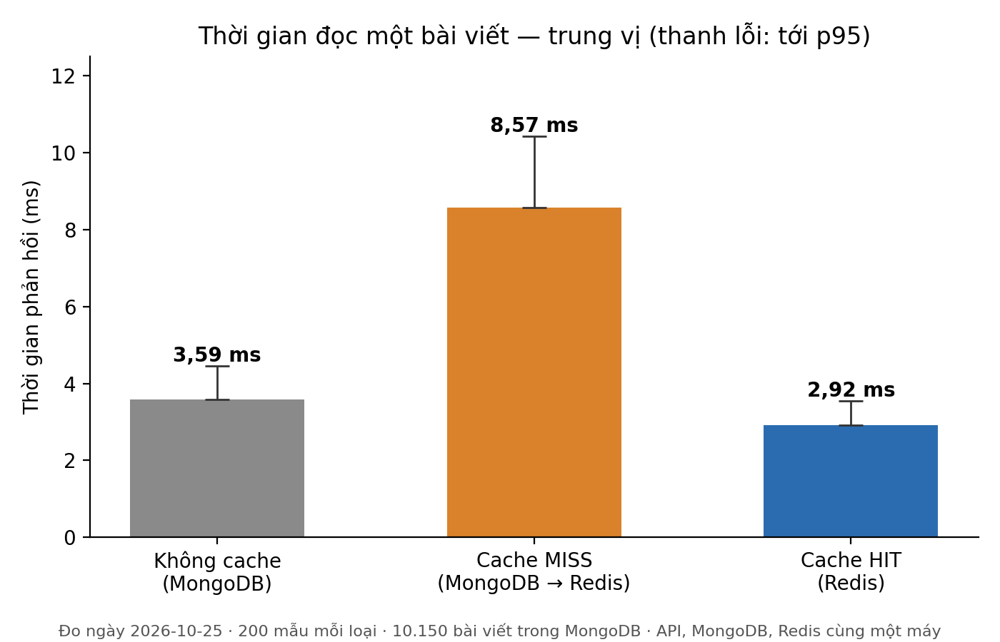
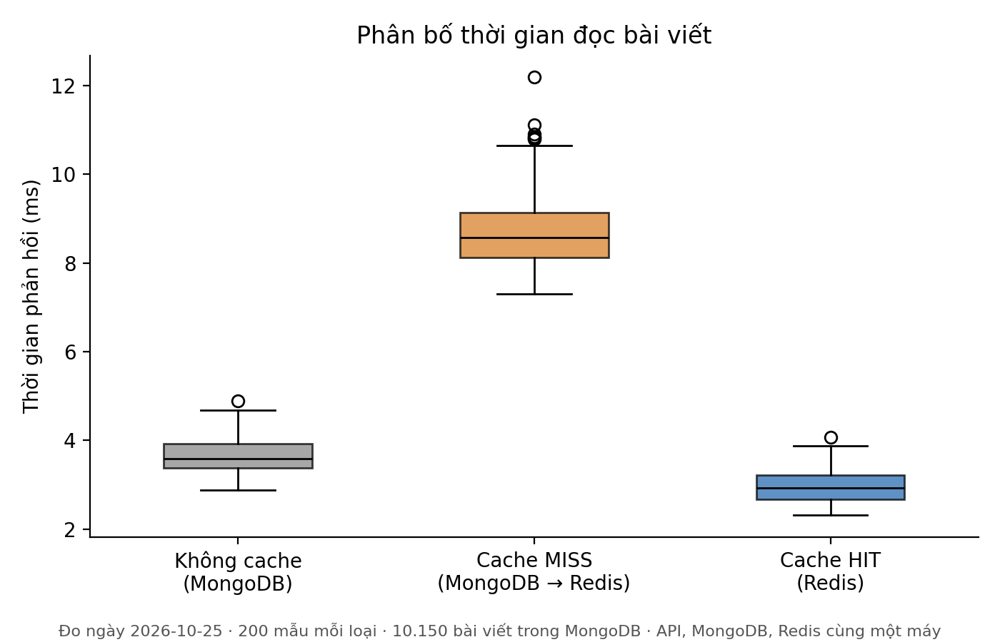
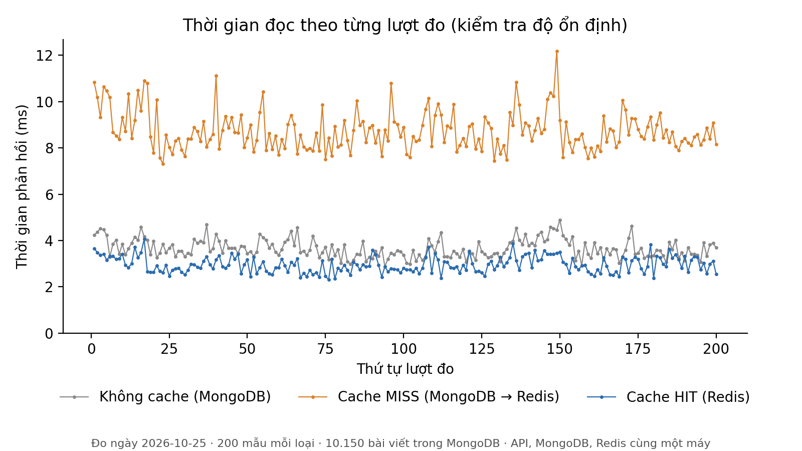
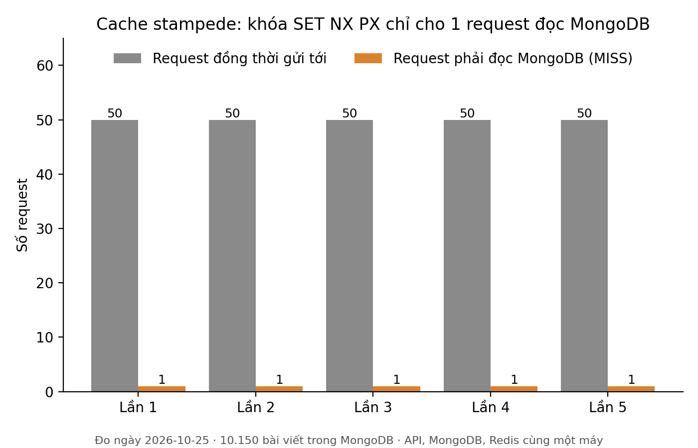
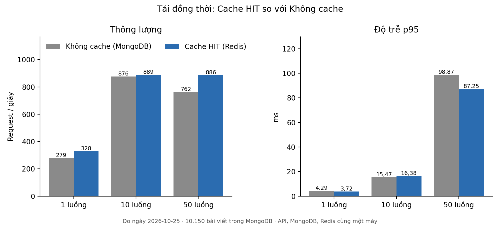

# Báo Cáo Chuyên Đề: Kiểm Thử Hiệu Năng Phân Hệ Caching Redis

**Học phần**: Hệ Cơ Sở Dữ Liệu NoSQL  
**Đề tài 06**: Phân hệ caching bài viết và quản lý phiên (Redis + MongoDB)  
**Người thực hiện**: Nguyễn Xuân Định (SV3 — Fullstack Integrator & DB Tester)  
**Mã Task Jira**: SCRUM-40 (đo), SCRUM-41 (biểu đồ), SCRUM-42 (chương này)  
**Dữ liệu gốc**: `scripts/Benchmark/results/2026-10-25-chinh-thuc/` — mọi con số trong chương
đều lấy từ `summary.json` (kết quả đo) và `env.json` (môi trường, `/api/cache/stats`) của thư mục này.

---

## 1. Mục Tiêu Kiểm Thử

Chương này trả lời bằng số đo thật ba câu hỏi:

1. **Lần đọc thứ hai (Cache HIT) nhanh hơn lần đọc đầu (Cache MISS) bao nhiêu?** Đây là kịch bản
   "tải bài viết lần 1 vs lần 2" của buổi demo.
2. **Khóa phân tán `SET NX PX` có chặn được Cache Stampede không?** Khi nhiều người cùng mở một
   bài vừa hết cache, MongoDB phải bị đọc đúng **một** lần.
3. **Khi nhiều request đồng thời, đọc từ Redis có chịu tải tốt hơn đọc thẳng MongoDB không?**

---

## 2. Môi Trường Đo

| Thành phần | Giá trị |
|---|---|
| Thời điểm đo | 25/10/2026, 05:11 UTC |
| Máy | Windows 11 (10.0.26200), CPU AMD 16 luồng |
| API | ASP.NET Core chạy bằng `dotnet run` (bản Debug, giống lúc demo), `http://localhost:5134` |
| MongoDB | 7.0 trong Docker (`news-mongo`), database `newsdb` |
| Redis | Docker (`news-redis`), `localhost:6379` |
| Dữ liệu | **10.150 bài viết** (bộ dữ liệu đầy đủ SCRUM-32) |
| Mã nguồn đo | commit `bab6a5c` trên `main` |
| Công cụ | `scripts/Benchmark/benchmark.py` — Python 3.12, `requests` + `redis-py` |

API, MongoDB, Redis và chương trình đo chạy **trên cùng một máy**. Chi tiết đầy đủ trong `env.json`.

---

## 3. Phương Pháp

### 3.1. Ba đường đọc được so sánh

| Loại | Endpoint | Công việc phía server |
|---|---|---|
| **Không cache** | `GET /api/posts/slug/{slug}` | 1 truy vấn MongoDB. Endpoint này **cố ý không cache**, dùng làm mốc "trước khi có cache". |
| **Cache MISS** | `DEL post:{id}` rồi `GET /api/posts/{id}` | `GET` Redis (trượt) → lấy khóa `SET NX PX 5000` → `GET` lại → truy vấn MongoDB → đọc `post:{id}:views` → `SET` kèm TTL 10 phút → nhả khóa |
| **Cache HIT** | `GET /api/posts/{id}` ngay sau đó | `GET post:{id}` + `GET post:{id}:views` trên Redis |

### 3.2. Ba kịch bản đo

- **S1 — Độ trễ tuần tự**: 20 bài × 10 vòng = **200 mẫu cho mỗi loại**. Trong cùng một vòng, mỗi bài
  được đo lần lượt Không cache → MISS → HIT. Ba loại xen kẽ nhau nên chịu cùng điều kiện máy.
- **S2 — Cache Stampede**: xóa `post:{id}`, rồi 50 luồng **cùng gửi một lúc** vào bài đó (đồng bộ bằng
  `threading.Barrier`). Lặp 5 lần trên 5 bài khác nhau.
- **S3 — Tải đồng thời**: 500 request ở mỗi mức 1, 10 và 50 luồng, so sánh HIT với Không cache.

### 3.3. Các biện pháp chống sai số

- **Giữ kết nối (keep-alive)**: dùng một `requests.Session`, nên không phải bắt tay TCP lại ở mỗi
  request. Thời gian đo phản ánh đúng việc của server.
- **Khởi động nóng (warm-up)**: 5 lượt đầu bị bỏ, để loại ảnh hưởng của JIT .NET và bước mở connection pool.
- **Kiểm chứng từng mẫu**: mỗi mẫu MISS phải nhận header `X-Cache: MISS`, mỗi mẫu HIT phải nhận
  `X-Cache: HIT`. Mẫu sai bị loại. Kết quả: **0/600 mẫu bị loại**.
- **Báo trung vị và p95**, không chỉ trung bình: trung vị không bị vài lượt bất thường kéo lệch.
- **Chỉ xóa đúng key** `post:{id}` của bài đang đo, không `FLUSH`/`SCAN`. Có unit test khóa chặt điều này.

---

## 4. Kết Quả

### 4.1. Độ trễ đọc một bài viết (S1)

| Loại | n | Trung bình | **Trung vị** | p95 | p99 | Nhỏ nhất | Lớn nhất |
|---|---|---|---|---|---|---|---|
| Không cache (MongoDB) | 200 | 3,66 | **3,59** | 4,46 | 4,63 | 2,88 | 4,89 |
| Cache MISS (MongoDB → Redis) | 200 | 8,74 | **8,57** | 10,42 | 10,90 | 7,31 | 12,19 |
| Cache HIT (Redis) | 200 | 2,96 | **2,92** | 3,55 | 3,82 | 2,31 | 4,06 |

*Đơn vị: mili giây (ms).*

**Theo trung vị, Cache HIT nhanh hơn Cache MISS 2,93 lần** (8,57 ms → 2,92 ms) và nhanh hơn
Không cache 1,23 lần.



*Hình 1. Trung vị thời gian đọc của ba loại; thanh lỗi kéo tới p95.*



*Hình 2. Phân bố 200 mẫu mỗi loại. HIT tập trung trong khoảng hẹp (độ lệch chuẩn 0,35 ms); MISS
dao động rộng hơn (0,84 ms) vì phải đi qua nhiều bước hơn.*



*Hình 3. Thời gian theo thứ tự lượt đo. Không có xu hướng tăng hay giảm dần, ba đường không
chồng lấn nhau, nên kết quả ổn định trong suốt lần chạy.*

### 4.2. Cache Stampede (S2)

| Lần | Request đồng thời | **MISS (đọc MongoDB)** | HIT | Lỗi | Trung vị (ms) | p95 (ms) |
|---|---|---|---|---|---|---|
| 1 | 50 | **1** | 49 | 0 | 50,74 | 57,98 |
| 2 | 50 | **1** | 49 | 0 | 53,05 | 104,26 |
| 3 | 50 | **1** | 49 | 0 | 50,15 | 104,61 |
| 4 | 50 | **1** | 49 | 0 | 50,42 | 59,51 |
| 5 | 50 | **1** | 49 | 0 | 69,13 | 115,10 |

**Cả 5 lần, đúng 1 trên 50 request phải đọc MongoDB.** 49 request còn lại nhận dữ liệu từ Redis.



*Hình 4. Không có khóa thì cả 50 request cùng trượt cache và cùng truy vấn MongoDB. Có khóa thì
chỉ còn 1.*

### 4.3. Tải đồng thời (S3)

| Loại | Luồng | Request/giây | p50 (ms) | p95 (ms) | p99 (ms) | Lỗi |
|---|---|---|---|---|---|---|
| Cache HIT (Redis) | 1 | 328,1 | 2,98 | 3,72 | 4,23 | 0 |
| Không cache (MongoDB) | 1 | 279,0 | 3,55 | 4,29 | 4,71 | 0 |
| Cache HIT (Redis) | 10 | 889,4 | 10,39 | 16,38 | 24,22 | 0 |
| Không cache (MongoDB) | 10 | 875,5 | 10,97 | 15,47 | 16,99 | 0 |
| Cache HIT (Redis) | 50 | 885,6 | 51,07 | 87,25 | 106,81 | 0 |
| Không cache (MongoDB) | 50 | 762,5 | 59,59 | 98,87 | 116,10 | 0 |



*Hình 5. Thông lượng (trái) và độ trễ p95 (phải) theo số luồng đồng thời.*

---

## 5. Phân Tích

### 5.1. Vì sao Cache MISS chậm hơn cả "Không cache"?

MISS (8,57 ms) chậm hơn Không cache (3,59 ms) khoảng 4,98 ms. Đây **không phải lỗi** mà là cái giá
của Cache-Aside. Lần MISS phải làm hết mọi việc của "Không cache" (1 truy vấn MongoDB), **cộng
thêm** khoảng 6 lượt đi về Redis: đọc trượt, lấy khóa, đọc lại để kiểm tra kép, đọc lượt xem, ghi
cache kèm TTL, nhả khóa. Lần đọc đầu trả thêm chi phí để mọi lần đọc sau trong 10 phút TTL đều đi
đường HIT.

Với tỉ lệ HIT thực tế của hệ thống (`/api/cache/stats` ghi **93,23%** trước lần đo), chi phí MISS
chỉ phát sinh ở khoảng 7% số lượt đọc.

### 5.2. Vì sao không đạt "~200 ms so với < 5 ms" như kịch bản đề bài?

Kịch bản đề bài mô tả một MongoDB ở xa và chịu tải. Ở phép đo này:

1. **MongoDB chạy cùng máy**, không có độ trễ mạng.
2. Truy vấn theo `_id`/`slug` đều **có chỉ mục**. Với 10.150 bài, MongoDB giữ toàn bộ dữ liệu và
   chỉ mục trong RAM (WiredTiger cache), nên một lần tìm chỉ tốn chưa tới 1 ms.
3. Phần lớn thời gian HIT (2,92 ms) là **chi phí cố định** của HTTP và pipeline ASP.NET Core bản
   Debug. Riêng phần chênh do nguồn dữ liệu, Không cache − HIT, chỉ là **0,67 ms**.

Nhóm **giữ nguyên số đo, không chỉnh cho đẹp**. Phép đo vẫn chứng minh đúng bản chất: đọc Redis
nhanh hơn và ổn định hơn đọc MongoDB, và cơ chế MISS → ghi cache → HIT hoạt động đúng.

### 5.3. Khóa chống Stampede hoạt động thế nào trong số đo?

Trong 50 request, request nào lấy được khóa `lock:post:{id}` thì đọc MongoDB và ghi cache. 49
request còn lại **chờ 50 ms rồi đọc lại Redis** (`Task.Delay(50)` trong `GetById`). Điều này giải
thích vì sao trung vị độ trễ ở S2 nằm quanh 50 ms. Lần 2, 3, 5 có p95 khoảng 104–115 ms vì một số
request phải chờ thêm **một vòng 50 ms nữa**, khi request giữ khóa chưa kịp ghi xong cache. Đánh
đổi này có chủ đích: chậm hơn vài chục ms cho một số người dùng, đổi lại MongoDB chỉ nhận 1 truy
vấn thay vì 50.

### 5.4. Tải đồng thời

- Ở **1 luồng**, HIT đạt 328,1 req/s so với 279,0 req/s của Không cache (**+17,6%**).
- Ở **50 luồng**, HIT vẫn giữ 885,6 req/s, còn Không cache giảm xuống 762,5 req/s (**+16,1%**).
  p95 của HIT cũng thấp hơn (87,25 ms so với 98,87 ms).
- Ở **10 luồng**, hai loại gần bằng nhau (889,4 so với 875,5 req/s). Thông lượng không tăng nữa khi
  đi từ 10 lên 50 luồng. Dấu hiệu này cho thấy **chương trình đo (Python) đã chạm trần** chứ chưa
  phải server (xem mục 6).

---

## 6. Giới Hạn Của Phép Đo

1. **Chương trình đo viết bằng Python** bị giới hạn bởi GIL. Từ khoảng 10 luồng, chính chương trình
   đo trở thành nút cổ chai (khoảng 880 req/s cho cả hai loại). Vì vậy S3 chỉ dùng để **so sánh tương
   đối**, không phải đo giới hạn chịu tải của server.
2. **Đo trên một máy**: chương trình đo, API, MongoDB và Redis tranh chung CPU.
3. **API chạy bản Debug** như lúc demo. Bản Release sẽ có số tuyệt đối thấp hơn.
4. **MongoDB "nóng"**: dữ liệu đã nằm trong RAM. Với dữ liệu lớn hơn RAM hoặc MongoDB ở máy khác,
   khoảng cách giữa MISS/Không cache và HIT sẽ giãn rộng.
5. **Đo ngoài trình duyệt**: số trên tab Network (F12) lúc demo gồm thêm thời gian trình duyệt xử lý,
   nên có thể cao hơn vài ms. Xu hướng MISS > HIT không đổi. Header `X-Cache` và badge HIT/MISS trên
   trang chi tiết (SCRUM-38) cho thấy cùng kết quả ngay trên giao diện.

### 6.1. Đối chiếu với phép đo sơ bộ của SV1

`docs/kich-ban-demo-va-do-hieu-nang.md` (mục B4) có một phép đo sơ bộ ngày 23/10. Phép đo đó dùng
`curl.exe`, 20 lượt, trên 101 bài:

| Loại | Đo sơ bộ (SV1, trung bình) | Chương này (trung bình) |
|---|---|---|
| Không cache | 5,95 ms | 3,66 ms |
| Cache MISS | 14,15 ms | 8,74 ms |
| Cache HIT | 4,61 ms | 2,96 ms |
| MISS / HIT | 3,07 lần | 2,95 lần |

Hai phép đo cho **cùng thứ tự và gần cùng tỉ lệ**. Số tuyệt đối ở phép đo sơ bộ cao hơn vì mỗi lần
`curl.exe` mở một kết nối TCP mới, còn chương này giữ kết nối mở. Hai bộ số bổ trợ nhau, không mâu thuẫn.

---

## 7. Kết Luận

| Câu hỏi | Kết quả đo |
|---|---|
| HIT nhanh hơn MISS bao nhiêu? | **2,93 lần** theo trung vị (8,57 ms → 2,92 ms), 0/600 mẫu sai `X-Cache` |
| Khóa có chặn Stampede không? | **Có**: 5/5 lần chỉ **1/50** request đọc MongoDB, 0 lỗi |
| Chịu tải đồng thời tốt hơn không? | HIT đạt thông lượng cao hơn **16–18%** ở 1 và 50 luồng, p95 thấp hơn ở 50 luồng |

Kết quả xác nhận luồng Cache-Aside, TTL và khóa phân tán do SV2 xây dựng hoạt động đúng thiết kế
trên bộ dữ liệu 10.150 bài viết. Đây là phần số liệu cho mục **"Kiểm thử hiệu năng & Demo trực
quan"** của barem.

---

## 8. Cách Tái Hiện

```powershell
# 1. Bật Docker + API (docs/kich-ban-demo-va-do-hieu-nang.md, Phần A)
python -m pip install -r scripts/Benchmark/requirements.txt
# 2. Đo
python scripts/Benchmark/benchmark.py --label <ten-lan-do>
# 3. Vẽ biểu đồ + bảng
python scripts/Benchmark/plot.py scripts/Benchmark/results/<ten-lan-do>
```

Kết quả nằm ở `scripts/Benchmark/results/<ten-lan-do>/` (`summary.md`, `charts/*.png`). Tham số
và giải thích từng file: `scripts/Benchmark/README.md`.
