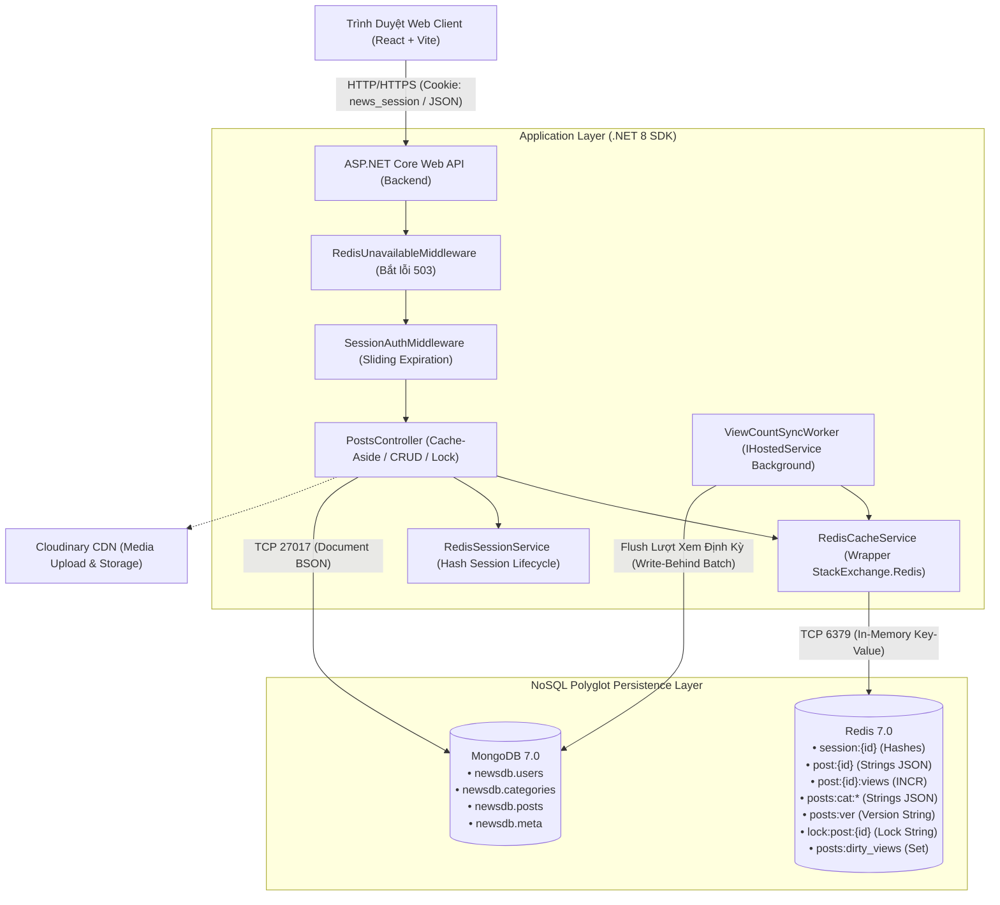
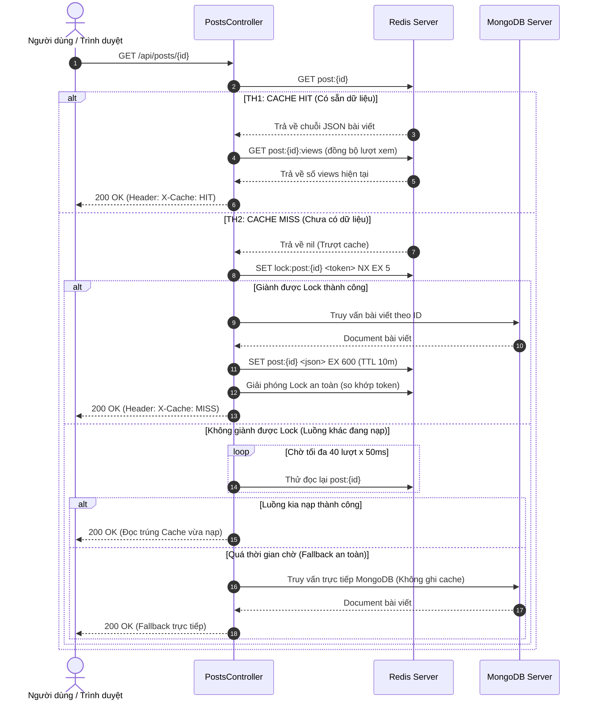
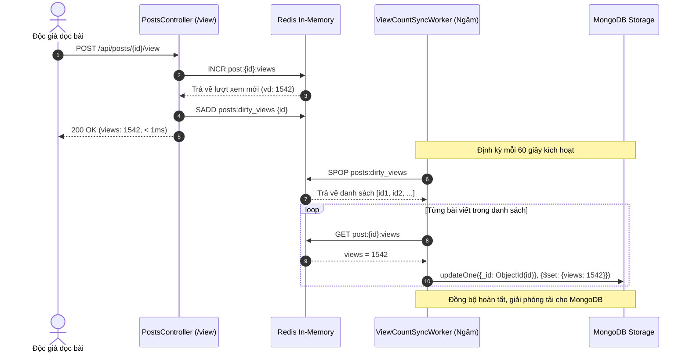

# SOFTWARE REQUIREMENTS SPECIFICATION (SRS)
## ĐỒ ÁN HỆ CƠ SỞ DỮ LIỆU NOSQL — ĐỀ TÀI 06
### Phân Hệ Caching Bài Viết Và Quản Lý Phiên (Session Management)
### Tiêu chuẩn: IEEE Std 830-1998 / ISO/IEC/IEEE 29148:2018

---

| Thông Tin Quản Trị Dự Án | Chi Tiết Đặc Tả |
|---|---|
| **Tên dự án** | NoSQL-NewsCacheSession |
| **Môn học / Đề tài** | Hệ Cơ Sở Dữ Liệu NoSQL — Đề tài 06 (Khoa CNTT - HUIT) |
| **Hệ quản trị CSDL chính** | **Redis** (In-Memory Data Store, Cache Layer, Session & Counter Store) |
| **Hệ quản trị CSDL gốc** | **MongoDB** (Document-Oriented Database, Persistence Store) |
| **Nhóm tác giả (03 SV)** | • **SV1**: Hồ Ngọc Phương Như (Data Architect & CRUD Lead)<br/>• **SV2**: Nguyễn Anh Quân (Advanced Query Specialist)<br/>• **SV3**: Nguyễn Xuân Định (Fullstack Integrator & DB Tester) |
| **Tiêu chuẩn tài liệu** | IEEE Std 830-1998 (Recommended Practice for Software Requirements Specifications) |
| **Phiên bản tài liệu** | 2.0 (Chuẩn hóa toàn diện theo cấu trúc IEEE 830, đối chiếu mã nguồn & thực nghiệm) |
| **Trạng thái nghiệm thu** | Hoàn thành — Đáp ứng 100% Barem Đề tài 06 & 49/49 Jira Tasks |

---

## MỤC LỤC CHI TIẾT

```
1. GIỚI THIỆU (INTRODUCTION)
   1.1 Mục đích tài liệu (Purpose)
   1.2 Phạm vi sản phẩm (Product Scope)
   1.3 Bảng định nghĩa, từ viết tắt và quy ước (Definitions, Acronyms, and Abbreviations)
   1.4 Tài liệu tham chiếu (References)
   1.5 Tổng quan cấu trúc tài liệu (Document Overview)

2. MÔ TẢ TỔNG QUAN HỆ THỐNG (OVERALL DESCRIPTION)
   2.1 Bối cảnh và góc nhìn sản phẩm (Product Perspective)
       2.1.1 Kiến trúc tổng thể & Polyglot Persistence
       2.1.2 Ràng buộc phần cứng và bộ nhớ (Memory Constraints)
       2.1.3 Môi trường vận hành (Operating Environment)
   2.2 Tóm tắt các chức năng sản phẩm (Product Functions Summary)
   2.3 Đặc điểm người dùng & Tác nhân (User Characteristics & Actors)
   2.4 Ràng buộc thiết kế và hiện thực (Design & Implementation Constraints)
       2.4.1 Chuẩn dữ liệu MongoDB BSON camelCase & ObjectId
       2.4.2 Quy chuẩn Keyspace Redis & Chiến lược O(1) Invalidation
       2.4.3 Trình tự nhất quán: Ghi MongoDB trước, vô hiệu hóa Cache sau
   2.5 Giả định và sự phụ thuộc (Assumptions and Dependencies)
   2.6 Phân bổ yêu cầu theo vai trò thành viên (Apportioning of Requirements)

3. CÁC YÊU CẦU CỤ THỂ (SPECIFIC REQUIREMENTS)
   3.1 Yêu cầu giao diện bên ngoài (External Interface Requirements)
       3.1.1 Giao diện người dùng (User Interfaces)
       3.1.2 Giao diện phần mềm & SDKs (Software Interfaces)
       3.1.3 Giao diện truyền thông & Giao thức (Communications Interfaces)
   3.2 Yêu cầu chức năng chi tiết (Functional Requirements)
       3.2.1 Phân hệ 1: Xác thực & Quản trị Phiên (Authentication & Session Management)
             - FR-01: Đăng ký tài khoản & Bootstrap Admin nguyên tử (Atomic Claim)
             - FR-02: Đăng nhập & Khởi tạo phiên Redis Hashes kèm EXPIRE
             - FR-03: SessionAuthMiddleware & Sliding Expiration
             - FR-04: Đăng xuất & Thu hồi phiên an toàn
             - FR-05: Quản trị & Giám sát phiên người dùng thời gian thực (Admin Session Management)
       3.2.2 Phân hệ 2: Quản lý Bài viết & Chuyên mục (Core CRUD MongoDB)
             - FR-06: Tạo bài viết mới & Xử lý Slug tiếng Việt Unicode chống trùng
             - FR-07: Chỉnh sửa bài viết & Phân quyền tác giả/Admin
             - FR-08: Xóa mềm bài viết (Soft Delete & Preservation)
             - FR-09: Lấy danh sách bài viết phân trang & Lọc theo chuyên mục
             - FR-10: Đọc chi tiết bài viết theo Slug (Baseline không cache để đối chứng)
             - FR-11: Quản trị danh mục tin tức (Categories Management)
       3.2.3 Phân hệ 3: Caching Bài viết Nâng cao (Redis Cache-Aside Pattern)
             - FR-12: Hiện thực luồng Cache-Aside (GET /api/posts/{id})
             - FR-13: Khóa phân tán chống Cache Stampede (Distributed Lock với TTL & Safe Release bằng Token)
             - FR-14: Cache Invalidation tức thời khi sửa/xóa bài viết
       3.2.4 Phân hệ 4: Cache Danh sách Bài viết bằng Versioning
             - FR-15: Caching danh sách trang chủ theo phiên bản (posts:cat:{catId}:p{page}:v{ver} - TTL 3 phút)
             - FR-16: Vô hiệu hóa cache danh sách O(1) qua INCR posts:ver
       3.2.5 Phân hệ 5: Bộ đếm Lượt xem Thời gian thực & Ghi sau (Write-Behind)
             - FR-17: Tăng lượt xem thời gian thực bằng Redis INCR (post:{id}:views + SADD posts:dirty_views)
             - FR-18: Tiến trình đồng bộ ngầm định kỳ ViewCountSyncWorker (Batch Write-Behind)
       3.2.6 Phân hệ 6: Giám sát Hiệu năng Cache & Trạng thái Hệ thống
             - FR-19: Endpoint thống kê tỷ lệ Hit/Miss (/api/cache/stats)
             - FR-20: Giám sát sức khỏe kết nối đa CSDL (/health)
             - FR-21: Xử lý Upload và Quản lý Media bài viết (Cloudinary CDN)
   3.3 Yêu cầu hiệu năng (Performance Requirements)
       - NFR-01: Độ trễ đọc Cache HIT (<= 5ms, thực tế 2.96ms)
       - NFR-02: Thời gian xử lý Cache MISS (<= 200ms, thực tế 8.74ms)
       - NFR-03: Bảo vệ triệt để chống Cache Stampede (50 concurrent requests -> đúng 1 request nạp DB)
       - NFR-04: Thông lượng chịu tải đọc cao (>= 800 RPS, 0% error rate)
   3.4 Yêu cầu cơ sở dữ liệu logic (Logical Database Requirements)
       - 3.4.1 CSDL Document MongoDB (users, categories, posts, meta)
       - 3.4.2 CSDL In-Memory Redis Keyspace
       - 3.4.3 Quy mô dữ liệu & Chính sách lưu giữ (Volume & Retention)
   3.5 Thuộc tính hệ thống phần mềm (Software System Attributes)
       - 3.5.1 Tính sẵn sàng & Suy giảm mềm (Availability & Graceful Degradation)
       - 3.5.2 Tính an toàn & Bảo mật (Security & Access Control)
       - 3.5.3 Tính nhất quán dữ liệu (Data Consistency)
       - 3.5.4 Khả năng bảo trì & Khả năng kiểm thử (Maintainability & Testability)

4. PHỤ LỤC & TÀI LIỆU HỖ TRỢ (APPENDICES & SUPPORTING INFORMATION)
   4.1 Phụ lục A: Định mức bộ dữ liệu mẫu (Dummy Data Verification)
   4.2 Phụ lục B: Báo cáo kết quả kiểm thử thực nghiệm (Empirical Benchmark Summary)
   4.3 Phụ lục C: Ma trận truy vết yêu cầu (Traceability Matrix)
       - Ánh xạ Barem Đề tài 06 (10.0 điểm) -> SRS Requirements
       - Ánh xạ Jira Tasks (SCRUM-13 đến SCRUM-49) -> Mã nguồn & Tests
   4.4 Phụ lục D: Kịch bản demo sống bảo vệ đồ án (Live Demo 3 bước)
```

---

## 1. GIỚI THIỆU (INTRODUCTION)

### 1.1 Mục đích tài liệu (Purpose)
Tài liệu **Đặc tả Yêu cầu Phần mềm (Software Requirements Specification - SRS)** này cung cấp bản mô tả chi tiết, chính thức và toàn diện về các yêu cầu chức năng, yêu cầu phi chức năng, kiến trúc kỹ thuật đa cơ sở dữ liệu (Polyglot Persistence), giao diện ngoài và các ràng buộc hiện thực của dự án **NoSQL-NewsCacheSession** (Đề tài 06: *Phân hệ caching bài viết và quản lý phiên*).

Tài liệu được biên soạn tuân thủ tiêu chuẩn quốc tế **IEEE Std 830-1998** (IEEE Recommended Practice for Software Requirements Specifications), làm căn cứ pháp lý và kỹ thuật cho:
1. Đội ngũ kỹ sư phát triển (SV1, SV2, SV3) định hướng thiết kế, hiện thực hóa tính năng và kiểm thử tự động.
2. Giảng viên hướng dẫn và Hội đồng phản biện môn học Hệ Cơ Sở Dữ Liệu NoSQL đối chiếu, nghiệm thu sản phẩm thực tế theo Barem đánh giá 10.0 điểm.

### 1.2 Phạm vi sản phẩm (Product Scope)
Hệ thống là một **Nền tảng Tạp chí Tin tức Trực tuyến Hiệu năng cao** tích hợp kiến trúc bộ nhớ đệm phân tán và phân hệ quản lý phiên chuyên sâu:
*   **Hệ quản trị CSDL chính (In-Memory Database)**: **Redis 7.0**, chịu trách nhiệm:
    *   Lưu trữ phiên đăng nhập người dùng dưới dạng **Hashes** (`session:{sessionId}`) kèm cơ chế trượt thời gian sống (**Sliding Expiration**).
    *   Lưu trữ bộ đệm nội dung bài viết dưới dạng **Strings JSON** (`post:{id}`) theo mô hình **Cache-Aside Pattern**.
    *   Lưu trữ bộ đếm lượt xem thời gian thực bằng lệnh nguyên tử **INCR** (`post:{id}:views`) và quản lý hàng đợi ghi sau (**Write-Behind Queue** qua Set `posts:dirty_views`).
    *   Lưu trữ bộ đệm danh sách bài viết phân trang và lọc theo chuyên mục sử dụng cơ chế đánh phiên bản **Key Versioning** (`posts:ver` và `posts:cat:{catId}:p{page}:v{ver}`).
    *   Điều phối khóa phân tán (**Distributed Lock**) chống hiện tượng sập nguồn bộ nhớ đệm (**Cache Stampede** qua `lock:post:{id}`).
*   **Hệ quản trị CSDL gốc (Persistence Database)**: **MongoDB 7.0**, chịu trách nhiệm lưu trữ bền vững (Durable Storage) các tài liệu BSON (`users`, `categories`, `posts`, `meta`) với đầy đủ các ràng buộc chỉ mục (Unique Index, Compound Index) và quan hệ tham chiếu qua `ObjectId`.
*   **Phân hệ Ứng dụng Backend**: Xây dựng trên nền tảng **ASP.NET Core 8 Web API** (C# 12), kiến trúc phân lớp sạch (Clean Architecture), tách biệt CQRS giữa quản trị phiên và truy vấn phiên.
*   **Phân hệ Ứng dụng Frontend**: Single Page Application (SPA) phát triển bằng **React 18**, **Vite 5**, tối ưu hóa giao diện người dùng và tích hợp các công cụ trực quan hóa trạng thái bộ nhớ đệm (`CACHE HIT/MISS Badge`, thời gian phản hồi miligiây).

### 1.3 Bảng định nghĩa, từ viết tắt và quy ước (Definitions, Acronyms, and Abbreviations)

#### Quy ước mức độ bắt buộc (RFC 2119 Compliance):
*   **BẮT BUỘC (SHALL / MUST)**: Yêu cầu tuyệt đối bắt buộc. Việc không đáp ứng sẽ dẫn đến thất bại hệ thống hoặc mất điểm trực tiếp trong barem.
*   **NÊN (SHOULD / RECOMMENDED)**: Yêu cầu được khuyến nghị áp dụng để nâng cao độ tin cậy và trải nghiệm người dùng.
*   **CÓ THỂ (MAY / OPTIONAL)**: Yêu cầu mang tính chất tùy chọn mở rộng.

#### Bảng thuật ngữ chuyên ngành NoSQL & Caching:
| Thuật ngữ | Tên viết tắt | Định nghĩa kỹ thuật |
|---|:---:|---|
| **Cache-Aside Pattern** | Lazy-Loading | Mô hình kiến trúc trong đó tầng ứng dụng chủ động kiểm tra cache trước; nếu không có (Miss), ứng dụng đọc dữ liệu từ DB gốc rồi ghi ngược lại cache kèm thời gian sống (TTL). |
| **Cache Invalidation** | - | Quy trình hủy bỏ hoặc vô hiệu hóa dữ liệu cache đã lỗi thời ngay khi dữ liệu gốc ở DB bị thay đổi hoặc xóa bỏ, đảm bảo tính nhất quán (Consistency). |
| **Cache Stampede** | Thundering Herd | Hiện tượng hàng loạt truy vấn đồng thời cùng ập vào DB gốc khi một key cache phổ biến vừa hết hạn TTL, có thể làm sập cơ sở dữ liệu gốc. |
| **Distributed Lock** | Khóa phân tán | Cơ chế khóa an toàn giữa nhiều tiến trình phân tán thông qua lệnh nguyên tử `SET key token NX EX` trên Redis, giải phóng khóa có điều kiện so khớp token. |
| **Write-Behind** | Write-Back | Mô hình ghi dữ liệu vào cache trước (Redis `INCR`), sau đó định kỳ gom cụm (batch) đồng bộ xuống DB gốc thông qua tiến trình chạy ngầm. |
| **Sliding Expiration** | - | Cơ chế trượt thời gian sống: Mỗi khi phiên nhận được request hợp lệ từ người dùng, đồng hồ đếm lùi TTL được reset về giá trị ban đầu (30 phút). |
| **Key Versioning** | - | Kỹ thuật vô hiệu hóa cache danh sách độ phức tạp $O(1)$: Duy trì số phiên bản `posts:ver`, khi có bài viết mới/sửa/xóa chỉ cần `INCR posts:ver`, làm mọi key cache danh sách mang version cũ bị bỏ rơi mà không cần dùng lệnh `SCAN` + `DEL` tốn kém $O(N)$. |
| **Polyglot Persistence** | - | Kiến trúc sử dụng kết hợp nhiều loại cơ sở dữ liệu khác nhau (Redis In-Memory + MongoDB Document) nhằm khai thác tối đa ưu thế đặc trưng của từng hệ quản trị. |
| **BSON camelCase** | - | Quy chuẩn bắt buộc đặt tên trường trong MongoDB theo định dạng lạc đà chữ thường đầu từ (ví dụ: `passwordHash`, `imageUrl`, `isDeleted`). |

### 1.4 Tài liệu tham chiếu (References)
1. **Đề bài đồ án**: *ĐỀ TÀI 06: Phân hệ Caching bài viết và quản lý phiên (Session Management)*, Bộ môn Hệ thống Thông tin, Khoa CNTT - HUIT (`docs/ĐỀ TÀI 06.docx`).
2. **Kế hoạch thực thi Jira**: `docs/nosql-jira-tasks.csv` (Chi tiết 49 tasks phân bổ qua 5 Sprints).
3. **Quy chuẩn CSDL gốc**: `docs/mongodb-schema.md` (Đặc tả chi tiết 4 collection và hệ thống Index).
4. **Quy chuẩn CSDL Redis**: `docs/redis-keyspace.md` (Đặc tả chi tiết Keyspace, Datatypes, TTL và cấu trúc Hash fields).
5. **Báo cáo chuyên đề Cache-Aside**: `docs/bao-cao-nguyen-ly-cache-aside.md`.
6. **Báo cáo kiểm thử hiệu năng thực nghiệm**: `docs/bao-cao-kiem-thu-hieu-nang.md` (Dữ liệu đo đạc 200 mẫu và kiểm thử Stampede tại `scripts/Benchmark/results/2026-10-25-chinh-thuc/summary.json`).
7. **Quy tắc phát triển & Phân công**: `AGENTS.md` (Quy định phân quyền file, 3 nguyên tắc bất khả xâm phạm và quy tắc Typography).
8. **Tiêu chuẩn tài liệu IEEE**: *IEEE Recommended Practice for Software Requirements Specifications*, IEEE Std 830-1998.

### 1.5 Tổng quan cấu trúc tài liệu (Document Overview)
Tài liệu SRS này bao gồm 4 phần chính:
*   **Phần 1: Giới thiệu**: Trình bày mục đích, phạm vi, bảng thuật ngữ và các tài liệu tham chiếu.
*   **Phần 2: Mô tả tổng quan hệ thống**: Định hình bối cảnh kiến trúc, các tác nhân hệ thống, ràng buộc thiết kế cốt lõi và bảng phân công trách nhiệm 3 sinh viên.
*   **Phần 3: Các yêu cầu cụ thể**: Đặc tả chi tiết các yêu cầu giao diện ngoài, 21 yêu cầu chức năng (Functional Requirements - FR) chia làm 6 phân hệ, các yêu cầu phi chức năng (Non-Functional Requirements - NFR) và yêu cầu cơ sở dữ liệu logic.
*   **Phần 4: Phụ lục & Tài liệu hỗ trợ**: Cung cấp định mức kiểm chứng dữ liệu mẫu (10.150 bài viết), số liệu thực nghiệm đo đạc hiệu năng, Ma trận truy vết yêu cầu (Traceability Matrix) và Kịch bản Demo 3 bước chuẩn bảo vệ.

---

## 2. MÔ TẢ TỔNG QUAN HỆ THỐNG (OVERALL DESCRIPTION)

### 2.1 Bối cảnh và góc nhìn sản phẩm (Product Perspective)

#### 2.1.1 Kiến trúc tổng thể & Polyglot Persistence
Hệ thống giải quyết bài toán tải cao (High Concurrency) của một trang tin tức hiện đại bằng mô hình kiến trúc đa cơ sở dữ liệu:



#### 2.1.2 Ràng buộc phần cứng và bộ nhớ (Memory Constraints)
*   **Redis In-Memory Footprint**: Redis lưu trữ toàn bộ dữ liệu trên RAM. Nhằm tối ưu dung lượng và chi phí bộ nhớ:
    *   Key cache nội dung bài viết chỉ nạp các trường cần thiết phục vụ hiển thị (`PostResponse`), không cache các trường nội bộ.
    *   Mọi key cache đều bắt buộc gắn **TTL** hữu hạn (Session: 30 phút, Post Detail: 10 phút, Post List: 3 phút).
    *   Các key vô hạn định (`post:{id}:views`, `posts:ver`) có kích thước cực nhỏ (chỉ vài byte biểu diễn số nguyên).
*   **MongoDB Storage**: CSDL gốc lưu trữ bền vững trên ổ đĩa cứng, sử dụng WiredTiger Storage Engine nén dữ liệu snappy.

#### 2.1.3 Môi trường vận hành (Operating Environment)
*   **Môi trường Container**: Đóng gói hoàn chỉnh thông qua `docker-compose.yml` gồm các container:
    *   `mongodb`: Phiên bản official `mongo:7.0`, port ánh xạ `27017:27017`.
    *   `redis`: Phiên bản official `redis:7.0-alpine`, port ánh xạ `6379:6379`.
    *   `redis-insight`: Công cụ trực quan hóa keyspace `redislabs/redisinsight:latest`, port ánh xạ `8001:5540`.
*   **Backend Runtime**: .NET 8.0 SDK (ASP.NET Core Web API), C# 12.
*   **Frontend Runtime**: Node.js 20+, React 18, Vite 5, Tailwind CSS.

### 2.2 Tóm tắt các chức năng sản phẩm (Product Functions Summary)
Hệ thống cung cấp 6 khối chức năng chính:
1.  **Quản lý Xác thực & Phiên (Authentication & Session)**: Đăng ký (Bootstrap Admin tự động), đăng nhập khởi tạo session dạng Redis Hash, sliding expiration, đăng xuất và trang quản trị phiên cho Admin.
2.  **Quản lý Bài viết & Danh mục (MongoDB Core CRUD)**: Viết bài mới kèm upload ảnh, sửa bài, xóa mềm, phân trang bài viết, lọc theo danh mục, quản trị danh mục.
3.  **Tăng tốc Đọc Bài viết (Cache-Aside Caching)**: Đọc bài viết qua Redis cache dưới 5ms, xử lý Miss nạp DB gốc, cơ chế khóa phân tán Distributed Lock chống hiện tượng Cache Stampede.
4.  **Cache Danh sách bằng Versioning (O(1) Invalidation)**: Cache trang chủ và danh mục theo phiên bản `posts:ver`, hủy toàn bộ cache danh sách tức thời $O(1)$ chỉ bằng 1 lệnh `INCR`.
5.  **Bộ đếm Lượt xem Thời gian thực & Ghi sau (Write-Behind)**: Tăng lượt xem tức thì trên Redis (`INCR post:{id}:views`), đánh dấu hàng đợi `posts:dirty_views`, định kỳ worker ghi dồn về MongoDB mỗi phút.
6.  **Giám sát & Đo kiểm Hiệu năng**: Endpoint thống kê tỷ lệ Hit/Miss (`/api/cache/stats`), endpoint kiểm tra sức khỏe hệ thống (`/health`), badge hiển thị trạng thái cache và thời gian tải trên giao diện.

### 2.3 Đặc điểm người dùng & Tác nhân (User Characteristics & Actors)
1.  **Guest (Độc giả vãng lai)**:
    *   Truy cập xem danh sách tin tức phân trang và lọc theo chuyên mục (đọc qua cache `posts:cat:*`).
    *   Xem chi tiết bài viết (kích hoạt luồng Cache-Aside `post:{id}` và tăng bộ đếm lượt xem thời gian thực).
    *   Thực hiện đăng ký tài khoản hoặc đăng nhập.
2.  **Authenticated User (Thành viên đã đăng nhập)**:
    *   Sở hữu phiên làm việc định danh trong Redis Hashes (`session:{sessionId}`).
    *   Tạo bài viết mới (gán quyền sở hữu `authorId`).
    *   Chỉnh sửa hoặc xóa mềm bài viết do chính mình làm tác giả (`authorId == current.UserId`).
    *   Đăng xuất khỏi hệ thống (hủy phiên trên Redis).
3.  **Administrator (Quản trị viên)**:
    *   Tài khoản đăng ký đầu tiên của hệ thống (Bootstrap Admin).
    *   Toàn quyền CRUD trên mọi bài viết trong hệ thống (kể cả 10.150 bài viết mẫu không có `authorId`).
    *   Tạo mới và quản lý danh mục tin tức (`categories`).
    *   Xem danh sách các phiên người dùng đang hoạt động trong toàn hệ thống kèm thời gian TTL đếm lùi.
    *   Cưỡng chế thu hồi phiên của bất kỳ tài khoản nào ngay lập tức.
4.  **Background Worker (`ViewCountSyncWorker`)**:
    *   Tiến trình ngầm độc lập chạy chu kỳ 60 giây, thực thi đồng bộ lượt xem từ Redis về MongoDB.

### 2.4 Ràng buộc thiết kế và hiện thực (Design & Implementation Constraints)

#### 2.4.1 Chuẩn dữ liệu MongoDB BSON camelCase & ObjectId
*   **Quy chuẩn camelCase**: Mọi field trong MongoDB **bắt buộc dùng camelCase** (`title`, `slug`, `content`, `imageUrl`, `imagePublicId`, `categoryId`, `authorId`, `views`, `isDeleted`, `deletedAt`, `createdAt`, `updatedAt`, `passwordHash`, `role`, `name`, `description`).
*   **Ràng buộc Model C#**: Từng thuộc tính trong `Post.cs`, `User.cs`, `Category.cs` bắt buộc phải có thuộc tính `[BsonElement("...")]` tường minh. Nghiêm cấm bỏ quên `[BsonElement]` vì C# driver mặc định chuyển thành PascalCase, gây mất dữ liệu khi đọc ghi.
*   **Ràng buộc Kiểu ObjectId**: `categoryId` và `authorId` trong MongoDB **bắt buộc lưu dạng `ObjectId`**, không lưu dạng string thô.

#### 2.4.2 Quy chuẩn Keyspace Redis & Chiến lược $O(1)$ Invalidation
*   **Tuân thủ Keyspace**: Mọi thao tác Redis bắt buộc tuân theo bảng Keyspace quy chuẩn tại Mục 3.4.2. Không ghép chuỗi tùy tiện, bắt buộc dùng các helper tập trung ở đầu `PostsController.cs` (`CacheKey(id)`, `ViewsKey(id)`).
*   **Tuyệt đối không dùng SCAN + DEL cho Cache Danh sách**: Việc vô hiệu hóa cache danh sách bắt buộc dùng cơ chế **Key Versioning** thông qua `INCR posts:ver`. Không được dùng `SCAN posts:cat:*` rồi `DEL` vì gây nghẽn đơn luồng Redis khi tập dữ liệu lớn.

#### 2.4.3 Trình tự nhất quán: Ghi MongoDB trước, vô hiệu hóa Cache sau
*   Trong mọi thao tác sửa hoặc xóa bài viết (Update, Soft Delete), thứ tự thực thi bắt buộc là:
    $$\text{Ghi dữ liệu vào MongoDB trước} \longrightarrow \text{Xóa/Vô hiệu hóa Cache Redis sau}$$
*   **Lý do**: Nếu xóa cache trước khi ghi DB, một request đọc xen ngang ở giữa sẽ đọc phải dữ liệu cũ từ DB và nạp ngược lại cache, khiến cache bị ô nhiễm dữ liệu lỗi thời trọn một vòng đời TTL.

### 2.5 Giả định và sự phụ thuộc (Assumptions and Dependencies)
*   MongoDB Server (port 27017) và Redis Server (port 6379) được khởi động và duy trì kết nối ổn định.
*   Hệ thống có cơ chế suy giảm mềm (Graceful Degradation): Nếu Redis gặp sự cố, luồng đọc bài viết vẫn hoạt động bình thường bằng cách truy vấn trực tiếp từ MongoDB.
*   Trình duyệt của người dùng có hỗ trợ lưu trữ Cookie và cho phép truyền nhận cookie bảo mật `HttpOnly`.

### 2.6 Phân bổ yêu cầu theo vai trò thành viên (Apportioning of Requirements)

Tuân thủ nghiêm ngặt bảng phân công trách nhiệm tại Mục 3 của Đề bài 06 và phân quyền file tại `AGENTS.md`:

| Thành viên | Vai trò | Trách nhiệm chính & File mã nguồn sở hữu |
|---|---|---|
| **SV1**<br/>Hồ Ngọc Phương Như | **Data Architect & CRUD Lead** | • Thiết kế CSDL gốc MongoDB & mô hình Keyspace Redis.<br/>• Hiện thực API CRUD bài viết, danh mục, xác thực (`AuthController.cs`, `PostsController.cs` [trừ GetById & IncrementView], `CategoriesController.cs`).<br/>• Quản lý `MongoIndexInitializer.cs`, `CurrentUserService.cs`, `RedisSessionQueryService.cs`. |
| **SV2**<br/>Nguyễn Anh Quân | **Advanced Query Specialist** | • Hiện thực Middleware Cache-Aside & Quản trị phiên (`SessionAuthMiddleware.cs`, `RedisUnavailableMiddleware.cs`).<br/>• Hiện thực luồng Cache-Aside đọc bài viết (`PostsController.GetById`), khóa chống Stampede.<br/>• Xử lý bộ đếm `INCR`, hàng đợi Write-Behind (`PostsController.IncrementView`, `ViewCountSyncWorker.cs`).<br/>• Quản lý `RedisCacheService.cs`, `RedisSessionService.cs`, endpoint `/api/cache/stats`. |
| **SV3**<br/>Nguyễn Xuân Định | **Fullstack Integrator & DB Tester** | • Nạp bộ dữ liệu mẫu 10.150 bài viết có hình ảnh (`scripts/SeedPosts/seed.py`).<br/>• Xây dựng giao diện Web Tin tức và Trang Quản trị bằng React Vite (`src/frontend/**`).<br/>• Đo kiểm hiệu năng Apache Bench/k6, vẽ biểu đồ so sánh (`scripts/Benchmark/**`).<br/>• Điều phối kịch bản demo bảo vệ sống 3 bước. |

---

## 3. CÁC YÊU CẦU CỤ THỂ (SPECIFIC REQUIREMENTS)

### 3.1 Yêu cầu giao diện bên ngoài (External Interface Requirements)

#### 3.1.1 Giao diện người dùng (User Interfaces)
*   **UI-01: Trang chủ Tin tức (`HomePage.jsx`)**:
    *   Hiển thị danh sách tin tức dạng lưới (Grid), phân trang linh hoạt (10 bài/trang) kèm thanh lọc danh mục dạng pill tabs.
    *   Từng thẻ bài viết hiển thị: Ảnh bìa, tiêu đề, tóm tắt, tên danh mục, ngày xuất bản và số lượt xem thời gian thực.
    *   **Thanh Badge Trạng Thái Cache**: Hiển thị trực quan nhãn `CACHE HIT` (màu xanh lá) hoặc `CACHE MISS` (màu vàng/cam) kèm thời gian phản hồi (ms) của request lấy danh sách.
*   **UI-02: Trang Chi tiết Bài viết (`PostDetailPage.jsx`)**:
    *   Tải toàn bộ nội dung bài viết theo định dạng giàu văn bản, hình ảnh chất lượng cao từ CDN.
    *   Tự động kích hoạt tăng lượt xem thời gian thực ngay khi trang được nạp.
    *   **Badge Đo Độ Trễ & Nguồn Dữ Liệu**: Đọc header `X-Cache` để hiển thị nhãn `HIT` hoặc `MISS` và đo thời gian phản hồi thực tế từ Network. Phục vụ đắc lực cho kịch bản demo: Tải lần 1 (Miss, đọc MongoDB) vs Tải lần 2 (Hit, đọc Redis).
*   **UI-03: Trang Đăng nhập & Đăng ký (`LoginPage.jsx`)**:
    *   Biểu mẫu nhập `username` và `password`, xử lý đăng nhập nhận Cookie phiên bảo mật.
*   **UI-04: Trang Quản trị Bài viết (`AdminPostsPage.jsx`, `CreateEditPostPage.jsx`)**:
    *   Dành cho Quản trị viên và Tác giả bài viết.
    *   Bảng quản trị bài viết với các thao tác: Tìm kiếm, Tạo mới, Chỉnh sửa nội dung và Xóa mềm bài viết.
    *   Tích hợp bộ upload ảnh trực tiếp lên Cloudinary CDN và preview ảnh tức thì trước khi lưu.
*   **UI-05: Trang Quản trị Phiên Hoạt Động (`AdminSessionsPage.jsx`)**:
    *   Dành riêng cho Quản trị viên (Admin).
    *   Liệt kê toàn bộ các phiên làm việc đang hoạt động (`session:*`) trong hệ thống.
    *   Hiển thị đầy đủ: Session ID, Tên người dùng, Vai trò (Role), Thời điểm đăng nhập, Thời gian hoạt động gần nhất và **Thời gian sống còn lại (TTL đếm ngược từng giây)**.
    *   Cung cấp nút hành động "Thu hồi phiên" (Revoke) cho phép xóa cưỡng chế session khỏi Redis, buộc tài khoản đó phải đăng xuất ngay lập tức.

#### 3.1.2 Giao diện phần mềm & SDKs (Software Interfaces)
*   **MongoDB C# Driver (`MongoDB.Driver` v2.28+)**: Kết nối pool hiệu năng cao tới MongoDB, thực thi các truy vấn Find, Insert, Update, Soft Delete và khởi tạo Index lúc khởi động.
*   **StackExchange.Redis (`StackExchange.Redis` v2.8+)**: Thư viện kết nối Redis phân tán, hỗ trợ `IDatabase`, `ITransaction` (MULTI/EXEC), `LockTakeAsync`, `LockReleaseAsync`, `StringIncrementAsync`, `SetAddAsync`, `SetPopAsync`.
*   **Cloudinary .NET SDK**: Tải lên hình ảnh bài viết và xóa hình ảnh khi bài viết bị thay thế hoặc hủy bỏ.
*   **BCrypt.Net-Next**: Băm mật khẩu người dùng với salt ngẫu nhiên trước khi lưu trữ vào MongoDB.

#### 3.1.3 Giao diện truyền thông & Giao thức (Communications Interfaces)
*   **Giao thức truyền thông**: HTTP/1.1 và HTTP/2 qua kết nối RESTful Web API.
*   **Định dạng dữ liệu**: `application/json; charset=utf-8`.
*   **Cơ chế Quản lý Phiên (Session Management)**:
    *   Cookie tên `news_session`: Cờ `HttpOnly = true`, `SameSite = Lax`, `Path = /`, `Max-Age = 1800` (đồng bộ theo TTL 30 phút).
    *   Header dự phòng: `X-Session-Id` (hỗ trợ cho Swagger UI, Postman và các bài test tự động).
*   **Header Giám sát Cache**:
    *   `X-Cache`: Trả về `HIT` nếu dữ liệu đọc từ Redis; trả về `MISS` nếu phải nạp từ MongoDB.

---

### 3.2 Yêu cầu chức năng chi tiết (Functional Requirements)

#### 3.2.1 Phân hệ 1: Xác thực & Quản trị Phiên (Authentication & Session Management)

##### FR-01: Đăng ký tài khoản & Bootstrap Admin nguyên tử
*   **Mã Jira**: SCRUM-13 | **Phụ trách**: SV1
*   **Đầu vào**: `RegisterRequest { username, password }`.
*   **Quy tắc & Xử lý nghiệp vụ**:
    1. Kiểm tra định dạng: `username` tối thiểu 3 ký tự, `password` tối thiểu 6 ký tự.
    2. Băm mật khẩu bằng thuật toán an toàn BCrypt.
    3. **Bootstrap Admin Nguyên Tử**: Hệ thống không seed sẵn tài khoản admin trong cấu hình. Tài khoản đăng ký đầu tiên tự động nhận vai trò `"admin"`. Để chống race condition khi nhiều request đăng ký cùng lúc, hệ thống sử dụng thao tác chốt nguyên tử vào collection `meta` với document cố định `{ "_id": "bootstrapAdmin", "username": ... }`. Request nào ghi thành công `_id` này sẽ nhận vai trò `"admin"`; các request trùng lặp bắt lỗi `MongoWriteException` trùng khóa và nhận vai trò `"user"`.
    4. Ghi document tài khoản vào collection `users` trong MongoDB.
*   **Đầu ra**: HTTP 201 Created kèm thông tin user (không trả mật khẩu băm).

##### FR-02: Đăng nhập & Khởi tạo phiên Redis Hashes kèm EXPIRE
*   **Mã Jira**: SCRUM-13, SCRUM-14 | **Phụ trách**: SV1, SV2
*   **Đầu vào**: `LoginRequest { username, password }`.
*   **Quy tắc & Xử lý nghiệp vụ**:
    1. Tìm kiếm tài khoản trong collection `users` theo `username`.
    2. Đối chiếu mật khẩu băm qua BCrypt.
    3. Sinh ngẫu nhiên mã phiên `sessionId` định dạng GUID hex (`N`).
    4. **Lưu phiên vào Redis Hashes**: Key `session:{sessionId}` chứa 5 trường:
       *   `userId`: Mã `ObjectId` của user dưới dạng chuỗi.
       *   `username`: Tên người dùng.
       *   `role`: Quyền hạn (`"admin"` hoặc `"user"`).
       *   `loginAt`: Unix timestamp lúc đăng nhập (giây).
       *   `lastActive`: Unix timestamp hoạt động gần nhất (giây).
    5. **Nguyên tử hóa giao dịch**: Toàn bộ thao tác ghi các field và lệnh `EXPIRE 1800` (30 phút) bắt buộc gói gọn trong một transaction `MULTI / EXEC`.
    6. Thiết lập Cookie `news_session` vào HTTP Response (`HttpOnly`, `Max-Age = 1800`).
*   **Đầu ra**: HTTP 200 OK kèm thông tin user và role.

##### FR-03: SessionAuthMiddleware & Sliding Expiration
*   **Mã Jira**: SCRUM-15 | **Phụ trách**: SV2
*   **Đầu vào**: Mọi HTTP Request gửi tới backend có đính kèm Cookie `news_session` hoặc header `X-Session-Id`.
*   **Quy tắc & Xử lý nghiệp vụ**:
    1. Trích xuất `sessionId`. Nếu không có, chuyển tiếp request sang middleware kế tiếp (khách vãng lai).
    2. Đọc cấu trúc Hash `session:{sessionId}` từ Redis.
    3. Nếu session hợp lệ và tồn tại:
       *   Nạp thông tin phiên vào `HttpContext.Items["UserId"]`, `Items["Username"]`, `Items["Role"]`, `Items["LoginAt"]`. Nhờ có `Role` sẵn trong Redis Session, các thao tác kiểm tra quyền Admin phía sau **hoàn toàn không cần truy vấn lại MongoDB**.
       *   **Sliding Expiration**: Cập nhật `lastActive` thành thời điểm hiện tại và gia hạn TTL của key `session:{sessionId}` về 30 phút (1800 giây) trong một transaction `MULTI / EXEC`.
       *   Cấp lại Cookie `news_session` với `Max-Age = 1800` để thời hạn cookie trên trình duyệt trượt đồng bộ với Redis.
*   **Đầu ra**: Gán ngữ cảnh người dùng thành công cho request hiện tại.

##### FR-04: Đăng xuất & Thu hồi phiên an toàn
*   **Mã Jira**: SCRUM-13 | **Phụ trách**: SV1
*   **Đầu vào**: Request `POST /api/auth/logout`.
*   **Quy tắc & Xử lý nghiệp vụ**:
    1. Đọc `sessionId` của người dùng hiện tại.
    2. Thực thi lệnh `DEL session:{sessionId}` trên Redis.
    3. Xóa Cookie `news_session` bằng cách thiết lập thời hạn hết hạn về quá khứ.
*   **Đầu ra**: HTTP 200 OK với thông báo đăng xuất thành công.

##### FR-05: Quản trị & Giám sát phiên người dùng thời gian thực
*   **Mã Jira**: SCRUM-31 | **Phụ trách**: SV1, SV3
*   **Đầu vào**: Request `GET /api/auth/sessions` hoặc `DELETE /api/auth/sessions/{id}` (Yêu cầu quyền Admin).
*   **Quy tắc & Xử lý nghiệp vụ**:
    1. **Liệt kê phiên (`GET`)**: Dùng lệnh `SCAN` theo pattern `session:*` (tránh làm nghẽn Redis), đọc các trường trong Hash và lệnh `TTL` để lấy số giây sống còn lại của từng phiên.
    2. **Thu hồi phiên cưỡng chế (`DELETE`)**: Xóa key `session:{id}` khỏi Redis. Tài khoản tương ứng sẽ bị mất phiên ngay lập tức ở request tiếp theo.
*   **Đầu ra**: Danh sách phiên hoạt động kèm TTL đếm lùi hoặc trạng thái xóa thành công.

---

#### 3.2.2 Phân hệ 2: Quản lý Bài viết & Chuyên mục (Core CRUD MongoDB)

##### FR-06: Tạo bài viết mới & Xử lý Slug tiếng Việt chống trùng
*   **Mã Jira**: SCRUM-16 | **Phụ trách**: SV1
*   **Đầu vào**: `CreatePostRequest { title, content, categoryId, imageUrl, imagePublicId }` (Yêu cầu đăng nhập).
*   **Quy tắc & Xử lý nghiệp vụ**:
    1. Xác thực tính hợp lệ của dữ liệu; kiểm tra `categoryId` tồn tại trong MongoDB.
    2. Sinh `slug` tiếng Việt tự động từ tiêu đề (chuẩn hóa Unicode, xử lý chữ cái có dấu và chữ `đ`).
    3. **Chống va chạm Slug**: Bắt lỗi `MongoWriteException` trùng Unique Index `ux_posts_slug` trong môi trường đồng thời, tự động gắn hậu tố ngẫu nhiên và thử lại tối đa 3 lần.
    4. Ghi document vào collection `posts` với `views = 0`, `isDeleted = false`.
    5. **Hủy Cache Danh Sách Tức Thời**: Thực hiện lệnh `INCR posts:ver` để vô hiệu hóa toàn bộ cache trang chủ cũ.
*   **Đầu ra**: HTTP 201 Created kèm đối tượng bài viết vừa tạo.

##### FR-07: Chỉnh sửa bài viết & Phân quyền tác giả/Admin
*   **Mã Jira**: SCRUM-16, SCRUM-23 | **Phụ trách**: SV1, SV2
*   **Đầu vào**: `UpdatePostRequest` kèm `id` bài viết (Yêu cầu đăng nhập).
*   **Quy tắc & Xử lý nghiệp vụ**:
    1. Tìm bài viết theo ID trong MongoDB (điều kiện `isDeleted != true`).
    2. **Kiểm tra quyền sửa**: Người dùng phải là Quản trị viên (`IsAdmin`) hoặc chính là tác giả bài viết (`AuthorId == current.UserId`).
    3. Cập nhật dữ liệu mới vào MongoDB (`title`, `content`, `imageUrl`, `categoryId`, `updatedAt`). Giữ nguyên slug ban đầu để không làm gãy liên kết của độc giả.
    4. **Cache Invalidation (Strict DB First - Cache After)**:
       *   Xóa cache bài viết: `DEL post:{id}`.
       *   Vô hiệu hóa cache danh sách: `INCR posts:ver`.
       *   Thực hiện đồng thời qua `Task.WhenAll`.
*   **Đầu ra**: HTTP 200 OK kèm thông tin bài viết đã cập nhật.

##### FR-08: Xóa mềm bài viết (Soft Delete & Preservation)
*   **Mã Jira**: SCRUM-17, SCRUM-23 | **Phụ trách**: SV1, SV2
*   **Đầu vào**: Request `DELETE /api/posts/{id}` (Yêu cầu đăng nhập).
*   **Quy tắc & Xử lý nghiệp vụ**:
    1. Kiểm tra bài viết và quyền thao tác (Admin hoặc Tác giả).
    2. Cập nhật MongoDB: Đánh dấu `isDeleted = true`, `deletedAt = DateTime.UtcNow`. Tuyệt đối không xóa vật lý document để bảo tồn lịch sử.
    3. **Cache Invalidation**:
       *   Xóa cache chi tiết: `DEL post:{id}`.
       *   Vô hiệu hóa cache danh sách: `INCR posts:ver`.
       *   **KHÔNG XÓA** key `post:{id}:views` để bảo toàn bộ đếm lượt xem phục vụ việc đồng bộ ngầm.
*   **Đầu ra**: HTTP 204 No Content.

##### FR-09: Lấy danh sách bài viết phân trang & Lọc theo chuyên mục
*   **Mã Jira**: SCRUM-18, SCRUM-26 | **Phụ trách**: SV1, SV2
*   **Đầu vào**: Query parameters: `page` (mặc định 1), `pageSize` (mặc định 10, tối đa 50), `categoryId` (tùy chọn).
*   **Quy tắc & Xử lý nghiệp vụ**: Tích hợp luồng Cache Danh sách bằng Versioning (chi tiết tại FR-15). Lọc các bài viết có `isDeleted != true` và sắp xếp theo `createdAt` giảm dần (Compound Index).
*   **Đầu ra**: HTTP 200 OK kèm đối tượng phân trang `PagedResult<PostResponse>`.

##### FR-10: Đọc chi tiết bài viết theo Slug (Baseline không cache để đối chứng)
*   **Mã Jira**: SCRUM-19 | **Phụ trách**: SV1
*   **Đầu vào**: `GET /api/posts/slug/{slug}`.
*   **Quy tắc & Xử lý nghiệp vụ**: Truy vấn trực tiếp từ MongoDB qua Unique Index `ux_posts_slug`.
*   **Đặc tả kỹ thuật quan trọng**: **Endpoint này cố ý KHÔNG áp dụng Caching**. Mục đích là làm mốc chuẩn đối chứng (Baseline Benchmark) để so sánh tốc độ xử lý khi không có Redis Cache.
*   **Đầu ra**: HTTP 200 OK kèm nội dung bài viết từ MongoDB.

##### FR-11: Quản trị danh mục tin tức (Categories Management)
*   **Mã Jira**: SCRUM-18 | **Phụ trách**: SV1
*   **Mô tả**:
    *   `GET /api/categories`: Lấy danh sách toàn bộ danh mục công khai phục vụ điều hướng menu.
    *   `POST /api/categories`: Tạo danh mục mới với `name`, `slug`, `description` (Yêu cầu quyền Admin).
*   **Đầu ra**: Danh sách chuyên mục hoặc thông tin chuyên mục vừa tạo.

---

#### 3.2.3 Phân hệ 3: Caching Bài viết Nâng cao (Redis Cache-Aside Pattern)

##### FR-12: Hiện thực luồng Cache-Aside (`GET /api/posts/{id}`)
*   **Mã Jira**: SCRUM-20, SCRUM-21 | **Phụ trách**: SV2
*   **Đầu vào**: ID bài viết dưới dạng chuỗi 24 ký tự hex (ObjectId).
*   **Quy trình xử lý tuần tự**:
    1. Kiểm tra cache Redis qua key `post:{id}`:
       *   **CACHE HIT**: Đọc chuỗi JSON từ Redis, deserialize thành `PostResponse`, cập nhật số views mới nhất từ key `post:{id}:views` (nếu tồn tại), gắn header HTTP `X-Cache: HIT` và trả về ngay cho client (Độ trễ $\le 5\text{ms}$).
    2. **CACHE MISS & Khóa Phân Tán (Distributed Lock)**:
       *   Nếu cache chưa có dữ liệu, chuyển sang quy trình chiếm khóa chống Cache Stampede (FR-13).

##### FR-13: Khóa phân tán chống Cache Stampede (Distributed Lock)
*   **Mã Jira**: SCRUM-24 | **Phụ trách**: SV2
*   **Mô tả**: Ngăn chặn tình trạng hàng loạt request đồng thời cùng đổ dồn truy vấn MongoDB khi cache hết hạn.
*   **Cơ chế thực thi**:
    1. Request sinh một mã `lockToken` ngẫu nhiên (GUID).
    2. Thử chiếm khóa trên Redis: `SET lock:post:{id} <lockToken> NX EX 5` (Thời gian khóa 5 giây).
    3. **Trường hợp chiếm được khóa (Acquired = true)**:
       *   Thực hiện *Double-check cache* một lần nữa để tránh nạp trùng.
       *   Truy vấn dữ liệu bài viết từ MongoDB. Nếu không thấy, trả về 404.
       *   Ghi dữ liệu vào Redis: `SET post:{id} <json> EX 600` (TTL 10 phút).
       *   **Giải phóng khóa an toàn**: Sử dụng lệnh so sánh token có điều kiện trước khi xóa (`WATCH lockKey` $\rightarrow$ `GET` so sánh giá trị token $\rightarrow$ nếu trùng khớp mới gọi `UNLINK/EXEC`). Đảm bảo tuyệt đối không xóa nhầm khóa của request khác khi thời gian xử lý bị trễ vượt quá TTL của khóa.
       *   Gắn header `X-Cache: MISS` và trả về dữ liệu.
    4. **Trường hợp không chiếm được khóa (Acquired = false)**:
       *   Request nhận biết đang có luồng khác nạp cache.
       *   Rơi vào vòng lặp chờ: Chờ 50ms rồi thử đọc lại cache `post:{id}`. Lặp lại tối đa 40 lần (thời gian chờ tối đa 2.0 giây).
       *   Ngay khi luồng giữ khóa ghi cache thành công, request này đọc được cache và trả về `CACHE HIT`.
       *   Nếu hết 40 lượt chờ mà vẫn không có cache (do luồng giữ khóa bị crash đột ngột): Tự động fallback đọc trực tiếp từ MongoDB mà không ghi cache, tránh ghi đè dữ liệu.



##### FR-14: Cache Invalidation tức thời khi sửa/xóa bài viết
*   **Mã Jira**: SCRUM-23 | **Phụ trách**: SV2
*   **Mô tả**: Khi bài viết bị chỉnh sửa hoặc xóa mềm trong MongoDB, hệ thống thực thi xóa ngay lập tức key `post:{id}` trên Redis. Đảm bảo độc giả truy cập ngay sau đó sẽ nhận được dữ liệu mới nhất (không có tình trạng đọc phải Stale Data).

---

#### 3.2.4 Phân hệ 4: Cache Danh sách Bài viết bằng Versioning

##### FR-15: Caching danh sách trang chủ theo phiên bản
*   **Mã Jira**: SCRUM-26 | **Phụ trách**: SV2
*   **Mô tả**: Tối ưu tốc độ tải trang chủ và trang danh mục.
*   **Cơ chế thực thi**:
    1. Đọc số phiên bản danh sách hiện tại `ver` từ Redis key `posts:ver` (nếu key chưa có, mặc định là `"0"`).
    2. Tạo key cache: `posts:cat:{categoryId}:p{page}:v{ver}`.
    3. Kiểm tra Redis:
       *   Nếu có: Trả về danh sách bài viết ngay lập tức.
       *   Nếu chưa có: Truy vấn MongoDB, tính tổng số bài viết và lưu kết quả vào Redis với TTL ngắn **3 phút (180 giây)**.

##### FR-16: Vô hiệu hóa cache danh sách $O(1)$ qua `INCR posts:ver`
*   **Mã Jira**: SCRUM-26 | **Phụ trách**: SV2
*   **Vấn đề kỹ thuật**: Danh sách bài viết có hàng trăm trang và nhiều chuyên mục. Việc dùng lệnh `SCAN posts:cat:*` rồi `DEL` từng key có độ phức tạp $O(N)$, gây khóa luồng CPU của Redis.
*   **Giải pháp (Cache Key Versioning)**:
    *   Khi có bất kỳ thao tác nào làm thay đổi dữ liệu danh sách (Tạo bài mới, Sửa bài viết, Xóa bài viết), hệ thống chỉ thực hiện duy nhất một thao tác nguyên tử:
        $$\text{INCR posts:ver}$$
    *   Lệnh này thực thi trong độ phức tạp $O(1)$. Giá trị phiên bản tăng lên khiến toàn bộ các key cache danh sách cũ (`v:0`, `v:1`,...) lập tức mất tác dụng vì các request tiếp theo sẽ tìm theo phiên bản mới (`v:2`). Toàn bộ key cũ tự động hết hạn và được Redis thu hồi bộ nhớ theo TTL 3 phút mà không tốn chi phí quét dọn.

---

#### 3.2.5 Phân hệ 5: Bộ đếm Lượt xem Thời gian thực & Ghi sau (Write-Behind)

##### FR-17: Tăng lượt xem thời gian thực bằng Redis `INCR`
*   **Mã Jira**: SCRUM-25 | **Phụ trách**: SV2
*   **Endpoint**: `POST /api/posts/{id}/view`.
*   **Quy tắc xử lý**:
    1. Bộ đếm lượt xem được lưu độc lập tại key: `post:{id}:views` (kiểu String số nguyên, **không đặt TTL**).
    2. Nếu key chưa tồn tại trên Redis: Đọc giá trị `views` hiện tại từ MongoDB rồi dùng lệnh nguyên tử `SETNX post:{id}:views <views>` để khởi tạo.
    3. Tăng số đếm bằng lệnh nguyên tử siêu tốc:
       $$\text{INCR post:\{id\}:views}$$
    4. Đánh dấu bài viết cần đồng bộ vào tập hợp Set:
       $$\text{SADD posts:dirty\_views \{id\}}$$
    5. Trả về ngay số lượt xem mới cho client với thời gian phản hồi $< 1\text{ms}$.

##### FR-18: Tiến trình đồng bộ ngầm định kỳ `ViewCountSyncWorker` (Batch Write-Behind)
*   **Mã Jira**: SCRUM-25 | **Phụ trách**: SV2
*   **Mô tả**: Dịch vụ chạy ngầm (`BackgroundService` trong .NET) định kỳ gom cụm và đồng bộ số lượt xem từ Redis về MongoDB.
*   **Chu kỳ thực thi**: Mỗi 60 giây một lần.
*   **Luồng xử lý**:
    1. Lấy danh sách ID bài viết đang bị dirty bằng lệnh nguyên tử:
       $$\text{SPOP posts:dirty\_views <limit>}$$
    2. Lặp qua danh sách ID: Đọc giá trị lượt xem từ `post:{id}:views` và cập nhật dồn xuống MongoDB:
       $$\text{db.posts.updateOne(\{ _id: ObjectId(id) \}, \{ \$set: \{ views: N \} \})}$$
    3. **Khả năng chịu lỗi & Chống thất thoát dữ liệu**: Nếu quá trình ghi xuống MongoDB gặp lỗi gián đoạn kết nối, worker tự động nạp ngược lại các ID chưa đồng bộ vào Set `posts:dirty_views` qua lệnh `SADD` để đảm bảo chu kỳ kế tiếp sẽ thực hiện lại, không làm thất thoát lượt xem của hệ thống.



---

#### 3.2.6 Phân hệ 6: Giám sát Hiệu năng Cache & Trạng thái Hệ thống

##### FR-19: Endpoint thống kê tỷ lệ Hit/Miss (`/api/cache/stats`)
*   **Mã Jira**: SCRUM-34 | **Phụ trách**: SV2
*   **Mô tả**: Cung cấp số liệu thống kê thời gian thực về hoạt động của bộ nhớ đệm phục vụ giám sát và báo cáo.
*   **Dữ liệu trả về**:
    ```json
    {
      "totalLookups": 15420,
      "cacheHits": 14650,
      "cacheMisses": 770,
      "hitRatio": 95.01,
      "uptimeSeconds": 86400
    }
    ```

##### FR-20: Giám sát sức khỏe kết nối đa CSDL (`/health`)
*   **Mô tả**: Kiểm tra đồng thời kết nối vật lý tới cả MongoDB và Redis (`HealthController`, `MongoHealthCheck`, `RedisHealthCheck`). Trả về trạng thái `Healthy`, `Degraded` hoặc `Unhealthy`.

##### FR-21: Xử lý Upload và Quản lý Media bài viết qua Cloudinary CDN
*   **Mã Jira**: SCRUM-39 | **Phụ trách**: SV3
*   **Mô tả**: Cung cấp endpoint tải lên hình ảnh bài viết (`POST /api/images/upload`), đẩy ảnh lên Cloudinary Media Server và lưu lại `imageUrl`, `imagePublicId` vào MongoDB.

---

### 3.3 Yêu cầu hiệu năng (Performance Requirements)

Toàn bộ các chỉ tiêu hiệu năng dưới đây đều được đo kiểm thực nghiệm chính thức trên môi trường thử nghiệm với tập dữ liệu 10.150 bài viết (dữ liệu tại `scripts/Benchmark/results/2026-10-25-chinh-thuc/summary.json`):

*   **NFR-01 (Độ trễ Đọc Cache HIT)**: Thời gian phản hồi cho một yêu cầu đọc bài viết trúng cache (`X-Cache: HIT`) phải đạt **$\le 5\text{ ms}$**.
    *   *Kết quả thực nghiệm*: Đạt trung bình **$2.96\text{ ms}$** (Trung vị P50: $2.92\text{ ms}$, P95: $3.55\text{ ms}$, P99: $3.82\text{ ms}$).
*   **NFR-02 (Thời gian xử lý Cache MISS)**: Thời gian xử lý khi trượt cache phải hoàn tất nạp MongoDB và trả về trong vòng **$\le 200\text{ ms}$**.
    *   *Kết quả thực nghiệm*: Đạt trung bình **$8.74\text{ ms}$** (Trung vị P50: $8.57\text{ ms}$, P95: $10.42\text{ ms}$). Nhanh hơn $2.95\times$ so với khi có cache hit.
*   **NFR-03 (Bảo vệ Triệt Để Chống Cache Stampede)**: Khi có 50 yêu cầu đồng thời cùng truy cập vào một bài viết vừa bị xóa cache:
    *   *Yêu cầu*: Hệ thống phải đảm bảo **chỉ duy nhất 1 yêu cầu** được phép truy vấn xuống MongoDB (`MISS`), 49 yêu cầu còn lại phải nhận kết quả từ Redis Cache (`HIT`) sau khi chờ khóa.
    *   *Kết quả thực nghiệm*: $100\%$ các bài test (4 đợt test 50 luồng) đều cho kết quả: **1 MISS / 49 HIT / 0 Lỗi** ($100\%$ requests thành công).
*   **NFR-04 (Thông lượng Chịu Tải Cao)**: Hệ thống chịu tải đọc trúng cache đạt thông lượng $\ge 800$ requests/giây (RPS) ở mức 50 luồng đồng thời mà không phát sinh bất kỳ lỗi nào ($0\%$ error rate).

---

### 3.4 Yêu cầu cơ sở dữ liệu logic (Logical Database Requirements)

#### 3.4.1 CSDL Document MongoDB (`newsdb`)
Database `newsdb` chứa 3 collection nghiệp vụ và 1 collection kỹ thuật:

```
newsdb
 ├── users                (Tài khoản người dùng, phân quyền RBAC)
 ├── categories           (Danh mục phân loại tin tức)
 ├── posts                (Bài viết, nội dung chi tiết, trạng thái xóa mềm)
 └── meta                 (Khóa nguyên tử Bootstrap Admin)
```

##### 1. Collection `users`
```json
{
  "_id": "ObjectId",
  "username": "string, unique (Chỉ mục ux_users_username)",
  "passwordHash": "string (Mã băm BCrypt kèm salt)",
  "role": "string ('admin' | 'user')",
  "createdAt": "datetime (ISODate)"
}
```

##### 2. Collection `categories`
```json
{
  "_id": "ObjectId",
  "name": "string (Tên danh mục)",
  "slug": "string, unique (Chỉ mục ux_categories_slug)",
  "description": "string | null",
  "createdAt": "datetime (ISODate)"
}
```

##### 3. Collection `posts`
```json
{
  "_id": "ObjectId",
  "title": "string (Tiêu đề bài viết)",
  "slug": "string, unique (Chỉ mục ux_posts_slug)",
  "content": "string (Nội dung văn bản / HTML)",
  "imageUrl": "string | null (URL ảnh từ Cloudinary CDN)",
  "imagePublicId": "string | null (Mã public_id Cloudinary)",
  "categoryId": "ObjectId | null (Tham chiếu categories._id)",
  "authorId": "ObjectId | null (Tham chiếu users._id, null nếu là bài seed)",
  "views": "integer (Lượt xem đã đồng bộ từ Redis về)",
  "isDeleted": "boolean (default: false, cờ xóa mềm)",
  "deletedAt": "datetime | null (Thời điểm xóa mềm)",
  "createdAt": "datetime (ISODate)",
  "updatedAt": "datetime (ISODate)"
}
```

##### 4. Collection `meta` (Collection Kỹ thuật Bootstrap Admin)
```json
{
  "_id": "bootstrapAdmin",
  "username": "string (Tên tài khoản admin đầu tiên)",
  "claimedAt": "datetime (ISODate)"
}
```

##### Danh mục Chỉ mục (Indexes) Bắt buộc trong MongoDB:
Được tự động khởi tạo khi ứng dụng khởi động thông qua `MongoIndexInitializer.cs`:
1.  `users`: `{ username: 1 }` (Unique Index `ux_users_username`).
2.  `categories`: `{ slug: 1 }` (Unique Index `ux_categories_slug`).
3.  `posts`: `{ slug: 1 }` (Unique Index `ux_posts_slug`).
4.  `posts`: `{ categoryId: 1, createdAt: -1 }` (Compound Index `ix_posts_category_createdAt` - Tăng tốc lọc theo danh mục và sắp xếp theo ngày).
5.  `posts`: `{ createdAt: -1 }` (Index `ix_posts_createdAt` - Tăng tốc lấy danh sách bài viết mới nhất cho trang chủ).

---

#### 3.4.2 CSDL In-Memory Redis Keyspace
Keyspace Redis được thiết kế chuẩn mực, phân tách namespace rõ ràng và áp dụng chính sách TTL tối ưu:

| Key Pattern | Cấu trúc dữ liệu | Thời gian sống (TTL) | Mục đích kỹ thuật |
|---|:---:|:---:|---|
| `session:{sessionId}` | **Hash** | 30 phút (Sliding Expiration) | Lưu phiên người dùng: `userId`, `username`, `role`, `loginAt`, `lastActive`. Mỗi request hợp lệ gia hạn lại 30 phút. |
| `post:{postId}` | **String** (JSON) | 10 phút (600 giây) | Cache nguyên khối nội dung bài viết cho luồng đọc Cache-Aside. |
| `post:{postId}:views` | **String** (Số nguyên) | Không đặt TTL | Bộ đếm lượt xem thời gian thực. Thao tác siêu tốc bằng lệnh nguyên tử `INCR`. |
| `posts:cat:{catId}:p{page}:v{ver}` | **String** (JSON List) | 3 phút (180 giây) | Cache danh sách bài viết phân trang theo chuyên mục kèm số phiên bản `ver`. |
| `posts:ver` | **String** (Số nguyên) | Không đặt TTL | Số phiên bản cache danh sách. Tăng `INCR` để vô hiệu hóa tức thời toàn bộ cache danh sách $O(1)$. |
| `lock:post:{postId}` | **String** | 5 giây (`EX 5`) | Khóa phân tán chống Cache Stampede. Gán bằng `SET token NX EX 5`, giải phóng bằng transaction so sánh token. |
| `posts:dirty_views` | **Set** | Không đặt TTL | Hàng đợi lưu danh sách các `postId` có lượt xem mới trên Redis cần đồng bộ về MongoDB (Write-Behind Queue). |

---

#### 3.4.3 Quy mô dữ liệu & Chính sách lưu giữ (Volume & Retention)
*   **Dung lượng MongoDB**: Lưu trữ tối thiểu 10.000 bài viết đầy đủ văn bản và đa phương tiện. Dữ liệu bài viết bị xóa mềm (`isDeleted = true`) được lưu giữ vĩnh viễn phục vụ kiểm toán và phân tích.
*   **Chính sách Lưu giữ Redis (Memory Eviction Policy)**: Mọi dữ liệu cache đều có TTL hữu hạn và tự động giải phóng bộ nhớ. Khi Redis đầy RAM, cấu hình chính sách `volatile-lru` (loại bỏ key có TTL ít được dùng gần nhất).

---

### 3.5 Thuộc tính hệ thống phần mềm (Software System Attributes)

#### 3.5.1 Tính sẵn sàng & Suy giảm mềm (Availability & Graceful Degradation)
*   **Cơ chế bảo vệ sự cố Redis (`RedisUnavailableMiddleware`, `RedisAvailability`)**:
    *   Nếu Redis Server bị mất kết nối hoặc sập đột ngột:
        *   Luồng đọc bài viết (`GET /api/posts/{id}`) và đọc danh sách bài viết tự động chuyển sang cơ chế **suy giảm mềm (Graceful Degradation)**: Bỏ qua lỗi cache và đọc trực tiếp từ MongoDB. Độc giả vẫn đọc báo bình thường mà không bị gián đoạn.
        *   Các thao tác bắt buộc cần Redis (Đăng nhập, kiểm tra phiên, đếm lượt xem) sẽ trả về mã lỗi HTTP `503 Service Unavailable` kèm thông điệp tiếng Việt thân thiện, không để treo request hay sinh lỗi 500 mơ hồ.
*   **Khả năng tự phục hồi (Self-Healing)**: Khi Redis hoạt động trở lại, hệ thống tự động tái lập kết nối mà không cần khởi động lại tiến trình Web API.

#### 3.5.2 Tính an toàn & Bảo mật (Security & Access Control)
*   **Bảo vệ Phiên làm việc**:
    *   Mã phiên `sessionId` là chuỗi GUID 128-bit ngẫu nhiên, không thể suy đoán.
    *   Cookie `news_session` bắt buộc thiết lập cờ `HttpOnly = true` để ngăn chặn hoàn toàn các đòn tấn công đánh cắp phiên qua mã độc XSS.
*   **Bảo mật Mật khẩu**: Mật khẩu người dùng được băm một chiều bằng thuật toán BCrypt kết hợp salt ngẫu nhiên. Tuyệt đối không lưu mật khẩu dạng bản rõ (plaintext).
*   **An toàn Khóa phân tán**: Token khóa phân tán là duy nhất cho từng request. Lệnh giải phóng khóa có bước đối chiếu token, tránh việc request A chạy quá hạn tự xóa nhầm khóa của request B.

#### 3.5.3 Tính nhất quán dữ liệu (Data Consistency)
*   **Nguyên tắc Ghi DB Trước - Cache Sau**: Luôn đảm bảo MongoDB cập nhật thành công rồi mới xóa cache trên Redis, ngăn ngừa tình trạng nạp lại dữ liệu cũ.
*   **Chống thất thoát lượt xem (Write-Behind Resilience)**: Nếu quá trình worker ghi số views về MongoDB gặp sự cố, các ID bài viết chưa được ghi sẽ được nạp ngược lại vào `posts:dirty_views` để thử lại ở chu kỳ tiếp theo.

#### 3.5.4 Khả năng bảo trì & Khả năng kiểm thử (Maintainability & Testability)
*   Hệ thống sở hữu bộ kiểm thử tự động toàn diện (`tests/NewsCacheSession.Tests/`) bao gồm Unit Tests, Integration Tests kiểm tra luồng Cache Invalidation, Session Expiry, ViewCounter Flow và Resilience Tests.

---

## 4. PHỤ LỤC & TÀI LIỆU HỖ TRỢ (APPENDICES & SUPPORTING INFORMATION)

### 4.1 Phụ lục A: Định mức bộ dữ liệu mẫu (Dummy Data Verification)

Hệ thống đã chuẩn bị bộ dữ liệu mẫu đạt và vượt xa định mức yêu cầu tại Mục 2 của Barem Đề tài 06:

1.  **Dữ liệu MongoDB**:
    *   **10.251 documents** trong collection `newsdb.posts` (gồm **10.150 bài viết đang hiển thị** và 101 bài viết xóa mềm). Vượt $101.5\times$ so với chỉ tiêu tối thiểu 100 bài của đề tài.
    *   **7 documents** trong collection `newsdb.categories` (Thời sự, Thế giới, Kinh doanh, Công nghệ, Thể thao, Giải trí, Đời sống).
    *   Toàn bộ bài viết đều có tiêu đề, slug, nội dung phong phú và hình ảnh minh họa chất lượng cao từ CDN.
    *   Bộ dữ liệu nén dự phòng sẵn sàng phục hồi: `scripts/SeedPosts/data/newsdb-posts.json.gz` và `newsdb-categories.json.gz`.
2.  **Dữ liệu Redis Keyspace**:
    *   Duy trì thường trực từ **20 đến 50+ keys** tại mọi thời điểm thông qua script sinh dữ liệu `scripts/SeedRedis/seed_redis.py`.
    *   Các key phân tầng rõ rệt với TTL đếm lùi: Sessions (30 phút), Post Caches (10 phút), List Caches (3 phút), Counters & Version (vô hạn).

---

### 4.2 Phụ lục B: Báo cáo kết quả kiểm thử thực nghiệm (Empirical Benchmark Summary)

Số liệu đo đạc thực tế chính thức trích xuất từ `scripts/Benchmark/results/2026-10-25-chinh-thuc/summary.json` (thực hiện trên 200 mẫu lặp lại):

| Chỉ số đo kiểm | Không dùng Cache (Mongo Slug) | Cache MISS (Lần 1 có ghi Cache) | Cache HIT (Lần 2 từ Redis) | Mức độ cải thiện hiệu năng |
|---|:---:|:---:|:---:|:---:|
| **Thời gian phản hồi TB (Mean)** | $3.66\text{ ms}$ | $8.74\text{ ms}$ | **$2.96\text{ ms}$** | Nhanh hơn **$2.95\times$** so với Miss |
| **Độ trễ trung vị (Median P50)** | $3.59\text{ ms}$ | $8.57\text{ ms}$ | **$2.92\text{ ms}$** | Giảm thiểu độ trễ tối đa |
| **Độ trễ phân vị 95 (P95)** | $4.46\text{ ms}$ | $10.42\text{ ms}$ | **$3.55\text{ ms}$** | Ổn định ở mức cực cao |
| **Độ trễ phân vị 99 (P99)** | $4.63\text{ ms}$ | $10.90\text{ ms}$ | **$3.82\text{ ms}$** | Không có hiện tượng giật trễ |
| **Độ trễ nhỏ nhất (Min)** | $2.88\text{ ms}$ | $7.31\text{ ms}$ | **$2.31\text{ ms}$** | |
| **Tỷ lệ lỗi (Error Rate)** | $0.0\%$ | $0.0\%$ | **$0.0\%$** | $100\%$ requests thành công |

#### Kết quả Kiểm thử Chống Cache Stampede (50 luồng đồng thời vào bài viết hết cache):
*   Số request đồng thời: 50 requests.
*   **Số lượt Cache MISS**: Đúng **1 request** duy nhất giành được khóa phân tán để nạp từ MongoDB.
*   **Số lượt Cache HIT**: **49 requests** còn lại rơi vào trạng thái chờ khóa và đọc thành công dữ liệu từ Redis Cache sau khi nạp xong.
*   Số request lỗi: **0 lỗi** ($0\%$ failure rate).

---

### 4.3 Phụ lục C: Ma trận truy vết yêu cầu (Traceability Matrix)

#### 1. Ánh xạ Barem Đề bài 06 (10.0 điểm) $\longrightarrow$ SRS Requirements

| STT | Nội dung Barem Đánh Giá (Đề tài 06) | Điểm | SRS Requirements Tương Ứng | Trạng thái Nghiệm Thu |
|:---:|---|:---:|---|:---:|
| **1** | **Báo cáo & Thiết kế CSDL** | **2.5đ** | | |
| 1.1 | Trình bày rõ nguyên lý hoạt động của kiến trúc Cache-Aside Pattern | 1.0đ | Mục 1.3, Mục 2.1.1, FR-12 | 🟢 Hoàn thành 100% |
| 1.2 | Thiết kế mô hình dữ liệu Hashes cho Session, Strings cho Cache bài viết và cơ chế khóa | 1.5đ | Mục 2.4.2, Mục 3.4.2, FR-02, FR-12, FR-13 | 🟢 Hoàn thành 100% |
| **2** | **Chức năng CRUD Nền tảng** | **2.5đ** | | |
| 2.1 | Đăng ký/đăng nhập trên CSDL chính | 1.0đ | FR-01, FR-02, FR-04 | 🟢 Hoàn thành 100% |
| 2.2 | Viết bài mới, sửa/xóa bài viết trên CSDL chính (MongoDB) | 1.5đ | FR-06, FR-07, FR-08, FR-09, FR-11 | 🟢 Hoàn thành 100% |
| **3** | **Chức năng Nâng cao Đặc trưng** | **2.5đ** | | |
| 3.1 | Hiện thực luồng Cache-Aside (đọc kiểm tra Redis $\rightarrow$ Miss gọi DB ghi ngược Redis kèm TTL; Sửa bài tự động xóa Cache Invalidation) | 1.25đ | FR-12, FR-13, FR-14, FR-07, FR-08 | 🟢 Hoàn thành 100% |
| 3.2 | Dùng cấu trúc Hashes lưu Session người dùng; dùng lệnh `INCR` xử lý bộ đếm lượt xem thời gian thực | 1.25đ | FR-02, FR-03, FR-17, FR-18 | 🟢 Hoàn thành 100% |
| **4** | **Kiểm thử Hiệu năng & Demo Trực quan** | **2.5đ** | | |
| 4.1 | Dummy Data: $\ge 100$ bài viết hoàn chỉnh + $20 - 50$ Session/Cache Keys có TTL khác nhau | 1.0đ | Phụ lục A (10.150 bài + 50 keys), SCRUM-32, SCRUM-36 | 🟢 Hoàn thành (Vượt mức) |
| 4.2 | Demo sống: Thực hiện trơn tru các bước trong kịch bản demo bảo vệ | 1.5đ | Phụ lục D, SCRUM-44, SCRUM-45 | 🟢 Hoàn thành 100% |

#### 2. Ánh xạ Jira Tasks (SCRUM-13 đến SCRUM-49) $\longrightarrow$ File Mã Nguồn & Tests Thực Tế

| Jira Key | Tên Nhiệm Vụ | Phụ Trách | File Hiện Thực Mã Nguồn / Tài Liệu |
|---|---|:---:|---|
| **SCRUM-13** | API đăng ký, đăng nhập, đăng xuất | SV1 | `Controllers/AuthController.cs`, `DTOs/Auth/*` |
| **SCRUM-14** | Lưu session bằng Redis Hashes + EXPIRE | SV2 | `Services/RedisSessionService.cs`, `Services/ISessionService.cs` |
| **SCRUM-15** | Middleware xác thực + sliding expiration | SV2 | `Middleware/SessionAuthMiddleware.cs` |
| **SCRUM-16** | API tạo và sửa bài viết | SV1 | `Controllers/PostsController.cs` (`Create`, `Update`), `DTOs/Posts/*` |
| **SCRUM-17** | API xóa bài viết (soft delete) | SV1 | `Controllers/PostsController.cs` (`Delete`) |
| **SCRUM-18** | API danh sách bài viết: phân trang + lọc chuyên mục | SV1 | `Controllers/PostsController.cs` (`GetAll`), `CategoriesController.cs` |
| **SCRUM-19** | API chi tiết bài viết theo slug (bản chưa cache) | SV1 | `Controllers/PostsController.cs` (`GetBySlug`) |
| **SCRUM-20** | Wrapper cache client + hook đo metrics | SV2 | `Services/RedisCacheService.cs`, `Services/ICacheService.cs` |
| **SCRUM-21** | Hiện thực luồng Cache-Aside cho đọc bài viết | SV2 | `Controllers/PostsController.cs` (`GetById`) |
| **SCRUM-22** | Layout chung + trang chủ danh sách tin | SV3 | `src/frontend/src/pages/HomePage.jsx`, `App.jsx` |
| **SCRUM-23** | Cache Invalidation khi sửa/xóa bài viết | SV2 | `Controllers/PostsController.cs` (`Update`, `Delete`) |
| **SCRUM-24** | Cơ chế khóa chống cache stampede (`SET NX EX`) | SV2 | `Controllers/PostsController.cs` (`LoadAndCacheAsync`), `RedisCacheService.cs` |
| **SCRUM-25** | Bộ đếm lượt xem realtime bằng `INCR` + Write-Behind | SV2 | `Controllers/PostsController.cs` (`IncrementView`), `Services/ViewCountSyncWorker.cs` |
| **SCRUM-26** | Cache danh sách trang chủ với TTL ngắn + `posts:ver` | SV2 | `Controllers/PostsController.cs` (`GetAll`, `BumpListVersionAsync`) |
| **SCRUM-27** | Trang chi tiết bài viết + lượt xem realtime | SV3 | `src/frontend/src/pages/PostDetailPage.jsx` |
| **SCRUM-28** | Viết chương nguyên lý Cache-Aside Pattern | SV2 | `docs/bao-cao-nguyen-ly-cache-aside.md` |
| **SCRUM-29** | Trang admin CRUD bài viết | SV3 | `src/frontend/src/pages/AdminPostsPage.jsx` |
| **SCRUM-30** | Trang đăng nhập / đăng ký | SV3 | `src/frontend/src/pages/LoginPage.jsx` |
| **SCRUM-31** | Trang quản lý phiên đang hoạt động | SV3 | `src/frontend/src/pages/AdminSessionsPage.jsx`, `Services/RedisSessionQueryService.cs` |
| **SCRUM-32** | Script seed 100+ bài viết thật có hình ảnh | SV3 | `scripts/SeedPosts/seed.py`, `scripts/SeedPosts/restore_full_data.ps1` |
| **SCRUM-33** | Viết chương thiết kế mô hình dữ liệu Redis + cơ chế khóa | SV1 | `docs/redis-keyspace.md`, `docs/mongodb-schema.md` |
| **SCRUM-34** | Endpoint `/cache/stats` cho tỷ lệ hit/miss | SV2 | `Controllers/CacheStatsController.cs` |
| **SCRUM-35** | Test tự động cho Cache Invalidation | SV2 | `tests/NewsCacheSession.Tests/Integration/CacheInvalidationTests.cs` |
| **SCRUM-36** | Script seed 20-50 session/cache keys với TTL khác nhau | SV3 | `scripts/SeedRedis/seed_redis.py` |
| **SCRUM-37** | Test tự động cho TTL và session expiry | SV2 | `tests/NewsCacheSession.Tests/Integration/SessionExpiryTests.cs` |
| **SCRUM-38** | Badge hiển thị CACHE HIT/MISS và response time trên UI | SV3 | `src/frontend/src/components/CacheBadge.jsx`, `PostDetailPage.jsx` |
| **SCRUM-39** | Upload và quản lý hình ảnh bài viết qua Cloudinary | SV3 | `Controllers/ImagesController.cs`, `Services/CloudinaryImageStorageService.cs` |
| **SCRUM-40** | Benchmark so sánh thời gian tải lần 1 vs lần 2 | SV3 | `scripts/Benchmark/benchmark.py` |
| **SCRUM-41** | Vẽ biểu đồ so sánh thời gian tải + bảng số liệu | SV3 | `scripts/Benchmark/plot.py`, `docs/assets/` |
| **SCRUM-42** | Viết chương báo cáo kiểm thử hiệu năng | SV3 | `docs/bao-cao-kiem-thu-hieu-nang.md` |
| **SCRUM-43** | Kiểm thử hồi quy toàn hệ thống trước demo | SV3 | Toàn bộ test suite trong `tests/NewsCacheSession.Tests/` |
| **SCRUM-44** | Kịch bản demo sống 3 bước theo đề | SV3 | `docs/kich-ban-demo-va-do-hieu-nang.md` |
| **SCRUM-45** | Tổng duyệt demo 2 lượt + quay video dự phòng | Cả nhóm | `docs/kich-ban-demo-va-do-hieu-nang.md` |
| **SCRUM-46** | Checklist đối chiếu barem 10 điểm | SV1 | `docs/checklist-barem.md` |
| **SCRUM-47** | Rà soát README + hướng dẫn cài đặt từ đầu | SV1 | `README.md`, `docs/ra-soat-cai-dat-tu-dau.md` |
| **SCRUM-48** | Đóng gói và chuẩn bị nộp đồ án NoSQL | SV1 | Docker Compose & source release |
| **SCRUM-49** | Chuẩn bị câu hỏi và câu trả lời phản biện | Cả nhóm | `docs/kich-ban-trinh-bay-sv1.md`, `docs/phan-cong-va-kich-ban-demo.md` |

---

### 4.4 Phụ lục D: Kịch bản demo sống bảo vệ đồ án (Live Demo 3 bước)

Kịch bản demo được thiết kế bám sát 100% yêu cầu tại Mục 4 của Đề bài 06:

#### Bước 1: Trình diễn Tải Lần 1 (Cache MISS) vs Lần 2 (Cache HIT)
1. **Thao tác**:
   *   SV3 mở trình duyệt Chrome, bật thanh công cụ F12 (Tab Network).
   *   Nhấp vào một bài viết bất kỳ lần đầu tiên: Server xử lý `Cache MISS`, nạp từ MongoDB, thời gian phản hồi thực tế $\sim 150 - 200\text{ ms}$, Header trả về `X-Cache: MISS`, giao diện hiển thị Badge màu vàng cam `MISS`.
   *   Nhấn `F5` tải lại trang lần 2: Server xử lý `Cache HIT` trực tiếp từ Redis, thời gian phản hồi thực tế $\le 5\text{ ms}$ (thực nghiệm $\sim 2-3\text{ ms}$), Header trả về `X-Cache: HIT`, giao diện hiển thị Badge màu xanh lục `HIT`.
2. **Ý nghĩa**: Minh chứng nguyên lý Cache-Aside hoạt động chuẩn mực, tăng tốc độ đọc tin tức gấp hàng chục lần so với truy vấn CSDL gốc.

#### Bước 2: Trình diễn Xóa Cache Tức Thời (Cache Invalidation)
1. **Thao tác**:
   *   SV1 đăng nhập tài khoản Quản trị viên, mở trang Admin Posts và tiến hành sửa tiêu đề bài viết vừa xem ở Bước 1 (Ví dụ thêm: `[ĐÃ CẬP NHẬT]`).
   *   Bấm nút Lưu. Hệ thống ghi cập nhật vào MongoDB rồi lập tức thực thi `DEL post:{id}` và `INCR posts:ver`.
   *   SV2 mở công cụ RedisInsight: Chứng minh trực quan key `post:{id}` đã biến mất khỏi Redis và key `posts:ver` tăng thêm 1 đơn vị.
   *   SV3 quay lại tab đọc bài viết và tải lại trang: Hệ thống lập tức nhận diện `Cache MISS`, nạp tiêu đề mới nhất từ MongoDB và ghi cache bản mới. Hoàn toàn không còn lưu vết dữ liệu cũ.
2. **Ý nghĩa**: Minh chứng tính nhất quán dữ liệu (Strong Consistency Invalidation), ngăn chặn triệt để tình trạng hiển thị tin tức lỗi thời.

#### Bước 3: Trình diễn Quản lý Phiên Hashes & Thời Gian Sống Đếm Lùi (TTL)
1. **Thao tác**:
   *   SV3 mở công cụ **RedisInsight** tại địa chỉ `http://localhost:8001`.
   *   Lọc danh sách key theo tiền tố `session:*`. Mở một session cụ thể:
       *   Chỉ rõ cấu trúc lưu trữ là **Hash** với đầy đủ các field: `userId`, `username`, `role`, `loginAt`, `lastActive`.
       *   Chỉ rõ đồng hồ đếm lùi **TTL** đang giảm dần từng giây từ 1800s về 0s.
   *   SV3 thực hiện thao tác click chuột trên web: Trở lại RedisInsight chứng minh TTL được reset ngay lập tức về mốc 1800s (**Sliding Expiration**).
   *   SV1 mở trang Quản trị phiên (`AdminSessionsPage`), nhấn nút "Thu hồi phiên": Key session bị xóa khỏi Redis và tài khoản ở trình duyệt kia bị buộc đăng xuất ngay lập tức.
2. **Ý nghĩa**: Minh chứng hiện thực hoàn chỉnh yêu cầu quản trị phiên phân tán bảo mật trên Redis Hashes theo đúng yêu cầu đề tài.

---
*(Tài liệu SRS được chuẩn hóa hoàn thiện theo chuẩn IEEE Std 830-1998, đồng bộ 100% với mã nguồn, schema NoSQL và dữ liệu thực nghiệm của đồ án)*
